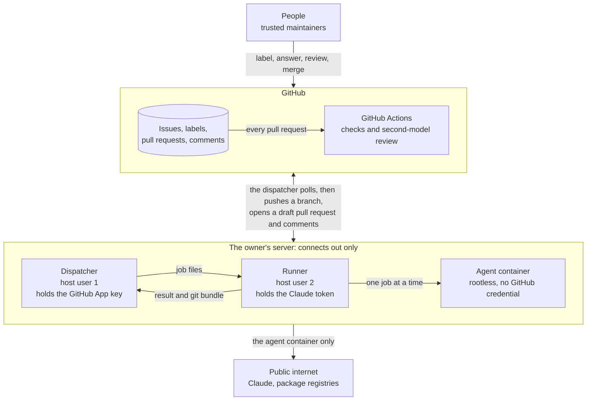
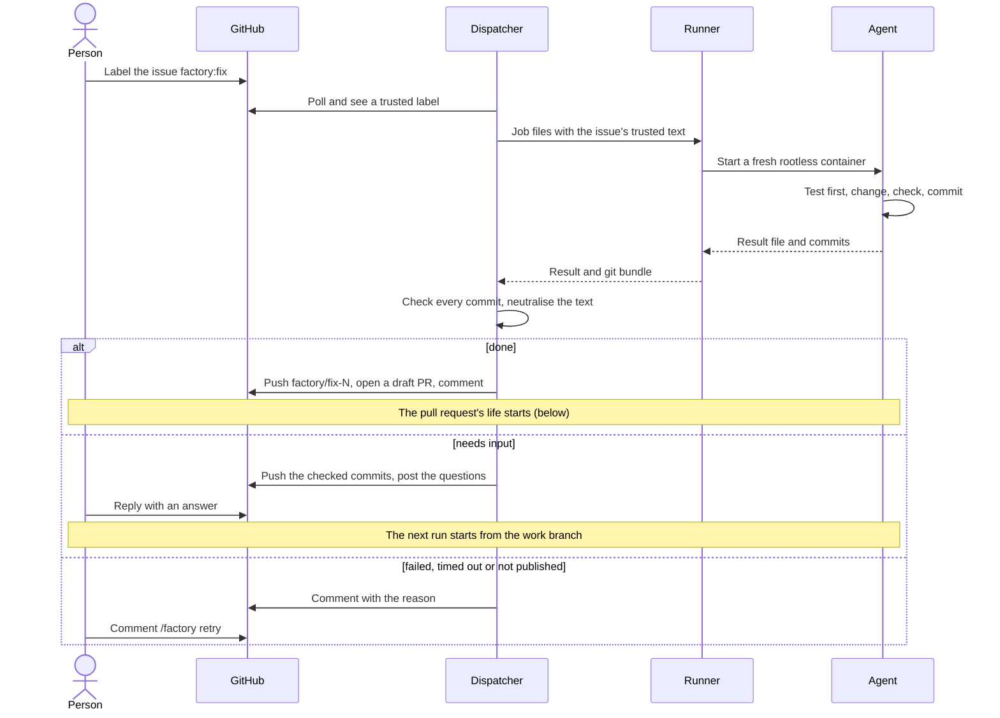
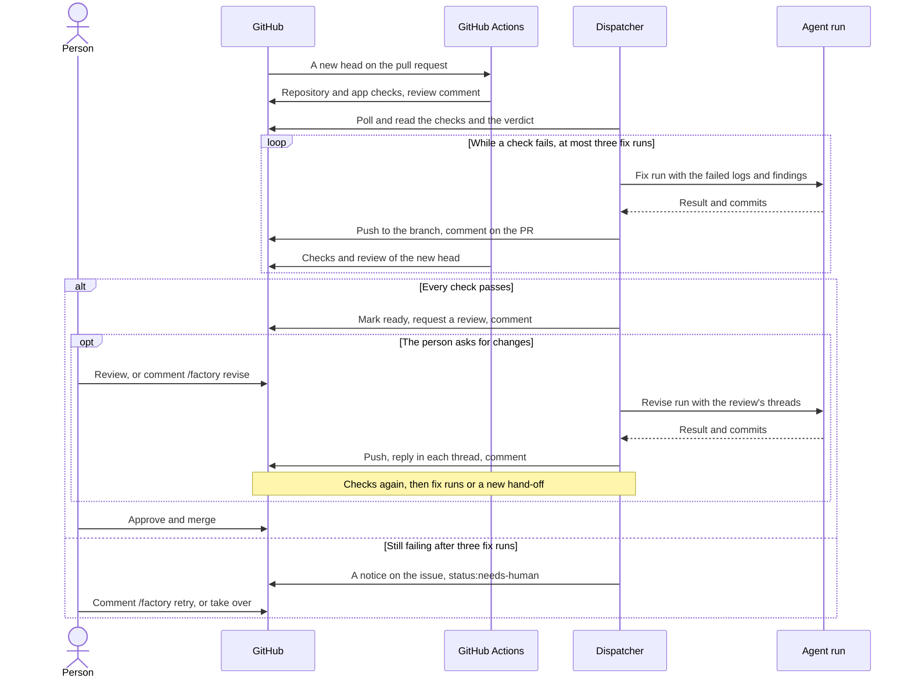
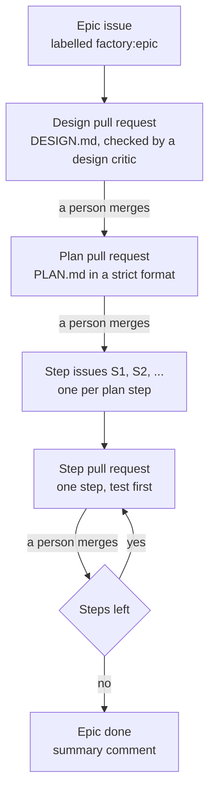

# AI Apps

AI Apps is a software factory that builds apps. Coding agents take work from GitHub issues and
return it as pull requests. People choose the work, steer it through issues and pull requests, and
approve every merge. All of it happens in public, so anyone can read how each app was built, wrong
turns included.

The first app is [AirCase](apps/aviation-investigations/README.md), live at
[aircase.app](https://aircase.app). It searches and compares NTSB aviation investigations, with
keyword search and an AI evidence search.

| Part | What it does | Status |
| --- | --- | --- |
| Agent harness | The instructions, skills, subagents and hooks every agent session loads, with the issue forms, labels and GitHub rulesets | Built |
| Small-change track | A trusted person labels an issue `factory:fix`; the factory answers with a draft pull request or with questions | Built and running |
| Checks and review | Per-app checks in CI, a second-model review of every pull request, automatic fix rounds, the hand-off from draft to ready, revise runs from a person's review | Built |
| Epic track | A design pull request, a plan pull request, then one pull request per plan step | Not built: next |
| Service containers, sandbox deployment | Temporary databases for an app's tests; a deployment where a person can try a change | Not built: later |

## How it fits together



Two programs run on the owner's server, under two different users, and exchange plain files in a
shared directory called the spool.

- The **dispatcher** polls GitHub, decides what each issue needs, and publishes as the factory's
  bot, `mk-factory[bot]`, through a GitHub App installed on this repository only.
- The **runner** takes one job at a time and runs the coding agent, the Claude Code CLI, in a fresh
  rootless container. It clones from a mirror that the dispatcher keeps, so it needs no access to
  GitHub.

The server only connects out. GitHub advises against self-hosted Actions runners on a public
repository, so there is none, no webhook, and no open inbound port.

| Part | Runs as | Holds | Cannot |
| --- | --- | --- | --- |
| Dispatcher | host user 1 | the GitHub App's private key, which mints one-hour tokens for this repository | run anything an agent produced |
| Runner | host user 2 | the Claude sign-in token | write to GitHub |
| Agent | an unprivileged user in a rootless container | the Claude token, for the length of the run | push, or reach the server and its private networks |

**GitHub holds the state.** Issues, labels, pull requests and comments are the record. The
dispatcher keeps no database: apart from the job files in the spool, it reads everything again from
GitHub on every poll. Each comment the bot writes ends with a hidden marker that names the job and
its outcome, so a restarted dispatcher sees what it already reported and posts nothing twice.

**One pure function decides.** On each poll, [`decide`](factory/decide.py) turns a snapshot of
GitHub and the spool's jobs into a list of actions: start a run, publish a finished run, set a
status label, post a notice, close a job. It does no I/O and is handed the time instead of reading
a clock, so every rule is tested offline, and `--dry-run` prints what one poll would do.

## See it work

Two issues the factory handled on AirCase, with everything it did on the record:

| Issue | What happened | Result |
| --- | --- | --- |
| [#5](https://github.com/Marfusios/ai-apps/issues/5): a document named a developer's terminal session | One run of 21 minutes. The bot opened a draft pull request with one commit and reported two problems it noticed on the way. | [Pull request #6](https://github.com/Marfusios/ai-apps/pull/6), merged |
| [#7](https://github.com/Marfusios/ai-apps/issues/7): add a linter to AirCase | The first run stopped after six minutes with a question: the linter the issue asked for cannot parse the app's TypeScript version. A person answered on the issue, and the second run delivered the change in 25 minutes, with about 140 findings fixed or annotated and six follow-ups. | [Pull request #8](https://github.com/Marfusios/ai-apps/pull/8), merged |

Each issue shows the run comments the bot posted: the stage, the outcome, the duration, the model,
the agent's summary and its questions or follow-ups.

## How work flows

Work starts as a GitHub issue, opened with one of three [issue forms](.github/ISSUE_TEMPLATE/):
**Fix** for something broken, **Small change** for a small feature or a chore, and **Epic** for a
new app or a larger feature. A maintainer reads it and, if it is accepted, applies a label. A label
counts only when a trusted person applied it, meaning a GitHub login listed in
[factory/config.toml](factory/config.toml). The label picks one of two tracks.

| | Small change | Epic |
| --- | --- | --- |
| Label | `factory:fix` | `factory:epic` |
| Use it for | A bug fix, a small feature or a chore: one concern, clear enough for one pull request | A new app, or a feature that needs design decisions |
| The agent produces | One pull request with the change, its tests and the checks it ran, or questions | A design, then a plan, then one pull request per plan step |
| Pull requests | One | One for the design, one for the plan, one per step |
| A person | Applies the label, answers questions, reviews and merges | Applies the label, then reviews and merges the design, the plan and each step |
| Stage skills | `factory-fix-issue` | `factory-design`, `factory-plan`, `factory-implement` |
| Status | Built and running | Designed, not built yet |

### Small change (`factory:fix`): built

A small change is one of three kinds, and the agent's skill,
[factory-fix-issue](.claude/skills/factory-fix-issue/SKILL.md), handles each in its own way:

- **A bug fix**: reproduce the problem, write a failing test that captures it, then fix the cause.
- **A small feature**: write a failing test for the new behaviour, then the least code that passes
  it, within one module.
- **A chore**: tooling such as a linter, a dependency update, configuration, cleanup or
  documentation. It changes no behaviour, so the app's check command is its verification.



Before a run ends, the `step-reviewer` subagent reviews the diff with fresh context, the `verifier`
subagent runs the app's checks, and a hook refuses to let the run stop with failing checks or
uncommitted work. The dispatcher then checks every commit (see
[What keeps it safe](#what-keeps-it-safe)) and publishes: a draft pull request from the branch
`factory/fix-<issue>`, whose body starts with `Closes #<issue>`, and one comment on the issue with
the stage, the outcome, the duration, the model and the agent's summary. Problems the agent noticed
and did not fix are listed under **Follow-ups**, and a person decides which become issues.

When the issue is unclear, too large or needs a design decision, the agent asks numbered questions
instead of guessing. Its checked commits so far go to the work branch, a trusted person replies on
the issue, and the next run starts from that branch with the reply in its context. An issue that is
really an epic gets that recommendation.

Every run ends with one outcome: **done**, **needs input**, **failed**, **timed out**, **ended
without a result**, **not started**, **work not published**, or **waiting for the usage limit**.
Reaching the subscription's usage limit is not a failure: the run starts again by itself once the
limit resets. The [operating guide](docs/factory/HOST_SETUP.md#9-operating) says what each outcome
means and what starts the next run.

Once the pull request is open, it looks after itself until a person is needed:



- **The checks.** Three hosted workflows run on every new head: the repository checks; App checks,
  which runs the `setup` and `check` commands of each app the change touches, read from the app's
  `factory.toml`; and a review by a second model, Codex. The review reads the change with a
  read-only profile and posts its findings as a comment. A blocker or a major finding fails it.
- **Fix rounds.** When a check fails, a fix run starts on the same branch, with the end of each
  failed job's log and the review's findings quoted in its context. The
  [factory-fix](.claude/skills/factory-fix/SKILL.md) skill verifies each item before it acts and
  fixes the cause. At most three fix runs follow each other; when the checks still fail, the
  factory says so on the issue and waits for a person.
- **The hand-off.** When every check passes, the dispatcher marks the pull request ready, asks the
  person who labelled the issue for a review, and comments whether the second model found nothing
  blocking or could not review this commit. It does this once for each head.
- **Revise runs.** A review that requests changes or leaves comments, or a comment
  `/factory revise <instruction>`, starts a revise run. The
  [factory-revise](.claude/skills/factory-revise/SKILL.md) skill answers every review thread with
  one reply, changing the code or saying why not, and resolves the threads its change settled. Its
  commits go through the same checks, fix runs and hand-off.

After the hand-off only a person's asks start runs: a check that fails then starts nothing, since
the pull request is in a person's hands. The person approves and merges.

All steering happens on GitHub:

| Signal | Effect |
| --- | --- |
| A trusted person applies `factory:fix` | Starts a small-change run |
| A trusted person replies after the agent's questions | The next run starts, with the reply in its context |
| A trusted person comments `/factory retry` | Runs again after a failure, a timeout, a refused job, a rejected result, used-up fix rounds, or a pull request closed without merging |
| A trusted person writes a line `app: <name>` | Picks the app the run works on |
| A trusted person submits a review that requests changes or leaves comments | One revise run that answers every thread of the review |
| A trusted person comments `/factory revise <instruction>` | One revise run that carries out the instruction |
| Anyone who can label applies `factory:pause` or `factory:halt` | No new run for this issue, or anywhere; a run in progress finishes and is published |

### Epic (`factory:epic`): designed, not built yet

Large work is split before code is written. An epic becomes a design, then a plan, then one pull
request per plan step, and a person merges each one before the next stage starts.



1. **Design.** [factory-design](.claude/skills/factory-design/SKILL.md) writes `DESIGN.md` under
   `apps/<app>/docs/epics/<issue>-<slug>/`: the stack and the alternatives rejected, architecture,
   data model, interfaces, edge cases, open questions, test strategy and risks. The
   `design-critic` subagent attacks it for gaps first. For a new app, this stage also creates the
   app's scaffold.
2. **Plan.** [factory-plan](.claude/skills/factory-plan/SKILL.md) turns the merged design into
   `PLAN.md` in a [strict format](factory/PLAN_FORMAT.md): steps `S1`, `S2` and on, each with its
   dependencies, risk, scope, acceptance criteria and verification commands. A check in CI rejects
   a plan that cannot be split into issues.
3. **Split.** Plain code, no agent: one `factory:step` issue per step, attached to the epic as a
   sub-issue, with a checklist in the epic.
4. **Steps.** [factory-implement](.claude/skills/factory-implement/SKILL.md) builds one step per
   pull request, test first, in order. When the last step merges, the epic gets a summary and
   `status:done`.

Why large work is split this way:

- **The merged design and plan are the authority.** Each run starts with no memory of earlier
  runs, so what a person merged is what every later run reads. `PLAN.md` on `main` decides each
  step; the step issues only mirror it, and the plan changes only when a person merges a change to
  it.
- **Each step is one pull request a person can review, and it leaves `main` working.** The review
  weighs a small diff against stated acceptance criteria, and a wrong turn costs one step, not the
  whole feature.
- **Decisions come before code.** A gap found while reviewing a design costs a paragraph; the same
  gap found in code review costs a rewrite.

Until the epic track is built, the `factory:epic` label starts nothing. A maintainer handles a
labelled epic by hand and can run the same stage skills in an interactive session. The design's
[epic pipeline](docs/factory/DESIGN.md#62-epic-pipeline) section has the details.

## What keeps it safe

The repository is public, and anyone can open an issue or a pull request. The factory is built so
that a stranger's issue, comment or fork cannot make an agent run or leak a credential, and an agent
cannot merge, force-push or rewrite history. The design's
[trust and safety](docs/factory/DESIGN.md#7-trust-and-safety) section gives the full reasoning.

**Who can start a run.** Only a label applied by a trusted login counts; the dispatcher checks who
applied it in the issue's timeline, not only that it is there. Only a trusted person's comments and
reviews steer, and comments by anyone else, review comments included, never reach the agent. For an
issue opened by someone outside the list, the agent never sees the title or the body, and a trusted
person restates the request in a comment. The factory never checks out a pull request from a fork.

**Two users, two credentials.** The program that can write to GitHub never runs anything an agent
produced, and the program that runs agent output cannot write to GitHub. The runner packs the
agent's commits into a git bundle in a second container with no network and no token, and the
dispatcher reads that bundle as data in its own repository.

**Confinement on the server.** Each run is a rootless container with every capability dropped,
under an unprivileged user. A firewall rule for that user rejects connections to the server's own
addresses and to private address ranges, so the agent reaches only the public internet. Before each
job the runner tests the rule from its own process and refuses the job if the test connects. A
resource cap on the user protects the other services on the server.

**Checks before anything is published.** The dispatcher checks every commit, not only the final
diff, so a secret added in one commit and removed in the next still blocks publication.

- Each commit has one parent and descends from the expected base: a linear history, nothing
  rewritten.
- Its author and committer are exactly the bot's identity, read from the raw commit.
- Every changed path is under `apps/` or `packages/`. The harness, the workflows and the factory's
  own code are out of reach, and GitHub refuses a push that touches a workflow file anyway, since
  the App has no Workflows permission.
- No file, commit message or file name matches a credential, personal-path or private-address
  pattern. The dispatcher uses its own deployed copy of the patterns, never the branch's.
- No commit message mentions a person or an issue other than its own, so a push cannot notify
  anyone or close another issue.
- No submodules, credential files or links that leave the repository, and limits on the size of
  each file, the number of commits and the bundle.

**Agent text is neutralised before it is posted.** Mentions, issue references, closing keywords,
links, images and HTML in a summary, a question, a pull request body or a reply to a review thread
are broken, and each text sits in a quote under a fixed lead-in. It cannot notify anyone, close an
issue, or pass for the bot's own lines. The dispatcher writes `Closes #<issue>` itself.

**A review the pull request cannot steer.** The second-model review runs in two jobs. The one that
holds the API key can only read, and takes its prompt and its answer schema from the base commit,
so a pull request cannot change how it is reviewed. The one that posts the comment holds no secret
and runs only the base commit's code. A check's log and the review's findings reach the next run
only as quotes under headings the dispatcher writes, cut to a fixed size.

**Guard rails inside the agent's session.** Four hooks guard every factory run; the first three
also run in a person's interactive session.

| Hook | Runs | Refuses |
| --- | --- | --- |
| `guard_git` | before each shell command | force pushes, pushes to `main`, deleting remote branches or tags, skipping hooks; in a factory run also merging, approving and changing settings |
| `guard_paths` | before each file write | git's own files and credential files; in a factory run, anything outside `apps/` and `packages/` |
| `guard_quality` | before each file write | a new lint, type-check or test suppression without a reason on the same line |
| `finish_check` | when a factory run tries to stop | stopping with failing repository checks, a failing quick command in a touched app, uncommitted work, or an invalid result file |

In the agent's image the hooks are installed as system-level settings that no file in the checkout
can override, they run from a copy owned by root with an interpreter that ignores the agent's
environment, and the runner refuses a job when the image does not match the deployed harness. The
hooks catch mistakes and casual attempts. They are not the security boundary, and the
[agent contract](factory/AGENT_CONTRACT.md#what-the-hooks-do-not-see) lists what they miss. The
checks before publishing, the rules on GitHub, and the agent's lack of any GitHub credential stand
behind them.

**People merge.** The dispatcher opens draft pull requests and marks them ready for a person, but
never merges and never approves. GitHub rulesets refuse a direct push to `main` and a force push to
a `factory/` branch, whatever the factory's code does.

**Accepted risk.** The agent has open access to the public internet and holds its Claude token
while it runs, so a poisoned dependency or web page could try to talk it into leaking the token. The
token cannot touch GitHub, can be revoked in one step, and the scan before publishing blocks the
obvious route of committing it.

## How the agents are told to work

Every agent session in the repository, a person's interactive session or a factory run, loads the
same files. Together they are called the harness.

| File | What it holds |
| --- | --- |
| [AGENTS.md](AGENTS.md) | The instructions every session reads: how work flows, change discipline, git rules, public-repository hygiene, safety, the definition of done, review guidelines |
| [docs/engineering.md](docs/engineering.md) | The engineering standards, with the reason for each and examples of the wrong and the right shape |
| `apps/<app>/AGENTS.md`, `apps/<app>/factory.toml` | Each app's stack, module map, vocabulary and pitfalls; its setup, check and quick commands |
| [.claude/skills/](.claude/skills/) | One skill per stage: `factory-fix-issue`, `factory-design`, `factory-plan`, `factory-implement`, `factory-fix`, `factory-revise`; and `new-app` |
| [.claude/agents/](.claude/agents/) | Three subagents: `design-critic` attacks a design, `step-reviewer` reviews a diff with fresh context, `verifier` runs the app's checks and reports the evidence |
| [.claude/hooks/](.claude/hooks/) | The four guards above |
| [factory/AGENT_CONTRACT.md](factory/AGENT_CONTRACT.md) | What a factory run is given (the job, the issue's trusted text, the base commit, and for a fix or revise run the failed checks' logs, the review's findings or a person's review threads) and what it returns: a JSON result that is done, needs input or failed, with a summary, questions, the pull request's text, replies to review threads, the commands it ran and follow-ups |

Each run starts with no memory of earlier runs. The code, its tests and its documents are all it
hands to the next run, so [AGENTS.md](AGENTS.md) tells every agent that the code is its own to keep
healthy, with no cleanup phase later. The standards it is held to:

- **Tests first**: a failing test before new behaviour or a bug fix; tests state behaviour, not
  internals.
- **Separation of concerns**: domain rules know no framework, database or provider; the edges
  validate.
- **Domain language**: the words of the epic and the design are the words of the code, fixed in the
  app's glossary.
- **Clean code**: one reason to change per unit, names that say what a thing is for, no dead code,
  errors that fail loudly.
- **Linted, formatted, typed**: a suppression carries its reason; no test is skipped or weakened to
  pass.
- **Continuous care**: tidy what the change touches; write anything larger down as a follow-up.
- **Documents are part of the code**: the README, the app's `AGENTS.md` and the design change with
  the code.
- **Dependencies are a decision**: each new one is named with its reason, and the lockfile matches
  the manifest.

The standards scale with the change: a typo fix needs no domain model. Tools enforce what they can,
through each app's linter and check command and the hooks; the step reviewer, the second-model
review and the person who merges judge the rest.

## The apps

| App | What it does | Status |
| --- | --- | --- |
| [AirCase](apps/aviation-investigations/README.md) (`apps/aviation-investigations`) | Finds and compares NTSB aviation investigations by their evidence, findings and probable causes, with keyword search and an AI evidence search. For flight instructors and safety analysts. | Live at [aircase.app](https://aircase.app) |

AirCase came first, built with coding agents before the factory's pipeline ran, and it is the app
the small-change track works on today. Each app keeps its stack, dependencies, configuration, tests
and setup instructions in `apps/<app>/`, and the [catalog](apps/README.md) lists every app with its
status. Once the epic track is built, a new app starts as an epic, and its design stage creates the
scaffold.

## Repository layout

```text
apps/<app>/      one app each: code, tests, README.md, AGENTS.md, factory.toml, docs/epics/
packages/        code shared by two or more apps
templates/app/   the files scripts/new_app.py copies into a new app
scripts/         repository tools: check_repo.py, new_app.py
factory/         the dispatcher, the runner, the agent image, the review, config.toml, AGENT_CONTRACT.md
.claude/         hooks, settings, skills and subagents for agent sessions
.github/         issue forms, the pull request template, the check and review workflows
docs/            repository conventions and the engineering standards
docs/factory/    the factory's design, the host guide and the implementation plans
```

## Getting started

The repository tools need **Git and Python 3.11 or newer**, and nothing else: no packages to
install and no API keys.

```bash
git clone https://github.com/Marfusios/ai-apps.git
cd ai-apps
python3 scripts/check_repo.py
python3 -m unittest discover -s factory/tests -t .
```

On Windows, use `py -3` in place of `python3` if that is how Python is installed. Each app
documents its own language runtime, package manager, services and provider accounts in its README.

To scaffold a new app by hand:

```bash
python3 scripts/new_app.py document-search
```

It copies the app template (a README, an `AGENTS.md`, a `factory.toml` and an empty `.env.example`)
and adds the app to the catalog as a scaffold. Then follow
[Adding an application](docs/development.md#adding-an-application).

## Checks

```bash
python3 scripts/check_repo.py
python3 -m unittest discover -s factory/tests -t .
```

The same two commands run in GitHub Actions on every pull request and on `main`, as the
`repository` check. The checker verifies each app's required files, its `factory.toml` and its
entry in the catalog, local Markdown links, empty credential placeholders in `.env.example` files,
and common accidental credential, personal-path and private-address patterns in tracked or
non-ignored files. These checks are useful safeguards, not a complete secret audit of the history.

The tests, more than 1,200 of them, run offline with the standard library's test runner. They cover
the decision function, the checks before publishing, the text neutraliser, the runner, the agent
image, the review's report and the hooks. Each app also has its own check command in its
`factory.toml`, which the App checks workflow runs on every pull request that touches the app, as
the `apps` check. The Review workflow adds the second-model review as the `review` check.

## Running an app

Choose an app from the [catalog](apps/README.md) and follow its README. Each app provides
installation, configuration and startup commands that work from a fresh clone, and a documented
local setup for each service it needs, such as a database or a search engine.

Provider credentials belong in the process environment or in the app's gitignored `.env` file. Copy
the app's `.env.example`, which lists every variable with an empty value, and fill in only what the
app needs; an existing nonempty environment value wins. See
[Configuration and data](docs/configuration.md). Each app says which actions call a paid provider,
and its tests run offline by default.

## Running the factory yourself

The factory runs on a Linux host with systemd, cgroup v2, nftables, rootless Podman, Python 3.11,
git and OpenSSL, outbound internet access and no inbound port. It needs two unprivileged users, a
GitHub App of your own and a token for a Claude subscription; the second-model review needs an
OpenAI API key as a repository secret. The
[host guide](docs/factory/HOST_SETUP.md) covers every step: the users and directories, the firewall
table, the resource cap, the GitHub App, the token, deploying, updating, operating and removing
everything. In a fork, set `trusted_logins` in [factory/config.toml](factory/config.toml) to your
own login before you deploy.

## Documents

| Document | What it covers |
| --- | --- |
| [docs/factory/DESIGN.md](docs/factory/DESIGN.md) | The factory's design: intent, the approaches considered, architecture, workflows, trust and safety, the harness, the [build order](docs/factory/DESIGN.md#14-build-order) |
| [docs/factory/plans/](docs/factory/plans/) | The implementation plans: [the harness](docs/factory/plans/01-harness.md), [the small-change pipeline](docs/factory/plans/02-fix-pipeline.md) and [checks and review](docs/factory/plans/03-checks-and-review.md) |
| [docs/factory/HOST_SETUP.md](docs/factory/HOST_SETUP.md) | Setting up, updating and operating a factory host |
| [factory/AGENT_CONTRACT.md](factory/AGENT_CONTRACT.md) | What a factory run is given and what it must return |
| [factory/PLAN_FORMAT.md](factory/PLAN_FORMAT.md) | The strict format of an epic's `PLAN.md` |
| [AGENTS.md](AGENTS.md), [docs/engineering.md](docs/engineering.md) | How agents work here, and the engineering standards |
| [docs/development.md](docs/development.md), [CONTRIBUTING.md](CONTRIBUTING.md) | Adding an app, and contributing a change |
| [SECURITY.md](SECURITY.md) | Reporting a vulnerability privately |

## License

The code and documentation in this repository are released under the [MIT License](LICENSE).

The license does not cover third-party material that an app includes as test or evaluation data.
Each app's README says what that material is and where it came from.
