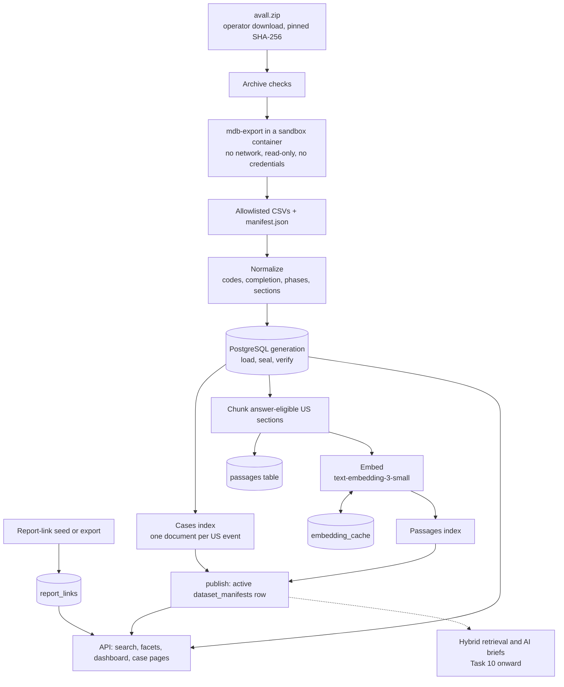

# Aviation Casebook data pipeline (as built)

How NTSB data becomes the PostgreSQL corpus and the two Elasticsearch indices, and
why each step works the way it does. Written 2026-10-22 against implementation
snapshot `fc450ec`. The numbers come from generation 1 in the shared `dev`
environment, loaded from the NTSB `avall.zip` archive. Paths are relative to
`apps/aviation-investigations/`.

Related documents: [DESIGN.md](DESIGN.md) and [DATA_REVIEW.md](DATA_REVIEW.md) give
the background. "Amendments after review gate G0" (A1–A16) in
[IMPLEMENTATION_PLAN.md](IMPLEMENTATION_PLAN.md) are binding. Commands are in the
[README](../README.md) and [RUNBOOK.md](RUNBOOK.md). Where the plan or design text
differs from this document, this document describes the implementation. That covers
multi-aircraft attribution (A3), index naming, the embedding-cache schema, archive
download and publication.

## 1. Summary

The pipeline turns one NTSB Access archive into a verified, versioned corpus and two
rebuildable search projections:

1. A host command checks the archive against a pinned SHA-256. It exports
   allowlisted columns with MDBTools inside a container that has no network.
2. A TypeScript normalizer turns the CSVs into canonical cases: decoded codes, a
   provisional completion class, flight phases, and narrative sections with
   versioned citation text.
3. The loader writes each import as an immutable *generation* in PostgreSQL.
   Database triggers seal it, and verification rebuilds every source text.
4. Two indices are built from a verified generation:
   - a **cases index**: one document per US event, for keyword search and facets;
   - a **passages index**: narrative chunks of provisionally answer-eligible US
     cases (completed, with probable cause), each with a 1,536-dimension OpenAI
     embedding.
5. A PostgreSQL **manifest** row, not an Elasticsearch alias, decides what the API
   serves.

Hybrid retrieval (Task 10) is still being built.



## 2. Step by step

### 2.1 Source archive and provenance

`avall.zip` holds events from 2008 onward in one Access database, `avall.mdb`. The
code downloads nothing: the operator passes the file and its expected SHA-256 to
`pnpm worker extract`, and `verifyArchive` (`worker/ingest/archive.ts`) refuses a
mismatch.

The hash pins the bytes that every count and citation depends on. Expectations for
one snapshot are keyed to it (`worker/ingest/verify-profiles/avall-2026-10-16.json`).

Provenance runs from the archive hash to the extraction `manifest.json` (image ID,
MDBTools version, flags, per-table counts), to the `dataset_generations` row (hash,
manifest, normalization versions), to each case's `source_revision` and each
section's `revision_id`.

The archive's own date is not recorded. The API's snapshot date is the newest change
date among the generation's case, admin and section records, capped at the extraction
date (`server/dataset.ts`). For generation 1 it is 2026-09-30.

### 2.2 Sandboxed extraction

Code: `worker/ingest/archive.ts`, `worker/ingest/extract.ts`,
`worker/ingest/tables.ts`, `docker/extract/Dockerfile`.

**Unzip.** The archive must contain exactly one entry, `avall.mdb`. The code rejects
traversal, symlinks, encrypted entries and nested zips, and anything over 200 MiB
compressed or 1 GiB expanded (counted on the bytes actually written).

**Export.** The image is a digest-pinned `debian:bookworm-slim` with
`mdbtools=1.0.0+dfsg-1.1`, running as uid 65534; its image ID is recorded. Each
table runs in its own container with `--network none --read-only --cap-drop ALL
--security-opt no-new-privileges --memory 1g --cpus 2 --pids-limit 64`. The root
filesystem and the MDB mount are read-only, there is no writable host mount, and the
host streams stdout to the CSV. The flags `-D %Y-%m-%d -T
%Y-%m-%dT%H:%M:%S` keep dates unambiguous without inventing time zones.

**Limits.** Each table gets 10 minutes and 2 GiB. Container removal is awaited and
confirmed, also on signals. **Any stderr output fails the export**, because MDBTools
can report read errors and still exit 0.

**Projection** to allowlisted columns happens in TypeScript:

- UTF-8 is validated with a fatal decoder, so a bad byte is an error, not U+FFFD.
- Records are capped at 4 MiB (the largest real one is about 106 KB) and 256 fields;
  oversized input is rejected, never truncated.
- The allowlist names every column, keys and `lchg_date` included, and never owner or
  operator names, addresses, contact fields or editor IDs.

The raw export is deleted, and the 0700 staging directory is published by one atomic
rename, with `manifest.json` written last.

**Why.** Parsing an external Access file is the riskiest step. In the container, a
parser exploit gets no network, no credentials, a read-only root and input, and no
writable host mount; the loader sees only validated CSV. Extraction needs the Docker
CLI, so it runs on the host.

**Real data.**

| events | aircraft | engines | narratives | findings | events_sequence | ntsb_admin |
| ---: | ---: | ---: | ---: | ---: | ---: | ---: |
| 31,303 | 31,854 | 28,648 | 28,516 | 73,002 | 66,683 | 31,303 |

Narratives use CRLF line ends. Thirty fields also contain `\r\r\n` or a lone CR.

### 2.3 Normalization

Code: `worker/ingest/normalize.ts`, `worker/ingest/scalars.ts`,
`worker/ingest/citation-text.ts`, `shared/codes.ts`, `shared/completion.ts`,
`shared/occurrences.ts`.

**Errors.** Structural problems stop the run:

- a missing table or column;
- a blank or duplicate `ntsb_no`;
- a duplicate composite key. Keys are typed tuples, so `1` and `01` are the same
  aircraft key.

Value problems go to a quarantine list with an action (row excluded, value nulled or
value kept) and are never coerced. Generation 1 has 25 entries, all coordinates of
non-US events. 75 US events have no coordinates, so their location is null.

**Scalars and codes.** A blank field becomes `null` before any numeric conversion.
Flags are decoded from their real vocabularies (`defining_ev` `0`/`1`, `cm_inpc`
`T`/`F`), never by truthiness. `afm_hrs_since` is exported as `Y`/`N`, unlike the
codes the dictionary documents, so it is kept as recorded and not interpreted.
Display labels come from fixed maps plus the embedded dictionary; raw codes are kept.

**Completion mapping** (`shared/completion.ts`). The raw `rec_stat` is stored
unchanged. `COMPLETION_MAPPING_V1` is `{ version: 'v1-empirical', verified: false,
completedStatuses: ['B'] }`:

- `B` is `completed`. While the mapping is unverified, every other status is
  `other_status`, never "in progress".
- Probable-cause availability is a separate boolean.
- **Answer-eligible** means a US event, `completed`, and nonblank probable-cause text.

The mapping is provisional because it is purely empirical. Among US records, every
record with a probable cause has `B`:

| `B` with cause | `B` without | `P` | `F` | blank |
| ---: | ---: | ---: | ---: | ---: |
| 24,291 | 2 | 1,040 | 18 | 56 |

NTSB metadata has not confirmed what the codes mean, and `F` is not guessed to mean
"final". Generations record `mapping_verified = false`, and `/api/config` reports the
cohort as provisional.

**Phases and defining events.** `phase_no` maps to 16 phase groups by fixed ranges.
An aircraft's defining event is its single row with `defining_ev = 1`; if several are
flagged, none is chosen. The event's `definingPhaseGroups` is the union over its
aircraft, and `sequencePhaseGroups` (every phase in the sequence) is kept separately.
Taking the first aircraft's phase had turned SEA08LA057 into `landing` and lost the
other aircraft's `initial_climb` (G2a).

**Sections and scope.** Each narrative row has three fields:

| Source field | Section kind |
| --- | --- |
| `narr_accp` | factual |
| `narr_accf` | analysis |
| `narr_cause` | probable cause |

- **Single-aircraft event:** each field is an aircraft-scoped section.
- **Multi-aircraft event:** every section is event-scoped. Texts that are equal after
  collapsing whitespace merge into one section, and every row is kept as provenance.
  Texts that genuinely differ become separate event-scoped variants.

The narrative row a text came from does not show which aircraft it describes. In
SEA08LA057 the cause stored under the landing Piper describes the departing pilot.
Structured rows (findings, sequence, aircraft fields) keep their aircraft key.

**Citation text** (`CITATION_TEXT_VERSION = 'v1'`). Plain text is kept as exported
except that CRLF and lone CR become LF. Text that looks like HTML goes through a
deterministic htmlparser2 conversion: inline tags vanish (`o<span>ne</span>` →
`one`), blocks and `<br>` become line breaks, entities are decoded, and unknown
tag-like text such as `<unintelligible>` stays literal. The exported original is
kept. Citation text is versioned apart from search analysis because offsets and quote
checks depend on its exact characters.

**Real data.** 31,303 events: 25,407 US, 24,291 answer-eligible, 545 multi-aircraft.
2 US events are completed without a cause (911 across all countries). 73,146
sections: 1,318 event-scoped and 11 converted from HTML.

### 2.4 Generations in PostgreSQL

Code: `server/db/schema/corpus.ts`, `worker/ingest/load.ts`,
`worker/ingest/verify.ts`, `server/db/generations.ts`, migrations `0000`–`0004`.

**Load.** One transaction inserts the generation as `loading`, batch-inserts every
row, records the run as `succeeded`, seals the generation and commits. A failure
rolls everything back. Keys start with `generation_id` and foreign keys are
composite, so rows reference only their own generation. The loader rejects an
extraction whose manifest disagrees with its files or row counts. Generation 1 loaded
in about 38 s.

**Sealing.** Statement triggers reject every insert, update or delete on a
generation that is not `loading`, for every role including the owner. The one
exception is a guarded deletion: `prune_generation` removes a whole generation.

- Status changes go only through migrator-owned `SECURITY DEFINER` functions.
  `seal_generation` runs inside the load transaction. `record_verification`,
  `publish_manifest` and `prune_generation` take one shared advisory lock, which
  verification also holds. `pin_generation` and `unpin_generation` take the same lock
  but only protect a generation from pruning; they never change its status.
- A sealed generation is `loaded`, and verification makes it `verified` or `failed`.
  Only a `verified` generation can be published. A `failed` one must pass
  verification first; there is no direct `failed → published` transition.
  Publishing another generation makes the previous one `retired`, and a `retired`
  generation can be published again.
- Why: G2b showed that denying UPDATE was not enough. The ingest role could still
  delete and re-insert rows.

**Revision IDs.** `section_id` is `<ntsb_no>:<section_key>`. `revision_id` is a
SHA-256 over the case number, section key, text hash and citation-text version, so
unchanged text keeps its revision across generations. Event section keys are
ordinals that can shift, so citations pin the generation **and** `revision_id`.

**Sources.** `case_section_sources` lists every narrative row behind a section. The
exported text is stored only when it cannot be rebuilt from the section text (HTML,
whitespace variants, mixed line ends). Otherwise `source_form` records how to rebuild
it.

**Verification.** `verify` holds the lifecycle lock and reads one REPEATABLE READ
snapshot. It checks keys, parents, hashes, scope rules, phase summaries and the
eligibility rules. It then rebuilds every exported source and re-derives its citation
text with the normalization code. A source recorded as `match = exact` must equal the
stored section exactly, and one recorded as `match = whitespace` must be
whitespace-equivalent to it. Its
aggregate-only report is written under a content-addressed name before the hash is
recorded. Publication requires a current `ok` from `VERIFIER_VERSION` (`verify-v2`).
**Generation 1: all 74,087 source texts were reconstructed and hash-verified, and the
snapshot profile matched.**

**Retention (not yet running).** `pruneGenerations` is implemented, but no worker
command or scheduled job calls it yet. When invoked, it would:

- keep the two most recently published generations and delete older published or
  retired ones;
- delete never-published generations that have failed, at once;
- delete other never-published generations 24 hours (the default grace) after their
  seal or latest verification;
- never delete loading, active or pinned generations.

Its absence does not affect generation 1.

### 2.5 Report links

Code: `shared/report-links.ts`, `worker/ingest/report-links.ts`, table
`report_links`.

The MDB holds no report identifier, and the numeric CAROL report ID is not `ev_id`.
Links therefore live in a separate mapping table without generations, because they
change on their own schedule.

- **Seed.** Four IDs were verified by hand on 2026-10-16, for DFW08TA066,
  DEN08LA103, MIA08LA156 and NYC08LA106.
- **Bulk import** from an Aviation Search export needs a column mapping supplied by
  the operator. `VERIFIED_LAYOUTS` is empty on purpose, so no field name is assumed.
- **Validation.** Rows are checked against the latest verified generation. Unknown
  cases and date mismatches are reported, not inserted. Each row records its source,
  file hash and retrieval time.
- **URLs** come only from a fixed HTTPS template and an ID matching `^\d{1,9}$`.
  Without one, the case page links to Aviation Search, labelled as a search.

In `dev`, all 4 seed links matched. No bulk export has been imported.

### 2.6 The cases index

Code: `worker/index/cases-index.ts`, `worker/index/analysis.ts`,
`worker/index/synonyms.ts`.

There is one document per US event, keyed by `ntsb_no`. `ev_id` is never indexed,
and `country` is always `USA`.

**Analyzer chain.** The index analyzer `aviation_english` runs: glued-heading
character filter → standard tokenizer → lowercase → possessive stemmer → stop words
(English **minus negations**) → stem overrides → light English (KStem) stemmer.
The search analyzer adds `synonym_graph` after the possessive stemmer, so **synonyms
run before stop words and stemming**. Quoted phrases use the index analyzer and never
expand synonyms.

- **Negations kept.** `no`, `not`, `nor`, `none`, `never` and `without` stay, so "no
  anomalies" never becomes "anomalies".
- **KStem, not Porter.** Porter merges generator/general and engine/engineer.
  Overrides join a few forms KStem keeps apart, such as icing → ice.
- **Synonyms first.** The rules are unstemmed. A stop filter in front of them would
  drop "into" from "controlled flight into terrain", and Elasticsearch rejects the
  rule set. G3 approved this order.
- **Synonym list.**
  - Equivalent: spelling variants (carb, carburetor, carburettor) and unambiguous
    abbreviations (IMC, VMC, ATC, IFR, VFR, AGL, MSL, CFIT, CFI).
  - One-way: `wx`, `mx`, and "carb ice".
  - Stall and spin are never synonyms.
- **Glued headings.** Runs such as "AIRCRAFT INFORMATIONThe" are mostly in the
  exported narratives themselves; the app's HTML conversion created few of them. The
  current pattern matches 2,769 sections, 2,751 of them answer-eligible, and only six
  of the matches were converted from HTML. The filter rewrites "NT" as "N T", which
  keeps highlight offsets exact. Stored text is unchanged.
- **Text arrays.** The text fields hold one array value per section or finding, with
  a position gap of 100. A phrase query with slop below 100 therefore cannot match
  across two values.

**Nested aircraft and facets.** `aircraft` is `nested`, so all active aircraft facets
(phase, category, engine, FAR part, purpose) must hold for one aircraft. The Phase
facet uses each aircraft's defining phase group. Aircraft facets count distinct
events with `nested → filter → terms → reverse_nested`. An event with different
aircraft counts once in each bucket, so buckets can sum to more than the total.

**Versions.** The current version is `cases-v3`: v2 introduced text arrays and KStem
(G3), and v3 added the glued-heading filter. The index `_meta` records the version, a
fingerprint of the settings and mapping, the generation and the build ID. The API
also serves `cases-v2`, but only at its exact recorded fingerprint.

**Build.** Pin the verified generation, then stream its US cases from one snapshot in
batches of 500 with refresh off. Then check documents, nested aircraft, eligible and
multi-aircraft counts against PostgreSQL.

**Real data.**

- 25,407 documents and 25,816 aircraft, built in 17.8 s.
- 405 multi-aircraft events; 140 with several defining phases, 7 with none.
- "carburetor icing" over the probable cause matches 373 cases as a `match` query
  with AND, and 367 as a `match_phrase`. As an API search anywhere in the text it
  matches 968 cases.
- "carb ice" through the synonym-expanded search analyzer matches 367 probable
  causes, the phrase count, because a multi-word synonym alternative is matched as a
  phrase.

### 2.7 Chunking

Code: `worker/index/chunk.ts`, `worker/index/tokens.ts`, `worker/index/passages.ts`.

Only provisionally answer-eligible US cases get passages. Each section is chunked on
its own, with exact `cl100k_base` token counts. `chunk-v2` uses a target of 650, a
maximum of 800, a minimum of 200 and an overlap of 80 tokens. The limits apply to
passage text, without the embedding header.

- **Short sections stay whole.** A section of at most 800 tokens is one passage,
  probable causes included. In generation 1 no cause needed splitting.
- **Longer sections** are split into paragraphs and sentences. Abbreviations and
  decimals do not end a sentence. Sentences are then packed evenly near the target.
  The packer *prefers* paragraph ends, avoids ending on a heading and avoids tails
  under 200 tokens; these are preferences with fallbacks, not guarantees. An offline
  probe produced ordinary chunks of 749 and 142 tokens.
- **Overlap.** Each later passage repeats up to 80 tokens from the end of the
  previous one: whole trailing sentences, or a clause or word tail when the last
  sentence is longer.
- **Glued headings** (new in chunk-v2) count as soft paragraph starts.
- **Continuation rule (A16).** A sentence or cause over 800 tokens is split at a
  clause boundary, else at whitespace. Text without whitespace is cut at a code-point
  boundary as a last resort. Later pieces carry `continuation: true` and
  `part`/`parts`. Nothing is truncated.
- **Offsets** are UTF-16 code units into the stored section text, never inside a
  surrogate pair. `text === section.text.slice(start, end)` always holds.
- **Identity.** `passage_id` is SHA-256 over the revision ID, the offsets and the
  chunker version.

G4 approved 650/800/80. The low median reflects short sections kept whole.

| Measure | Value |
| --- | ---: |
| Sections → passages | 69,023 → 91,898 |
| Aircraft-specific / event-scoped | 89,701 / 2,197 |
| Factual / analysis / probable cause | 42,599 / 24,921 / 24,378 |
| Input tokens (text + headers; overlap) | 28.51M (27.17M + 1.34M; 1.48M) |
| Embedding-input tokens per passage, header included: p50 / p95 / max | 238 / 663 / 819 |
| Largest whole probable cause (passage text) | 428 |
| Oversized splits | 0 |

### 2.8 Embedding

Code: `worker/index/embed.ts`, `worker/index/embedding-cache.ts`,
`worker/index/spend-gate.ts`.

**Input** (template `input-v1`):

```
<section label> · <make model | Event (n aircraft)> · <defining phase(s)>
<passage text>
```

The header gives the vector context that a mid-section passage lacks: which section,
aircraft type and phase. It exists only in the embedding input. Stored, indexed and
cited text is the raw passage.

**Model.** `text-embedding-3-small`, 1,536 dimensions, $0.02 per million tokens.

**Cache key.** SHA-256 of the template version, model, dimensions and the exact
input, header included, so a header change misses. Vectors are stored as their
responses arrive. A rerun pays again for any vector that was not stored successfully.
Identical inputs are embedded once.

**Batching and rate limits.** A request holds at most 96 inputs and 250,000 tokens.
SDK retries are off. The worker makes up to 3 attempts on 429 (except
`insufficient_quota`), 408, 5xx and connection failures. It waits out the latest of
`Retry-After` and the rate-limit reset headers, and a wait over 10 minutes stops the
run with a rerun time.

**Spend gate: reserve and settle.** Each attempt, retries included, gets its own
reservation on the ledger before it is sent: exact tokens × price × 1.1, rounded up to
a micro-dollar. It settles at the reported usage on success, at zero for a 4xx other
than 408, and at the full reservation when the outcome is uncertain. Without
`--confirm-cost` the command is a dry run. A paid run refuses if its planned
reservations exceed what remains of the $20 monthly allowance, which indexing and
evaluation share.

**Errors** keep only the HTTP status, provider error code and request ID: no
provider message (a 401 quotes part of the key) and no input text. A malformed 200 is
reported by a fixed category, never by its content.

**Real data.** 91,676 distinct inputs (222 duplicates embedded once), 955 requests,
28,428,104 tokens, 597 s, no cache hits. Three amounts describe the cost:

| Amount | Value |
| --- | ---: |
| Computed cost: usage × price | $0.56856208 (shown as **$0.5686**) |
| Ledger charge: each request rounded up to a micro-dollar | $0.569028 |
| Reservations: sum of 955 separate attempts, not one held for the run | $0.625890 |

### 2.9 The passages index

Code: `worker/index/passages-index.ts`, `server/db/schema/passages.ts`, migration
`0012_passages.sql`.

**PostgreSQL first.** Passage rows (IDs, scope, offsets, token count, no text) go
into `passages` before indexing. Triggers require a verified generation and a
matching section of an answer-eligible US case. They also forbid updates, and make
an insert lock its generation so pruning waits (G4).

**Mapping choices.**

- **`embedding`** is a `dense_vector` with 1,536 dimensions, cosine similarity and
  `int8_hnsw`, which quantizes the vectors used by the HNSW graph to save memory.
- **`exclude_source_vectors`** keeps vectors out of `_source`, so hits do not carry
  1,536 floats each.
- **Nested `aircraft` versus object `event_aircraft`.**
  - An aircraft-scoped passage fills the nested `aircraft` field with its own
    aircraft.
  - An event-scoped passage puts the event's aircraft in the plain object field
    `event_aircraft` and sets `aircraft_specific: false`.

  A nested aircraft filter therefore can never match an event-scoped passage.
- **Filters copied per passage:** `country`, year, date, state, `answer_eligible`,
  defining phases, injury, weather and light. The kNN prefilter and the keyword
  channel can then apply the same constraints without a cross-index join.
- **One primary shard** avoids BM25 statistics that differ from shard to shard.
  **Zero replicas** is a capacity choice for a single node and gives no redundancy.

**Build checks.** Before the alias moves, the build checks counts per kind and scope,
that every document has an embedding, and that there are zero scope violations and
zero non-US or non-eligible documents.

**Real data.** 91,898 documents, all US and answer-eligible. In a smoke check, kNN
seeded with a carburetor-icing probable-cause vector returned other
carburetor-icing causes at Elasticsearch `_score` 0.94–0.95. With cosine
similarity, `_score = (1 + cosine) / 2`, so that is a cosine of about 0.88–0.90.
This is a smoke check, not a retrieval evaluation.

### 2.10 Index naming, aliases and the manifest

Code: `worker/index/aliases.ts`, `worker/index/publications.ts`, migration
`0010_index_switches.sql`.

**Naming.** Indices are named `<prefix>-<version>-g<generation>-<UTC
timestamp>-<build id>` with prefix `ai-aviation-<env>`, for example
`ai-aviation-dev-cases-v3-g1-20261022143728115-f0d0e84d`.

**Aliases versus the manifest.** The aliases `<prefix>-cases` and
`<prefix>-passages` mean "built last", for operators, and the API never reads them.
The served dataset is a PostgreSQL generation plus two indices that must change
together. An alias switches one index and knows nothing of PostgreSQL. A manifest
flip is one transaction under the lifecycle lock.

**Switch attempts are kept.** A per-alias advisory lock serializes switches.

- If the alias already points only at the index, nothing is sent and no attempt is
  recorded.
- Otherwise a `pending` row goes into `index_switch_attempts`, and one unretried
  `_aliases` request is sent.
- A response resolves the attempt to `committed` or `rejected`. A timeout, transport
  failure or server error leaves it `unknown`, because Elasticsearch may still apply
  a queued change.
- An `unknown` attempt blocks the alias until `index reconcile` sees the index there,
  or an operator declares it abandoned, which deletes nothing.
- Attempt rows are never deleted. Their outcome changes only through permitted
  forward transitions, and `committed` is final.

G3 re-checks kept finding races in automatic recovery, so the design was simplified
to this.

**Explicit deletion.** A build deletes its own index only if it never reached an
alias request. Everything else waits for `index delete-unused --yes`, which
revalidates under locks and refuses:

- alias targets, and indices named in any manifest;
- indices with any committed, pending or unknown attempt, including an unknown one
  declared abandoned;
- running or recent builds.

It is therefore no way to retire a previously committed index routinely.

### 2.11 Publishing, and what the API reads

Code: `worker/index/publish.ts`, `server/dataset.ts`, `server/search/*`.

**Publishing.** `pnpm worker publish` checks that the cases index is a concrete index
whose `_meta` names the generation and a servable version and fingerprint, and whose
document count equals the generation's US events. A passages index is checked only
for the same generation and a nonzero count. Stronger checks are listed under
remaining work in section 6. `publish_manifest` then requires a current
successful verification, retires the old manifest and activates the new one. A
manifest without passages is keyword-only. Republishing an earlier generation is the
rollback. **The `dev` manifest for
generation 1 serves `cases-v3` and `passages-v1`.**

**The API:**

- caches the active manifest row for 5 s;
- checks the cases index `_meta` once per manifest, when it loads that manifest's
  facts, and answers 503 rather than serve a mismatch;
- uses a dataset revision such as `g1-cases-v3-b65442be` in ETags;
- runs search, facets and the dashboard on the cases index, with a 5 s timeout and
  no partial results;
- reads result rows and case pages from PostgreSQL for the same generation;
- reads report links, which belong to no generation, from `report_links`.

No route reads the passages index yet, because the AI routes do not exist.

### 2.12 Retrieval (planned; Task 10 in progress)

Task 10 is being built on a separate branch, and gate G5 locks its defaults. The plan,
from Task 10 and amendments A11 and A13:

- **One filter compiler for both channels.** It always adds `country: USA` and
  `answer_eligible: true`. Aircraft constraints use nested `aircraft` clauses, which
  drops event-scoped passages whenever an aircraft filter is active.
- **Two channels.** BM25 runs over passage `text`. kNN runs with the same filter as
  its prefilter, and the question is embedded once.
- **Fusion.** Reciprocal rank fusion, `sum(1 / (60 + rank))`, runs in TypeScript.
  Native RRF needs a paid license; this works on the Basic tier. Each channel
  returns up to 100 passages for evaluation (50 live), and the fused list is then
  deduplicated to cases.
- **Packing.** At most 6 cases, 12 passages and 16,000 measured tokens, and by
  default 3 passages per case. Each selected case's probable-cause evidence is always
  attached and counted within those limits. That includes every distinct
  event-scoped cause variant that applies.
- **Evaluation.** A held-out silver set of at least 40 questions covers negation,
  causal uncertainty, maintenance timing and multi-aircraft cases. Labels are marked
  for expert adjudication. The evaluation reports case Recall@20 for keyword, vector
  and hybrid search.

## 3. How Elasticsearch is composed

Both indices are `dynamic: strict`, share the aviation analyzers, and record version,
fingerprint and generation in `_meta`. Each has one primary shard, for consistent
BM25 statistics, and zero replicas, for single-node capacity without redundancy.

| Field group | Cases index (`cases-v3`, 25,407 docs) | Passages index (`passages-v1`, 91,898 docs) | Purpose |
| --- | --- | --- | --- |
| Unit | one US event | one passage of a provisionally answer-eligible US case (completed, with probable cause) | |
| Identity | `ntsb_no` | `passage_id`, `ntsb_no`, `section_id`, `revision_id` | Case URL; citation chain |
| Span | — | `section_kind`, `scope`, `aircraft_specific`, `aircraft_key`, `start`, `end`, `part`, `parts`, `continuation` | Provenance, UTF-16 offsets |
| Text | `probable_cause`, `analysis`, `factual`, `findings_text`: arrays, gap 100 | `text` | BM25, highlights |
| Vector | — | `embedding`: `dense_vector` 1,536, cosine, `int8_hnsw`, not in `_source` | kNN |
| Event filters | `country`, `ev_date`, `ev_year`, `state`, `city`, `location` (`geo_point`), `highest_injury`, `light`, `wx_cond`, `completion_class`, `raw_status`, `answer_eligible`, `completed_with_cause` | `country`, `ev_date`, `ev_year`, `state`, `highest_injury`, `light`, `wx_cond`, `answer_eligible` | Facets, cohorts, compulsory clauses |
| Phases | `defining_phase_groups`, `sequence_phase_groups`, `defining_events` | `defining_phase_groups` | Event-level phase data; the Phase facet filters `aircraft.defining_phase_group` |
| Aircraft | `nested` `aircraft` (make, model, category, FAR part, purpose, damage, engine types, homebuilt, defining phase); `aircraft_count` | `nested` `aircraft` if aircraft-scoped; `object` `event_aircraft` if event-scoped | Same-aircraft constraints |

**Why two indices.**

- **Units.** Search, facets and the dashboard count events. Evidence retrieval
  scores passages and needs vectors.
- **Cohorts.** Browsing covers every US event; passages cover only provisionally
  answer-eligible cases.
- **Cost.** A cases rebuild takes 18 s and makes no paid embedding calls. A passages
  build needs embeddings, although the cache makes rebuilds nearly free.
- **No joins.** Copying filters into the passages avoids a cross-index join in the
  search and kNN pipeline.
- **Independence.** A keyword-only manifest keeps browsing working without AI.

## 4. Access model for data

**PostgreSQL** has one database per environment (`aviation_dev`, `aviation_live`):

- `NOLOGIN` group roles (migrator, ingest, app) hold the privileges.
- Per-environment `NOINHERIT` login roles act as their group role.
- A per-environment `NOLOGIN` owner role owns the database. `CONNECT` is granted only
  to that environment's logins, so a `dev` login cannot reach `aviation_live`.
- **Ingest** inserts corpus, passage and cache rows, but cannot update or delete them;
  status changes go through the definer functions.
- **App** has two separate boundaries:
  - **Corpus data:** read-only. It cannot read `ev_id`, quarantine, run errors or the
    embedding cache.
  - **Control data:** it writes usage buckets, leases, idempotency records, trial and
    abuse records, reservations and ledger entries.

**Elasticsearch** has a reader role and a writer role per environment, both limited
to `ai-aviation-<env>-*` and without cluster privileges. The API gets only the read
key; workers use the write key.

The extraction container holds no credentials. The OpenAI key is used only by the
worker's paid run.

## 5. Data-review gates

GPT-6-Astra (Codex) reviewed each data step before it ran on real data, and re-checked
until no blocking issue remained.

| Gate | Before | Found | Changed |
| --- | --- | --- | --- |
| G0 | Implementation | 15 plan gaps: join keys, country field, attribution, completion code, generations, spend metering, scalars, HTML, negations | Amendments A1–A16 |
| G1 | Real extraction | Unbounded CSV parsing, unsafe cleanup, unawaited container removal, ignored stderr, silent UTF-8 repair, readable raw MDB | Bounded fatal parsing, owned staging, confirmed removal, stderr fails |
| G2a | Normalization | Provenance read as attribution, string-typed keys, first-aircraft phase, arbitrary defining flags | Event scope, typed keys, phase union, unresolved conflicts |
| G2b | Full load | Sealed rows deletable, unproven source-to-text link, failed generations publishable, lifecycle races | Seal triggers, source reconstruction, verification status, lifecycle lock, locked pins |
| G3 | Full cases index | Cross-section phrases, alias-switch and cleanup races, pruning during builds | Text arrays, alias locks, build pins, append-only attempts, explicit deletion; KStem |
| G4 | Paid embedding | Error text leaks, insert/prune race, shortened provider waits | Metadata-only errors, generation lock, full waits; defaults and estimate confirmed |

G5 (retrieval defaults) and G6 (model input and quote validation) are still ahead.

## 6. Known limits and open owner items

**Owner items:**

- **Completion mapping.** Verify it with NTSB. Production launch is blocked until
  then. Generation 1's metadata is immutable and cannot simply be flipped:
  confirming the mapping needs a new generation, recorded with the verified mapping,
  and republished projections.
- **Report links.** Provide a real Aviation Search export; only the 4 seed links
  exist.
- **Evaluation labels.** Seed cases and the silver set need an aviation expert.
- **Snapshot date.** Confirm whether it should stay the newest record change
  (2026-09-30) or become the download date.
- **Enterprise API.** Arrange access before NTSB retires the legacy downloads on
  2027-04-05.

**Remaining work:**

- **Passages validation.** Fix this before any AI route reads the passages index.
  Publication must check the passages index version, fingerprint, model and
  dimensions, chunker and template versions, and its count against PostgreSQL for
  that generation and chunker version. The API must check the same metadata before
  using the index.
- **Retention.** Wire `pruneGenerations` to an operator command or a scheduled job.

**Known limits:**

- Archive download is manual; the planned host allowlist is not implemented.
- Only `avall.zip` (2008 onward) is ingested: no weekly updates or pre-2008 archives.
- Old indices are deleted by hand, and `delete-unused` never removes an index that
  was ever committed to an alias. `dev` still keeps `cases-v2`.
- Embedding inputs still contain glued headings. Fixing that needs a new input
  template and a paid re-embedding.
- Multi-aircraft narratives (2,197 passages) can never ground an aircraft-specific
  claim.
- Aircraft facets can sum to more than the event total.
- Extraction can rarely orphan a container if the Docker daemon is slow.
- There are no replicas. Both indices can be rebuilt from PostgreSQL and the cache.
