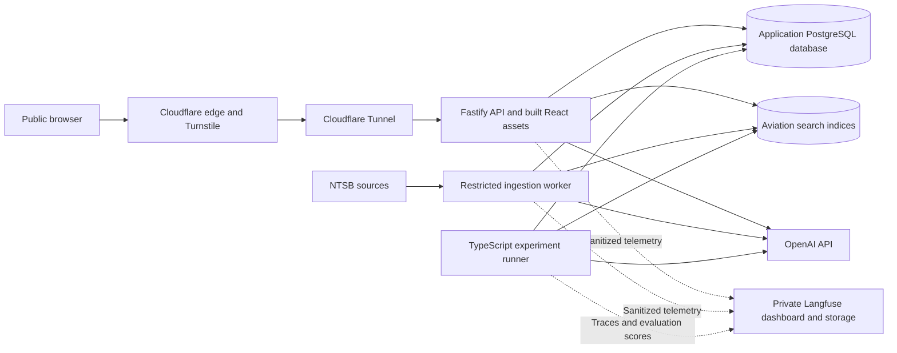

# Aviation Casebook: implementation design

**Draft, updated 2026-10-21.** Initial data research: 2026-10-16. Design only;
the application is not built. Tracing/evaluation decision: self-hosted Langfuse.
Working assumptions: English-first public beta, all completed US investigations
as the eventual scope, and a **$25/month OpenAI ceiling**. These are proposed
defaults pending owner feedback, not deployed limits.

Build a small TypeScript application that finds relevant investigations, explains
why they match, and compares supporting evidence. Start with the 2008-onward
dataset and add historical coverage later. The experience is search with an
evidence-based answer and comparison table, alongside browsable cases and a modest
dashboard. The first implementation should be a complete, small vertical slice.

## 1. Recommended stack

| Concern | Recommendation | Reason |
| --- | --- | --- |
| Runtime/tooling | Node.js 24 LTS, TypeScript strict mode, pnpm, committed lockfile | Supported runtime; TypeScript practice across the app |
| Frontend | React + Vite, React Router, TanStack Query | Explicit client/server boundary and straightforward deployment |
| UI | Tailwind CSS, shadcn/ui, Lucide icons, Recharts | Restrained visual system, accessible components, simple charts |
| Backend | Fastify, Zod contracts, OpenAPI | Small explicit API; shared types plus runtime validation |
| Authentication | Better Auth + Google OIDC + database sessions | Avoid writing OAuth/session cryptography ourselves |
| Relational data | PostgreSQL + Drizzle queries/migrations | Identity, quotas, consent, ingestion state, canonical cases |
| Search | Elasticsearch 9.x Basic + official JS client | Keywords, filters, aggregations, and vector search |
| AI | Official OpenAI TypeScript SDK, Responses API, embeddings endpoint | Direct control over schemas, prompts, tokens, and accounting |
| Jobs | Separate TypeScript worker from the same codebase/image | Imports do not block the HTTP process; no broker needed initially |
| Public access | Docker Compose + Cloudflare Tunnel + Turnstile | Suitable for one Linux host |
| Observability | Self-hosted Langfuse + OpenTelemetry-backed TypeScript integration | Existing AI dashboard for traces, usage, latency, and scores |
| AI evaluations | Langfuse experiments + custom TypeScript evaluators | Versioned datasets, retrieval/classification metrics, and regression comparisons |
| Software tests | Vitest, Fastify injection tests, Playwright | Deterministic logic, auth, quotas, and user journeys |

Node 24 is supported in the [Node release schedule](https://github.com/nodejs/Release).
Fastify documents [TypeScript](https://fastify.dev/docs/latest/Reference/TypeScript/)
and [runtime validation](https://fastify.dev/docs/latest/Reference/Validation-and-Serialization/);
Better Auth documents its [Fastify integration](https://better-auth.com/docs/integrations/fastify).
Pin compatible versions, including the Zod/Fastify adapter, when implementing.

Prefer the explicit frontend/backend split for learning. Next.js is a reasonable
alternative if server rendering and indexed public case pages become priorities;
the initial search interface does not need its rendering/cache conventions.
Use one application package with `web/`, `server/`, `worker/`, `shared/`, `tests/`,
`evals/`, and `fixtures/`. Application orchestration remains plain TypeScript;
LangChain/LangGraph are not required for version one. The app needs no Redis,
Kafka, or graph database; the separate Langfuse deployment has its own storage
dependencies. Keep repository tooling framework-neutral.

Use Langfuse's dashboard and experiment runner. No Jaeger plugin/custom AI dashboard
is planned, and Promptfoo is optional future tooling rather than a first-release
dependency. The [tracing and evaluation guide](OBSERVABILITY_AND_EVALUATION.md)
defines instrumentation, development experiments, production assessment, and hosting.

## 2. First-release behavior

An instructor can ask:

> Find completed investigations involving engine power loss shortly after
> maintenance. Separate confirmed mechanical failures from cases where
> investigators found no mechanical fault.

Return a bounded set of cases, the interpretation of “shortly,” supporting
passages, and explicit gaps. Preserve unknown causes rather than forcing every
case into two categories. Reading, filtering, and comparing underlying records
should remain useful even when AI is unavailable.

Include keyword/filter browsing, natural-language search, case details, comparison
of up to four cases, citations, three anonymous AI requests, Google sign-in, and
a basic corpus dashboard. Ordinary browsing requires neither an LLM nor login.
Saved collections and generated lesson packs can follow.

Filters: completion, date, location/state, aircraft category/make/model, engine
type, FAR part, flight purpose, flight phase, VMC/IMC/unknown, light, and injuries.
Define general aviation as a documented source-based preset; do not silently
treat every Part 91 flight as the same training population. Show unknown values.

Scope is historical study. Exclude unrestricted chat, uploaded documents, public
write tools, live-flight advice, maintenance procedures, and airworthiness
decisions. Operational/emergency requests get a short static redirect to
appropriate authoritative assistance, not generated instructions.

## 3. Evidence and classification

Keep independent dimensions instead of a single “mechanical failure” flag:

| Dimension | Values/examples |
| --- | --- |
| Symptom | Total/partial power loss, rough running, failure to climb |
| Mechanical evidence | Causal fault established; no relevant fault identified within examination scope; defect found without established causal link; insufficient/conflicting evidence |
| Maintenance relationship | Investigator-attributed contribution; preceding maintenance without established causality; no evidence; unknown |
| Timing | Calendar days, flight hours, first/subsequent flight, qualitative wording, unknown |
| Attribution | Pilot/witness statement, examination, analysis, probable cause, application interpretation |

“No fault identified” does not prove a fault was impossible. An undetermined cause
does not itself establish a negative examination. Physical breakage, an incorrect
adjustment, fuel exhaustion, and icing are distinct mechanisms.

Each extracted assertion retains event/aircraft identity, source revision,
section, exact span offsets, supporting text, model/prompt version, and review
status. Display **AI-derived** separately from **NTSB finding**. Prefer “established
in the investigation” over absolute certainty. Store unknown/needs-review rather
than an uncalibrated confidence percentage.

For “shortly,” suggest a visible, editable interpretation such as **within 30
calendar days OR 10 flight hours**, plus an optional first-flight constraint.
Qualitative intervals remain a separate “timing not quantified” group. Never
silently substitute inspection date or hours since inspection for maintenance.

The [data assessment](DATA_REVIEW.md) gives four real seed cases. DFW08TA066
supports a maintenance-related causal fault; DEN08LA103 an undetermined cause
with a negative examination; MIA08LA156 a real defect without an established causal
link. NYC08LA106 shows why a successful test after cleaning does not negate the
earlier failure. An aviation reviewer must adjudicate final evaluation labels.

## 4. Sources and ingestion

The inspected archive contains **31,303 events**, including **24,291 provisional
US completed cases**. `avall.zip` starts in 2008. Historical archives have other
schemas. NTSB announces replacement of the download channel on **April 5, 2027**.
See [source measurements and qualifications](DATA_REVIEW.md).

Define a source adapter returning canonical cases, identifiers, revisions, and
provenance. Implement MDB first, historical normalizers separately, and an
Enterprise API adapter before the transition. API access, pagination, quotas,
identifier mapping, date semantics, revisions, and deletions remain unverified.
`GetCasesByDateRangeV2` must not be assumed to be a change feed.

The pipeline:

1. Discover official downloads and record retrieval metadata/hash. Accept fixed
   source hosts/paths only, with download time and size limits.
2. Extract allowlisted members with expanded-size limits; reject traversal,
   symlinks, nested archives, and unexpected files. Run pinned MDBTools in a
   no-network/no-secrets extraction container with read-only root and CPU, memory,
   and execution limits. A separate TypeScript loader validates its CSV before
   receiving database/search credentials. Source text never becomes a command,
   script, filename, or SQL statement. Check allowlisted hosts at every redirect.
3. Use the embedded dictionary to normalize dates, units, and country codes;
   validate coordinates/keys and quarantine malformed records.
4. Join on `(ev_id, Aircraft_Key)` where applicable. Select fields explicitly,
   omitting owner street addresses, contact details, and internal editor names.
5. Verify completed-status mapping using official metadata/reports. Preserve the
   raw status and mapping version. Missing/conflicting status is ineligible for
   findings-based answers; `F` must not be guessed to mean final.
6. Store canonical sections and revisions in PostgreSQL; create sanitized search
   documents/chunks. Keep factual, final analysis, cause, and findings separate.
7. Hash normalized sections, embed only changed text, build versioned indices,
   check counts/sample queries, and switch aliases atomically. Mark dependent
   assertions stale after a revision and exclude them from answers/aggregates until
   reprocessed. Version citation text independently of normalized search text;
   specify the offset unit and retain a deterministic mapping between the two.

The numeric CAROL report ID is not `ev_id`; `ntsb_docket` is entirely empty in the
inspected snapshot. Resolve and verify report links from source metadata. Start
with database text and official PDF links. Full PDF/docket extraction can wait.
PDF citations need real page/version information; MDB citations use source
sections/paragraphs without invented PDF pages. Build clickable URLs from a fixed
HTTPS host/path template and a validated, resolved report ID; never directly render
an arbitrary source/model URL. Label captured source revisions because the official
latest-report link can subsequently change.

Use monthly full snapshots for reconciliation. Weekly filenames repeat; version
them by retrieval timestamp/hash. Verify whether updates contain full cases or
partial rows before replacing child records or detecting deletions. Until then,
full snapshots are the reliable refresh path and the UI shows their actual age.
Failures preserve the last known-good corpus. Date-range API ingestion also needs
historical reconciliation to catch amendments to old cases.

Suggested PostgreSQL groups:

| Group | Tables/responsibility |
| --- | --- |
| Corpus | Cases, aircraft, source sections/revisions, findings, assertions, ingestion runs |
| Identity | Better Auth user/account/session/verification tables |
| Product | Saved case collections; separate email-consent records |
| Controls | Usage buckets, cost ledger, reservations, concurrency leases, short-lived idempotent results |

Use a dedicated application database and separate restricted runtime, ingestion,
and migration roles. Elasticsearch is a rebuildable projection, not the only
copy of source evidence or the store for users/quotas.

## 5. Hybrid retrieval and bounded RAG

Embeddings represent text numerically so differently worded passages can match.
RAG retrieves evidence and supplies it to a model to write an answer. Neither
establishes whether a suspected cause was confirmed; provenance and evaluation
are essential.

Create two versioned indices:

- `aviation-cases-*`: one event document, typed filters, nested aircraft, completion
  state, source references, and dashboard attributes.
- `aviation-passages-*`: section chunks with event/aircraft keys, revision/hash,
  offsets, section type, copied filter metadata, text, and `dense_vector`.

Use explicit mappings and `dynamic: strict`. Same-aircraft constraints must match
one nested aircraft or a validated aircraft ID. A collision must not satisfy a
Cessna filter with one aircraft and turbine evidence from another. Case charts
count distinct events, not expanded join rows.

Mark passages as aircraft-scoped or event-scoped. A row's aircraft key does not
prove that every sentence concerns that aircraft. In multiaircraft events,
event-scoped text alone cannot establish an aircraft-specific maintenance or fault
claim. Require an explicitly attributable passage or retain ambiguity. Mark these
cases in the UI and test them independently.

Start with 500–800-token section chunks and modest overlap; retain short causes
and findings intact. Use `text-embedding-3-small` at 1,536 dimensions. Evaluate
768/1,024 dimensions only with a full reindex and retrieval benchmark. Version
model, dimensions, normalization, and chunking together. The
[embeddings guide](https://developers.openai.com/api/docs/guides/embeddings)
documents shortened dimensions.

Run BM25 keyword search and filtered kNN, then combine rankings in TypeScript via
reciprocal rank fusion: `sum(1 / (60 + rank))`. Start with 50 candidates from each
channel; deduplicate, diversify by case, and tune on evaluation data. Apply the
same completion/country/aircraft constraints in both channels, including the kNN
prefilter. Preserve exact case numbers and negation such as “no” in evidence text.

Use `match`/`multi_match` on allowlisted text fields, never user/model text in
`query_string`, regex, scripts, or wildcard queries. Validate filter enums/ranges;
fix candidate counts, page limits, and timeouts in code. Country and completion
constraints are compulsory server clauses, not optional planner suggestions.

This Basic-compatible approach does not need ELSER, ML nodes, additional plugins,
`semantic_text`, Elasticsearch inference endpoints, or licensed native RRF. Use
[explicit vector mappings](https://www.elastic.co/docs/solutions/search/vector)
and check deployment features against the [subscription matrix](https://www.elastic.co/subscriptions).
OpenAI embedding calls happen in application/worker code.

The online pipeline is fixed:

1. **Admit:** validate input, identify the principal, validate Turnstile when
   required, and atomically reserve quota, concurrency, and maximum cost.
2. **Scope/plan:** one small structured model call emits an allowed intent, filters,
   terms, and ambiguity. It cannot emit SQL, Elasticsearch DSL, URLs, index names,
   model choices, or privileged messages.
3. **Retrieve:** compile fixed query templates, embed the query once, and retrieve
   at most six cases/twelve passages. Include relevant cause, analysis, and adjacent
   context rather than classify an isolated fragment.
4. **Compose:** one model call emits structured comparisons and references from
   an allowlisted set of retrieved passages.
5. **Validate:** code checks IDs, revisions, offsets, exact quotation matches, and
   schema; a separate small model checks scope/claim support against the evidence.
   It receives bounded claim/citation pairs and a fixed policy, not the raw user
   question/history or planner instructions. Validate referenced case identifiers
   in free text too; an unallowlisted identifier rejects the whole generated answer
   and falls back to retrieved case cards. Render labels/links from server-owned fields. The checker
   is still fallible and has no tools or authorization role.
   Failed/inconclusive validation returns case cards without generated conclusions.
   There is no automatic repair loop.
6. **Settle:** record cost metadata, settle reservations, release concurrency, and
   return the validated result. Show progress stages; do not stream unvalidated
   generated claims before verification finishes.

No general agent loop is needed. Developer instructions are server-controlled;
questions and source passages are untrusted data. The model cannot see credentials,
emails, sessions, private configuration, or quota rows. Code determines tools,
sources, budgets, and permissible filters.

Label a relevance-ranked result “examples found,” not all matching investigations.
Global statistics come from deterministic queries over indexed fields. Aggregates
using extracted assertions must state the processed/reviewed cohort and show
unknown/unprocessed counts. Do not extrapolate from the top retrieved cases.

## 6. Off-topic and prompt-injection defenses

Neither a system prompt nor an LLM classifier guarantees rejection of every attack.
Use layered rejection and bounded consequences. OpenAI's
[safety guidance](https://developers.openai.com/api/docs/guides/safety-best-practices)
supports constrained inputs/outputs, evidence-based answers, and adversarial tests;
[OWASP](https://cheatsheetseries.owasp.org/cheatsheets/LLM_Prompt_Injection_Prevention_Cheat_Sheet.html)
also treats retrieved content/model output as untrusted.

| Layer | Decision |
| --- | --- |
| Input | JSON only; bounded body, 1,500-character question, limited filter/case arrays/history; reject unknown fields |
| Scope | Enum: `case_search`, `case_comparison`, `corpus_statistics`, `needs_clarification`, `out_of_scope`, `operational_advice` |
| Topic | Historical case study and evidence-supported explanations; decline unrelated coding, finance, travel, prompt/key disclosure |
| History | Recheck each turn; only short server-owned history and validated IDs; never accept client system/developer messages |
| Retrieval | Fixed read queries over public aviation indices; no arbitrary URLs, browsing, scripts, shell, uploads, or generic SQL |
| Output | Allowlisted case/citation IDs; HTML-encoded text; no model-generated active HTML, images, scripts, or arbitrary links |
| Uncertainty | Insufficient evidence/verifier failure returns abstention or case cards |
| Economics | Rejections count toward abuse attempts; classifier, embedding, and verification costs are also metered |

Moderation is content-safety screening, not topic detection. Evaluate it on
aviation queries so references to fatalities are not automatically treated as
abusive. If included, screen user input and treat it as an additional layer.

[Structured Outputs](https://developers.openai.com/api/docs/guides/structured-outputs)
enforce shape, not truth. Validate with Zod, handle incomplete/refused responses,
and verify semantics separately. Follow OpenAI's
[trusted/untrusted input separation](https://developers.openai.com/api/docs/guides/agent-builder-safety);
use the SDK directly, not the Agent Builder product.

Tests must include a recipe hidden in an aviation story, encoded off-topic input,
fake source IDs, “ignore instructions,” malicious text inside a narrative, topic
drift, and valid citations attached to unsupported claims. Also measure false
rejections of legitimate questions without obvious aviation keywords.

## 7. Anonymous trial, Google login, and consent

Proposed configurable ceilings, all subordinate to the global spend limit:

| Identity/action | Initial limit |
| --- | --- |
| Anonymous trial | 3 AI requests per server-tracked identity retained for 30 days |
| Anonymous burst | 2 AI attempts/minute; one in flight per identity |
| Anonymous network backstop | 10 attempts/hour and 20/day per normalized IP or IPv6 /64 |
| Signed-in AI | 20/day, 150/month/account; 5 attempts/minute; one in flight; new accounts get 5/day for their first 3 days |
| Signed-in network backstop | 30 attempts/hour and 100/day per normalized IP or IPv6 /64, with tuning for shared networks |
| Global AI | 2 in flight, at most 1 anonymous; anonymous spend at most 25% of daily interactive allowance |
| Browsing/search/dashboard | No AI quota; bounded queries and initially 60 HTTP requests/minute/network identity |

These are ceilings, not guaranteed allocations. Tune shared-school-network behavior.
Cookies, IPs, and Google accounts are not unique people: resets, network changes,
and account farming remain possible. The global budget is the final cost boundary.

Reserve the remaining daily budget for authenticated users. Broader IPv6 /56 and
/48 anomalies can trigger step-up checks and temporary limits, but shared networks
need an appeal/tuning path. Multiple aged accounts can still exhaust the public
allocation: retain a login-required emergency mode and expect a small beta under
this budget, not abuse-proof availability.

Use a random signed HttpOnly trial cookie backed by a database record, not a
browser-only counter. After three requests, explain the limit and offer Google
sign-in while keeping browsing available.

Better Auth manages authorization-code login, state/PKCE, and sessions. Request
only `openid email profile`; require verified email. Use Google provider **`sub`**
as identity, not mutable email, as [Google specifies](https://developers.google.com/identity/openid-connect/openid-connect).
Disable unused providers, password registration, and automatic email-based account
linking. Avoid offline access and retaining provider tokens unless required;
verify the auth library's actual storage behavior.

Disable session cookie caching initially so logout/deletion/revocation checks hit
the authoritative session store. Store only needed Google profile fields. Create
trial identities only after a successful challenge when AI is first requested;
cap their creation rate and count. A cookie-setting response must never be cached.

Use host-only Secure/HttpOnly/SameSite cookies, explicit production `APP_URL`,
exact trusted origins/callbacks, and CSRF protection on custom POST endpoints.
Keep [Better Auth security checks](https://better-auth.com/docs/reference/security)
enabled and configure its [auth rate limiter](https://better-auth.com/docs/concepts/rate-limit).
That limiter does not replace application AI quotas.

Login email serves account operation. Training-case updates require a **separate,
unchecked opt-in**, consent text/version/time, confirmation, and unsubscribe.
Google login must not silently subscribe users to marketing. This conservative
design follows the [Czech privacy authority's guidance](https://uoou.gov.cz/index.php/profesional/qa-otazky-a-odpovedi/obchodni-sdeleni).
Publish a privacy/contact notice before collecting real users.

Consent belongs to the confirmed email address as well as the account; changing
that address requires reconfirmation. Unsubscribe must work without login using
an opaque token. After deletion, retain only the minimal documented suppression
record needed to avoid further mail, not an active marketing profile.

Proposed retention: trial identities 30 days; pseudonymous security logs 7 days;
content-free request records 30 days; quota buckets through their calendar window
plus 7 days; content-free cost ledger 90 days for reconciliation; backup expiry
30 days. Keep in-progress/idempotent results for at most 24 hours, disclosed as
temporary processing; conversation context expires with that window. Persist a
collection/history beyond that only at the user's request. Account deletion ends
sessions and removes saved content; explain backup expiry and minimal retained
anti-abuse/financial records. Do not delete an active monthly budget bucket on day
30 of a 31-day month or grant fresh quota on account deletion/re-registration.
Keep a minimal anti-abuse record keyed by an HMAC of the Google issuer and `sub`,
using a dedicated secret, through the quota window plus 7 days. It survives account
deletion without retaining the email/profile and reattaches the existing usage on
re-registration. Document this pseudonymous retention and preserve its counters
during key rotation; do not cascade-delete it with the account.

Langfuse production traces follow the 30-day content-free metadata limit. Questions
and answers remain outside telemetry by default; asynchronous evaluation uses only
the existing 24-hour temporary-processing window. Public/synthetic benchmark
fixtures have a separate lifecycle. See the [capture and retention policy](OBSERVABILITY_AND_EVALUATION.md#privacy-retention-cost-and-availability).

## 8. Abuse controls and atomic accounting

Cloudflare is the outer traffic filter. Validate Turnstile server-side, checking
success and expected hostname/action; tokens expire after five minutes and are
single-use. Challenge anonymous AI use and suspicious authenticated activity.
See [Turnstile verification](https://developers.cloudflare.com/turnstile/get-started/server-side-validation/).

Trust `CF-Connecting-IP` only through the controlled tunnel/proxy path. Never accept
arbitrary forwarded headers on an independently reachable origin. Normalize
IPv4-mapped IPv6; enforce IPv6 /64 limits. Store short-lived keyed IP HMACs, not raw
addresses in analytics; these remain pseudonymous personal data. Key rotation must
preserve counters across an overlap period. No browser fingerprinting.

For the public deployment, isolate app ingress and the tunnel connector on a
dedicated network, with no unrelated containers. Set Fastify `trustProxy: false`
explicitly; admit production HTTP only from the configured connector socket peer,
not from a header assertion. Bind/firewall the listener accordingly even if the
app has other interfaces for database access. After accepting the socket peer,
derive one validated client identity from `CF-Connecting-IP`. Every network bucket,
including browsing and Better Auth's limiter, must use that identity through an
explicit adapter, never Fastify's connector-valued `request.ip`. Missing/invalid
client-IP headers reject dynamic requests, including browsing, auth, and paid APIs;
they must not mint a new identity or put everyone in the connector's bucket.
Test direct access and forged headers from another container. Loopback alone does not authenticate
co-resident processes; reserve that simpler mode for local development.

For every paid path, use one short PostgreSQL transaction to lock/create relevant
principal/network/global buckets in a stable order, enforce limits/idempotency,
reserve maximum cost, and acquire expiring concurrency leases. Commit before
provider calls; do not hold a transaction while waiting on the model.

Scope idempotency to principal and canonical request hash. Different content with
the same key fails; identical retries cannot trigger another paid request or read
another user's result. Comparisons, future exports, and ingestion/evaluation jobs
must use the same cost gate.

Settle actual usage and release unused reservations. If a paid call has no reliable
usage result, settle its reservation at the full maximum, marked uncertain; never
automatically refund it on timeout or lease expiry. Operator reconciliation against
the dedicated provider project's billing can correct verified over-reservations
or reduce remaining headroom when observed spend is higher. Aggregate billing
does not prove an individual request was free. Provider organization/admin billing
credentials, if needed, belong to operator tooling, never the public app/worker.
User credit refunds are separate from actual provider-spend accounting.

Give each lease an ownership/fencing token. Enforce a total 60-second application
pipeline deadline, per-stage timeouts within it, and a longer lease TTL (initially
90 seconds). Settlements/releases require the current ownership token. A retry
finding running/expired work returns its state/result, never silently starts a
second pipeline. Expiry can free a local execution slot but not reserved money.
Aborting a connection cannot guarantee remote inference stopped; the conservative
charge still bounds spend. The concurrency target concerns local pipelines, not
an unverifiable promise about provider execution after timeouts.

Fail closed for paid requests if quota storage or required abuse validation is
unavailable; cached/bounded browsing can continue. Use 429 plus retry information
for limits, 503 for temporary dependency failures, and an AI kill switch.
Do not rely on provider dashboard budgets as an instantaneous hard cutoff.
Bound timeouts/tokens/context/concurrency and disable automatic SDK retries
initially; ambiguous retries must not multiply unaccounted charges.

## 9. Model choices and cost envelope

These are candidates to evaluate, not benchmark results. Published prices checked
2026-10-16; verify account access and current pricing when implementing.

| Stage | Candidate | USD / million tokens |
| --- | --- | --- |
| Scope/plan and output check | [GPT-5.6 Luna](https://developers.openai.com/api/docs/models/gpt-5.6-luna) | $0.20 input / $1.20 output |
| Evidence comparison | [GPT-5.4 Mini](https://developers.openai.com/api/docs/models/gpt-5.4-mini), snapshot `gpt-5.4-mini-2026-03-17` | $0.75 input / $4.50 output |
| Embeddings | [text-embedding-3-small](https://developers.openai.com/api/docs/models/text-embedding-3-small) | $0.02 input |
| Offline quality challenger | [GPT-5.6 Terra](https://developers.openai.com/api/docs/models/gpt-5.6-terra) | $2 input / $12 output |

Example token budget: scope 1,000 input/120 output ($0.000344), answer 8,000/1,200
($0.0114), verification 10,000/200 ($0.00224), embedding 200 ($0.000004).
Total **about $0.014/request**, or $14/1,000. This excludes retries, ingestion,
evaluations, taxes, and hosting. Meter all billable output, including reasoning.
Built-in web/file-search tools and their fees are unnecessary.

Proposed per-request hard caps: scope 2,000 input/300 output, answer 12,000/2,000,
verification 14,000/300, embedding 1,000 input tokens. Reserve **$0.03/request**
conservatively using worst applicable/uncached prices. Use the correct tokenizer;
characters alone do not bound tokens. Minimal/disabled reasoning is preferred if
evaluation permits; output caps must include reasoning tokens. Recalculate the
reservation whenever model, price, token caps, or retry policy changes.

At startup, compute worst-case cost from an allowlisted model/price/cap table and
refuse to enable AI if it exceeds the reservation or pricing is unknown. Cache
write premiums and retry allowances must be included. Low output caps can truncate
verification; measure abstention/truncation rather than treating it as good quality.

Split $25/month into **$20 interactive + $5 indexing/evaluation**, with **$1/day**
as an upper interactive daily bound. Pace the daily allowance using the lower of
that bound and remaining interactive money divided by remaining calendar days;
cap anonymous spending at 25% of the resulting allowance. $20 covers roughly
1,400 typical responses under the example,
not a guaranteed allocation; abuse and unresolved reservations reduce it.
Compute remaining money after subtracting settled charges and the full amount of
all unsettled/uncertain reservations. Pacing must never make those funds available
again merely because a request or lease expired.

The provisional corpus has approximately 31.9 million tokens before deduplication
and overlap: roughly **$0.64 for one embedding pass** at the stated price. This
is a character-based estimate, not a measured token bill. Bulk LLM extraction is
separate and can cost far more. Start with a capped maintenance-related sample,
retain unprocessed values, and expand only after quality/cost measurements.

Set Responses `store: false`, avoid provider background execution, and send only
bounded questions/public evidence. This is not zero retention; the
[OpenAI data-controls documentation](https://developers.openai.com/api/docs/guides/your-data)
describes separate abuse-monitoring and other retention. Disclose actual processing.

## 10. Interface and dashboard direction

Use warm off-white surfaces, dark navy text, restrained teal accents, fine borders,
generous spacing, and a locally served readable font. Evidence dominates the page;
avoid decorative cockpit graphics and endless chat bubbles.

Desktop: compact header with Explore/Dashboard, question box and example prompts,
filter chips, results, evidence drawer, and a four-case comparison tray. Mobile:
accessible filter/evidence drawers and stacked comparison cards. Support keyboard
focus, screen readers, contrast, reduced motion, and labels beyond color.

Each case shows number, date, aircraft, location, why it matched, evidence category,
source excerpt, completion status, and original-report link. Citations open exact
sections with context. Distinguish NTSB text from application interpretation. Show
actual coverage/freshness, trial balance, and useful loading, empty, limit, and error
states. The user should never need to understand embeddings to judge an answer.

Initial dashboard: counts by year, phase, weather, aircraft category, and a data
coverage panel. Display cohort/denominator and let each bar open matching cases.
A map follows coordinate validation and a tile-provider decision with attribution,
usage terms, and budget; a static geographic overview is sufficient initially.

Follow-ups grounded in [the data assessment](DATA_REVIEW.md): evidence maps,
maintenance-to-event timelines, similar-symptom/different-finding case pairs,
recurring phase/event sequences, and report revision tracking. AI-derived charts
must expose extraction/review coverage.

These ideas are potential differentiators, not claims of scientific novelty.
Do not rank manufacturers as safest, turn counts into exposure-adjusted accident
risk, infer causation from co-occurrence, or hide completion lag. A later lesson
pack can generate cited discussion questions from selected cases, not operational
recommendations.

## 11. Deployment and trust boundaries

Use a multi-stage non-root image. Fastify serves built Vite assets and `/api/*`
on the same origin; the dev server is not deployed. Compose project `ai-aviation`
groups clear `app`, `ingest`, and one-shot `extract` services. Avoid global `container_name` values so
multiple checkouts can coexist. Offer a reproducible local service profile with
pinned PostgreSQL/Elasticsearch and configurable connections to existing services.

Run Langfuse as separate reusable infrastructure under Compose project
`ai-observability`, with isolated projects/credentials and its own resource budget.
The experiment runner invokes the same application functions and cost gate; its
provider calls remain metered. Tracing exports are asynchronous and best-effort.
The [hosting plan](OBSERVABILITY_AND_EVALUATION.md#prompt-management-and-hosting)
lists Langfuse's additional services and portable configuration.

Only the application is tunnel-exposed. Elasticsearch, Kibana, PostgreSQL, workers,
Langfuse, admin, and metrics routes remain private. Use an isolated container
connector for production and publish no app port; loopback access is a development
option. Test origin restrictions externally and from co-resident containers.
Direct/LAN access must not become an alternate trusted-header path. Set the final
hostname with `APP_URL`; keep machine-specific addresses/tunnel secrets outside Git.

The HTTP process receives an Elasticsearch read credential limited to aviation
indices; ingestion uses a separate writer. Validate TLS using the configured CA.
PostgreSQL roles are limited to the app database; HTTP has no migration/ingestion
or shared-cluster administration privileges. No Docker socket, host-home mounts,
or file containing unrelated provider keys. Scope worker credentials separately.

Add CSP/security headers, safe text rendering, parameterized SQL, explicit response
serialization, bounded search templates, and redacted logs/errors. Never publicly
cache AI responses, OAuth callbacks, session/quota endpoints, or authenticated
responses: use `Cache-Control: private, no-store`. Public case/aggregate caches
include dataset revision. Arbitrary prompts/answers are not shared across users.

Initial resource budgets to measure: API 0.5–1 GiB, worker 1–2 GiB, one ingestion
job, two AI requests in flight. One primary shard and zero replicas suit a single
node but provide no high availability. 100,000 raw 1,536-dimensional float32 vectors
alone use about 614 MB; text, graph/index structures, and encoding add overhead.
Measure the actual index and allow a second index's disk space during rebuilds.

Use bounded database/search timeouts and pools. Back up identity/consent/quota data
encrypted to an off-host destination and test restore; search indices are
rebuildable. Track freshness, latency, cost, rejects, errors, and saturation without
default email/prompt logging. Document single-host downtime, rollback, and recovery.

## 12. Security review and evaluation gates

Use Langfuse for traces, datasets, experiments, and scores; custom TypeScript
evaluators run in our controlled script/worker process. Ordinary software tests
remain separate. [The evaluation guide](OBSERVABILITY_AND_EVALUATION.md) explains
unit tests, component/end-to-end evaluations, human/model scoring, and production
sampling. Scores are assessments from a named evaluator, not automatic proof of
correctness. Inline answer checks and PostgreSQL spend enforcement remain in the API.

[Independent design review](SECURITY_REVIEW.md) is separate from implementation
review. Before public launch, ask **Claude Fable or Opus** to review a fixed code
commit and configuration: auth/cookies, every paid-call path, quota races, proxy
trust, output rendering, permissions, dependencies, and containers/tunnel. Use
synthetic credentials and public fixtures; record actual reviewer model and fixes.
Test findings, and review changes after the reviewed commit. A model review is
not a guarantee of no vulnerabilities. The Langfuse additions postdate the October 16
review and must be included in the implementation review.

Block public launch on unresolved critical/high issues, failed auth/origin/budget
tests, or evidence-classification failures. Build a 60–100-question set, split by
case to prevent overlapping-chunk leakage. Include confirmed faults, negative
examinations, noncausal defects, unknowns, pilot beliefs, timing ambiguity,
multiaircraft cases, negation, and attacks. Have an instructor/analyst adjudicate
important labels. The four seed cases are not a sufficient independent benchmark.

Proposed targets to measure:

- Recall@20 at least 90% on curated relevant cases; compare keyword, vector, and
  hybrid baselines before adding reranking.
- At least 95% precision for established causal mechanical faults on reviewed
  holdout data; report sample size and abstentions separately.
- 100% resolvable citations/exact span matches; human-check semantic support.
- No preliminary/factual-only cases in completed-only answers or known
  cross-aircraft attribution failures in the regression suite.
- At least 98% off-topic rejection on the curated set, plus a false-reject target
  for valid requests; not a guarantee against arbitrary adversarial input.
- Concurrent requests, retries, restarts, proxy-header forgery, cookie deletion,
  account switching, and dependency outages cannot bypass the global budget.
- Test cross-user caches/idempotency/sessions, XSS, CSRF, OAuth redirects,
  unsafe source redirects, and malicious retrieved text.

Network-independent tests run in CI. Prepared-dataset ("offline") evaluations can
call real models: run them only as explicit, budgeted jobs, recording dataset,
corpus, prompt, model, evaluator, and code versions. Missing/failed required scores
must fail the release gate. Background production judges use the same $5/month
indexing/evaluation allocation and shared paid-call gate; Langfuse cost charts do
not enforce the app's spending limit. Aim for
subsecond cached browsing and roughly ten-second AI responses, then measure on
the target host; these are targets, not observed benchmarks.

## 13. Delivery plan

| Milestone | Deliverable | Exit condition |
| --- | --- | --- |
| 1. Data and keyword search | TypeScript importer, canonical schema, 2008+ US slice, filters, case page | Completion mapping/counts/joins verified; no LLM needed |
| 2. Evidence retrieval | Chunks, embeddings, application RRF, cited comparison, Langfuse traces and TypeScript experiments | Seed cases correct; baseline/holdout scores recorded; telemetry capture checked |
| 3. Interface | Search workspace, evidence drawer, comparison, basic dashboard | Instructor can find and verify a case independently |
| 4. Public-beta controls | Google login, trial, consent, Turnstile, atomic quotas/spend, bounded production evaluation | Adversarial/auth/concurrency and telemetry privacy/retention tests pass privately |
| 5. Review and launch | Claude code/config review, fixes, restore drill, tunnel/domain | Launch gates pass; enable a small public beta |
| 6. Extend coverage | Historical sources, Enterprise API, reviewed enrichment | Coverage and quality remain explicit |

First slice: import the four seed cases, index their sections, answer the motivating
question, and click every evidence reference. Expand the corpus before advanced
dashboard graphics. Prioritize the Enterprise API transition by its deadline even
if historical backfill or advanced features slip.

## 14. Decisions and remaining verification

Accepted tooling: Langfuse's existing UI for observability/evaluations, custom
TypeScript evaluation rules, and Vitest for ordinary tests. No Jaeger UI work or
Promptfoo dependency in version one. Plain TypeScript orchestration remains.

Defaults awaiting feedback: monthly budget and breadth of initial coverage.
Technical unknowns: completion codes, historical schemas, partial-update semantics,
Enterprise API access/pagination, actual model availability, evaluated quality,
and measured Langfuse resource/retention behavior on the deployment host.
These are implementation tasks, not concealed assumptions of production readiness.

Before implementing public login/access, configure Google OAuth for the final
origin, Turnstile, an app-specific OpenAI project/key, restricted database/search
credentials, and a privacy/contact notice. Environment configuration keeps the app
reproducible without any particular private network or shared secrets file.
