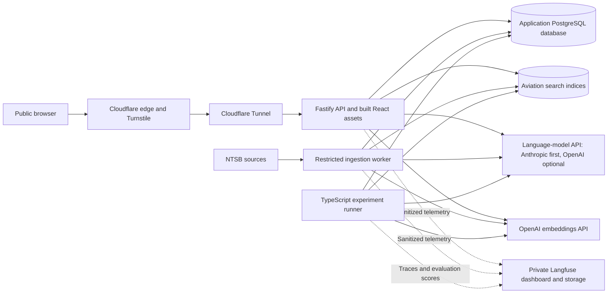

# AirCase: implementation design

**As built, updated 2026-10-25.** AirCase's public search, case pages and accounts
use TypeScript, PostgreSQL and Elasticsearch. The initial AI feature is an extractive
**evidence view** (§5): typed query interpretation, pinned retrieval and canonical
NTSB text. Generated summaries remain experimental and disabled behind
`AI_BRIEFS_ENABLED=false`; their previous design and calibration history is retained
below. The independent evidence-view G6 and UI integration must clear before AI opens.
The owner-set ceilings remain $100/month total, $80 interactive, $20 indexing and
evaluation, and at most $3/day interactive. Scope uses Anthropic; embeddings use OpenAI.

## 1. Recommended stack

| Concern | Recommendation | Reason |
| --- | --- | --- |
| Runtime/tooling | Node.js 24 LTS, TypeScript strict mode, pnpm, committed lockfile | Supported runtime; TypeScript practice across the app |
| Frontend | React + Vite, React Router, TanStack Query | Explicit client/server boundary and straightforward deployment |
| UI | Tailwind CSS, shadcn/ui, Lucide icons, Recharts | Restrained visual system, accessible components, simple charts |
| Backend | Fastify, Zod contracts, OpenAPI | Small explicit API; shared types plus runtime validation |
| Authentication | Better Auth + Google OIDC + database sessions | Avoid writing OAuth/session cryptography ourselves |
| Relational data | PostgreSQL + Drizzle queries/migrations | Identity, quotas, ingestion state, canonical cases; consent records later |
| Search | Elasticsearch 9.x Basic + official JS client | Keywords, filters, aggregations, and vector search |
| Language models | Official Anthropic TypeScript SDK (Messages API) behind an app-owned provider interface; an OpenAI Responses API adapter only when a switch is needed (§9) | Direct control over schemas, prompts, tokens, and accounting; provider chosen by deployment configuration |
| Embeddings | Official OpenAI TypeScript SDK, embeddings endpoint | Anthropic offers no embedding model; pinned to the index version, independent of the language-model provider |
| Jobs | Separate TypeScript worker from the same codebase/image | Imports do not block the HTTP process; no broker needed initially |
| Public access | Docker Compose + Cloudflare Tunnel + Turnstile | Suitable for one Linux host |
| Observability | Self-hosted Langfuse + OpenTelemetry-backed TypeScript integration | Existing AI dashboard for traces, usage, latency, and scores |
| AI evaluations | Langfuse experiments + custom TypeScript evaluators | Versioned datasets, retrieval/classification metrics, and regression comparisons |
| Software tests | Vitest, Fastify injection tests, Playwright | Deterministic logic, auth, quotas, and user journeys |

Node 24 is supported in the [Node release schedule](https://github.com/nodejs/Release).
Fastify documents [TypeScript](https://fastify.dev/docs/latest/Reference/TypeScript/)
and [runtime validation](https://fastify.dev/docs/latest/Reference/Validation-and-Serialization/);
Better Auth documents its [Fastify integration](https://better-auth.com/docs/integrations/fastify).
Pin compatible versions, including the Zod/Fastify adapter, when implementing.

Prefer the explicit frontend/backend split for learning. Next.js is a reasonable
alternative if server rendering and indexed public case pages become priorities;
the initial search interface does not need its rendering/cache conventions.
A client-rendered beta is acceptable; case and filter URLs must survive direct
navigation and refresh.
Use one application package with `web/`, `server/`, `worker/`, `shared/`, `tests/`,
`evals/`, and `fixtures/`. Application orchestration remains plain TypeScript;
LangChain/LangGraph are not required for version one. The app needs no Redis,
Kafka, or graph database; the separate Langfuse deployment has its own storage
dependencies. Keep repository tooling framework-neutral.

Use Langfuse's dashboard and experiment runner. No Jaeger plugin/custom AI dashboard
is planned, and Promptfoo is optional future tooling rather than a first-release
dependency. The [tracing and evaluation guide](OBSERVABILITY_AND_EVALUATION.md)
defines instrumentation, development experiments, production assessment, and hosting.

## 2. First-release behavior

The evidence-view MVP in §5 supersedes the composed-answer behavior below for launch.
Public AI returns canonical NTSB text and coded facts only. The following brief and
refinement behavior remains the disabled experimental summary track.

An instructor can ask:

> Find completed investigations involving engine power loss shortly after
> maintenance. Separate confirmed mechanical failures from cases where
> investigators found no mechanical fault.

Return a bounded set of cases, the interpretation of “shortly,” supporting
passages, and explicit gaps. Preserve unknown causes rather than forcing every
case into two categories. Reading, filtering, and comparing underlying records
should remain useful even when AI is unavailable.

Include keyword/filter browsing, natural-language search, case details, comparison
of up to four cases, citations, three anonymous AI requests, Google sign-in, and
a basic corpus dashboard. Ordinary browsing requires neither an LLM nor login.
Saved collections and generated lesson packs can follow.

A **brief** is one question plus at most three **Refine this search** steps, not an
open chat. Each refinement is another metered AI request through the full
admission, scope, retrieval, and validation pipeline; anonymous trial requests
count across the sequence. The client sends only the brief ID and one bounded
refinement: a Zod discriminated union of free `text`, an allowlisted
`interpretation` edit, or a validated `filters` edit
([interface design](UI_DESIGN.md) §4.3).
The server keeps a bounded representation of the search intent, including any
clarified meaning of “shortly,” plus validated filters and earlier case IDs. It
treats that intent as untrusted input in every scope check and retrieves afresh
rather than automatically restricting a refinement to earlier results. Earlier
generated answers never become evidence. Briefs expire within the 24-hour
processing window.

Filters: completion, date, location/state, aircraft category/make/model, engine
type, FAR part, flight purpose, flight phase, VMC/IMC/unknown, light, and injuries.
Define general aviation as a documented source-based preset; do not silently
treat every Part 91 flight as the same training population. Show unknown values.

Scope is historical study. Exclude unrestricted chat, uploaded documents, public
write tools, live-flight advice, maintenance procedures, and airworthiness
decisions. Operational/emergency requests get a short static redirect to
appropriate authoritative assistance, not generated instructions.

## 3. Evidence and classification

Keep independent dimensions instead of a single “mechanical failure” flag:

| Dimension | Values/examples |
| --- | --- |
| Symptom | Total/partial power loss, rough running, failure to climb |
| Mechanical evidence | Causal fault established; no relevant fault identified within examination scope; defect found without established causal link; insufficient/conflicting evidence |
| Maintenance relationship | Investigator-attributed contribution; preceding maintenance without established causality; no evidence; unknown |
| Timing | Stated facts from the relevant maintenance: calendar days, flight hours, the same or the previous calendar day, immediately before the event flight, which flight, completed flights in between, qualitative wording; unknown |
| Attribution | Pilot/witness statement, examination, analysis, probable cause, application interpretation |

“No fault identified” does not prove a fault was impossible. An undetermined cause
does not itself establish a negative examination. Physical breakage, an incorrect
adjustment, fuel exhaustion, and icing are distinct mechanisms.

Each extracted assertion retains event/aircraft identity, source revision,
section, exact span offsets, supporting text, model/prompt version, and review
status. Display **AI-derived** separately from **NTSB finding**. Prefer “established
in the investigation” over absolute certainty. Store unknown/needs-review rather
than an uncalibrated confidence percentage.

For “shortly,” suggest a visible, editable interpretation such as **within 30
calendar days OR 10 flight hours**, plus an optional first-flight constraint.
Qualitative intervals remain a separate “timing not quantified” group. Never
silently substitute inspection date or hours since inspection for maintenance.

**Chronology** (compose v6 and later, Tasks 16c and 16d, gate G6). A case's chronology
names its relevant maintenance once and lists each stated time relation that ends at the
event flight as its own fact, stored as parts: the anchor (the relevant maintenance, or
another event in the passage's own words, so "the accident flight was conducted 2 days
later" after the second test flight keeps that flight as its antecedent), the relation and
its value and bound (`exact`, `about`, `at_most`, `at_least`), and the passages that
state it. Hours a passage does not call flight hours (engine, tachometer or Hobbs time,
time in service, plain "hours") are their own relation, `operating_hours`, never flight
hours. The attribution (one aircraft, or the whole event) is never written by the model:
the server derives it from the cited passages' verified scope. A fact no passage states
is left out, and leaving one out never makes a case match. The reader's criteria are
decided in code by the versioned timing rules **`chronology-rules-v3`**
(server/briefs/criteria.ts; the check prompt states the same rules). Each fact is read as
a constraint on one quantity (calendar days, flight hours, operating hours, completed
flights):

- **Anchor and aircraft.** Only a fact from the relevant maintenance to the event flight
  decides anything; a bound worked out from a time measured from something else decides
  nothing. The server cannot tell such a derived bound from a stated one: `compose.v8`
  encodes it with its own anchor and `check.v9` asks the checker to hold every time to what
  it is measured from, and nothing else enforces it (the residual case is a composition that
  anchors a derived bound on the maintenance anyway, as 16d's development brief `holdout.b5`
  did; labels v3 mark that fact `unknown`; 16d review m2). In an event with more than one aircraft, only a fact cited from one aircraft's
  passages counts, facts about different aircraft are never compared or combined, and
  facts naming more than one aircraft decide nothing. Since version 3 a fact about the
  whole event still takes part in the conflict test with one aircraft's fact: "2 days" for
  one airplane and "40 days" for the event leave the days unsettled (16d review m1).
- **Conflicts first.** Before any decision, all the facts on one quantity (one anchor,
  one aircraft, one unit) must hold together: their ranges must overlap, or the quantity
  decides nothing whatever the window ("exact 20 days" and "at least 40 days" conflict
  under a 50-day window as under a 30-day one). Units are never mixed.
- **Approximation.** "About N" decides nothing; for the conflict test it counts as exactly
  N, with no tolerance, so it can only turn a decision into `unknown`.
- **Numbers.** With the facts consistent, the non-approximate ones narrow a quantity to one
  range: within the limit when the whole range is, outside when all of it is beyond, else
  undecided. Days counted from dates the passages state are exact; a date only in the
  case header is never combined with a passage date. Wording without a number decides
  nothing, and zero calendar days, flight hours or operating hours are refused at
  validation (the same day is `same_day`, just before the flight `immediately_before`).
- **Calendar dates.** "The same day" and "the day before" are one calendar date (0 or 1):
  within any calendar-day window, never a number of hours. Maintenance completed
  immediately before the event flight is within any calendar-day window and establishes
  the first flight; it is never a zero-day or zero-hour interval.
- **Operating hours** decide no flight-hour window.
- **Which flight** (the first flight, or zero completed flights in between) decides only
  the first-flight criterion, and calendar days or flight hours never decide which flight
  it was. The first flight alone never establishes a calendar-day or flight-hour window.
  Since version 3 an ordinal or a count of flights decides only with explicit evidence in
  the passages it cites (rule O-1, `ordinal-evidence-v2`, below): a narrated sequence ("the
  first flight …, the second flight …, the accident flight was conducted 2 days later")
  does not make the accident flight the third. Without that evidence the fact can still
  conflict with another, never settle one, and its timing statement is never shown.
- A window matches when either unit is within; it fails only when every unit it names is
  outside; a conflict on a quantity it reads decides nothing. Anything else is `unknown`,
  with a content-free reason (`unstated`, `other_anchor`, `ambiguous_attribution`,
  `approximate`, `insufficient_bound`, `not_settling`, `operating_hours`, `conflict`,
  `ordinal_unverified`).

Version 1 (Task 16c) compared facts only after reducing each to within, outside or
unknown, so an approximate or bounded fact that conflicted with the deciding one went
unnoticed (16c review I3); version 2 also adds the one-aircraft rule, operating hours and
the zero-interval refusal; version 3 (Task 16e) the event-level conflict and rule O-1.

A case whose passages do not settle a criterion is shown labelled unconfirmed, never as a
match; the copy says this analysis could not establish the timing from the supplied
passages, never that the investigation has none. Every decision, `unknown` included,
becomes a server-template claim ("Under the timing rules, the supplied passages of this
case do not settle whether …") that the evidence checker judges against every supplied
passage of the case; a contradiction of a "do not settle" claim is recorded as
`chronology_missed` (a likely extraction miss). A decision is shown as decided only while
its own claim and the facts it rests on are confirmed; the display never recomputes it,
so a removal can only downgrade it to unconfirmed (claim-level display, below). There is
no repair call.

**Deterministic rules before the check** (Task 16e, gate G6's 16d verdict, findings 1 and
2). Two versioned rules run in code on the validated composition and the canonical passage
texts and decide, whatever any model says, what can never be shown. A claim they abstain
from is still sent to the evidence checker (its verdict counts, a contradiction included),
and is never shown; in `whole` mode an abstention withholds the summary like any removal.

- **Excerpt context, `excerpt-context-v1`** (server/briefs/excerpts.ts, in the validator):
  a quote is shown only when its words keep their meaning read alone in a card. It is
  omitted when it is not whole sentences of its passage (a pilot's or witness's account may
  leave out "the pilot reported that"), opens with a pointing word or connective ("This
  deformation", "He", "However"), keeps a pronoun with no person named, a demonstrative
  ("this work", "these repairs", "at that time") whose noun it does not name, a relative
  time without its anchor ("approximately 29 hours earlier", "the previous day"), a
  relative sequence ("the next flight", "then"), or a comparison without its object ("the
  same mechanic", "similar debris"). Version 1 supplies no surrounding context: nothing
  can prove that added words hold the antecedent, so such an excerpt is omitted, and the
  card says how many quotes were left out. Measured on a blind sample of 200 sentences of
  the 16e evidence, labelled before the frozen rule ran on them: 7 of 166 standalone
  sentences omitted (4.2%, Wilson 95% 2.1–8.4%), 18 of 34 context-dependent ones caught; the
  misses (quoted handbook words, unnamed test settings, "the valve" among many) are left to
  the checker. On the development sample the rule was revised against, 1 of 164 and 25 of
  36.
- **Ordinal evidence, `ordinal-evidence-v2`** (server/briefs/ordinals.ts): which flight it
  was needs an ordinal the cited passages state for a flight ("the first flight after the
  annual inspection", "the accident flight was the first following …") or a complete count
  stated with what it counts from ("had not flown since", "two flights since the overhaul",
  maintenance completed "immediately before the flight"). A timing fact, summary sentence,
  `why` line or gap note stating an ordinal without it is never shown (an ordinal in a
  "whether" clause is asked, not stated). The rule is a necessary condition only: it does
  not check what the ordinal is counted from, which the checker judges. Version 2 (before
  any 16e checker call) stopped reading "had not flown in 22 years" or "the previous two
  flights" as counts.

**Claim-level display** (Task 16d, versioned dependency rules **`display-deps-v2`** since Task
16e, server/briefs/display.ts). After the evidence check (§5), one pure function decides what may
be shown, from dependencies the server derives from the composition's structure and never from
the model. A claim is shown only with exactly one valid `supported` verdict, no abstention by
the rules above, and only while everything it depends on is shown; removal is of whole
sentences and whole fields, never spliced or reworded.

- **Reading.** A presented case's AI reading needs a confirmed `why` line, at least one
  confirmed quote and no contradicted criterion claim (a contradicted decision has no
  direction: the case may be outside the reader's criteria). Every other statement of the case
  depends on it.
- **Basis.** A contradicted essential claim of a case (its `why` line, classification,
  maintenance relation, a timing fact, a criterion decision, a quote attribution, or a summary
  sentence citing it) suppresses the case's summary sentences, its group placement and every
  comparison citing it, whatever the thresholds below. Symptoms and gap notes are not
  essential.
- **Group.** A case keeps its group only with its reading, its basis and (mechanical grouping)
  its confirmed classification; otherwise it is shown unclassified, never in another group.
  A classification also depends on the case's basis (v2).
- **Criteria.** A decision is shown as decided only when its own claim is confirmed and the
  facts it reads are shown (every timing fact for the timing window and the first flight; the
  symptom for a failure type); otherwise it is shown unconfirmed and marked not verified.
  Decisions are never recomputed, so a removal only ever downgrades one. Timing facts that
  conflict with each other are shown together or not at all (v2): "2 days" is never left
  standing once the "40 days" beside it is removed.
- **Summary sentences.** A sentence depends on the reading and basis of every case it cites,
  and, when it refers outside itself anywhere (v2, 16d review I1: comparatives and anaphora such
  as "similar", "again", "comparable", "too", "also", "another", "both", "the same", "the second
  case", "earlier", "remaining", "this", "these", "however", a leading "it" or "they"), on every
  other sentence and every case those sentences present; a sentence that counts or contrasts
  the presented cases ("in both cases", "all three") depends on every presented case's reading
  and basis. When in doubt, the sentence is removed with its antecedent. A case's own sentences
  stand or fall together. A comparison citing two or more
  cases also depends on every statement and group placement of those cases, on their own
  sentences and on other comparisons sharing a case; removing a comparison never removes a
  case's own sentences. Gap notes depend on nothing else.
- **Whole output.** A failed check call, a check input over its limits, or a structurally
  unusable verdict set withholds everything. After the cascade, more than a third of the
  summary's sentences removed, or two or more contradicted claims, withholds the whole output
  (pre-registered experimental usability defaults, not safety guarantees). Minimum useful
  content is one shown summary sentence and one presented case with its reading; a marker-only
  summary is never shown.
- **Copy.** A removed run of sentences leaves a count marker; a removed field or decision is
  marked as not verified ("the check could not confirm this against the cited passages"),
  never as evidence the NTSB record lacks. The checklist states the count, never a blanket
  status: "Evidence check completed · 2 statements removed" (Task 16e; "PARTLY CHECKED" is
  gone). Every case the result counts is on the sheet: one the projection keeps without a
  confirmed classification is listed under "Not classified" (or "Not confirmed" for
  examples), one without its reading says "AI reading not shown", and its drawer, the print
  view and Compare carry the same markers (UI_DESIGN §4.3, "What the evidence check
  removed").

The [data assessment](DATA_REVIEW.md) gives four real seed cases. DFW08TA066
supports a maintenance-related causal fault; DEN08LA103 an undetermined cause
with a negative examination; MIA08LA156 a real defect without an established causal
link. NYC08LA106 shows why a successful test after cleaning does not negate the
earlier failure. An aviation reviewer must adjudicate final evaluation labels.

## 4. Sources and ingestion

The inspected archive contains **31,303 events**, including **24,291 provisional
US completed cases**. `avall.zip` starts in 2008. Historical archives have other
schemas. NTSB announces replacement of the download channel on **April 5, 2027**.
See [source measurements and qualifications](DATA_REVIEW.md).

Define a source adapter returning canonical cases, identifiers, revisions, and
provenance. Implement MDB first, historical normalizers separately, and an
Enterprise API adapter before the transition. API access, pagination, quotas,
identifier mapping, date semantics, revisions, and deletions remain unverified.
`GetCasesByDateRangeV2` must not be assumed to be a change feed.

The pipeline:

1. Discover official downloads and record retrieval metadata/hash. Accept fixed
   source hosts/paths only, with download time and size limits.
2. Extract allowlisted members with expanded-size limits; reject traversal,
   symlinks, nested archives, and unexpected files. Run pinned MDBTools in a
   no-network/no-secrets extraction container with read-only root and CPU, memory,
   and execution limits. A separate TypeScript loader validates its CSV before
   receiving database/search credentials. Source text never becomes a command,
   script, filename, or SQL statement. Check allowlisted hosts at every redirect.
3. Use the embedded dictionary to normalize dates, units, and country codes;
   validate coordinates/keys and quarantine malformed records.
4. Join on `(ev_id, Aircraft_Key)` where applicable. Select fields explicitly,
   omitting owner street addresses, contact details, and internal editor names.
5. Verify completed-status mapping using official metadata/reports. Preserve the
   raw status and mapping version. Missing/conflicting status is ineligible for
   findings-based answers; `F` must not be guessed to mean final.
6. Store canonical sections and revisions in PostgreSQL; create sanitized search
   documents/chunks. Keep factual, final analysis, cause, and findings separate.
7. Hash normalized sections, embed only changed text, build versioned indices,
   check counts/sample queries, and switch aliases atomically. Mark dependent
   assertions stale after a revision and exclude them from answers/aggregates until
   reprocessed. Version citation text independently of normalized search text;
   specify the offset unit and retain a deterministic mapping between the two.

**As built (first release).** Step 1 is not automated: an operator supplies the
archive and its SHA-256, and the worker checks the hash before extraction, so the
host allowlist and download limits wait for an automated download. In step 3 the
dictionary supplies display labels; units and country codes are kept as published
(for example `USA`). Step 7 publishes by writing the active `dataset_manifests`
row, which names concrete index names. Aliases only point at the last build, and
the API never reads them. [DATA_PIPELINE.md](DATA_PIPELINE.md) describes the
pipeline as built.

Use the event-level `ntsb_no` as the public case key and URL (`/cases/SEA08LA057`);
keep `ev_id` internal. All 31,303 event-level numbers in the inspected snapshot are
populated and unique; enforce that invariant during import. Multiaircraft events
carry suffixed aircraft numbers (`SEA08LA057A`, `SEA08LA057B`). Resolve them
through the parent event relationship, not by stripping a trailing letter, and
preserve aircraft attribution on narratives, findings, and report links.

The numeric CAROL report ID is not `ev_id`; `ntsb_docket` is entirely empty in the
inspected snapshot, and the MDB contains no other report identifier. The four seed
IDs were matched individually. For the bulk mapping, use the official Aviation
Search JSON (or CSV) export, which [NTSB documents](https://www.ntsb.gov/news/press-releases/Pages/NR07172023.aspx)
as including report and docket links. Verify a fresh export's field names, limits,
and completeness first; do not hard-code an assumed field name. Match case/aircraft
numbers and dates to imported records, keep potentially several reports per event,
record the mapping source and retrieval date, and partition exports by date if
needed. Start with database text and official PDF links. Full PDF/docket
extraction can wait.
PDF citations need real page/version information; MDB citations use source
sections/paragraphs without invented PDF pages. Build clickable URLs from a fixed
HTTPS host/path template and a validated, resolved report ID; never directly render
an arbitrary source/model URL. Label captured source revisions because the official
latest-report link can subsequently change. When no report ID is resolved, show
the copyable case number, “Direct report link unavailable,” and a link to official
[Aviation Search](https://my.ntsb.gov/aviation) labelled as a search, not as the
report. Do not construct prefilled search URLs until their format is verified.

Use monthly full snapshots for reconciliation. Weekly filenames repeat; version
them by retrieval timestamp/hash. Verify whether updates contain full cases or
partial rows before replacing child records or detecting deletions. Until then,
full snapshots are the reliable refresh path and the UI shows their actual age.
Failures preserve the last known-good corpus. Date-range API ingestion also needs
historical reconciliation to catch amendments to old cases.

Suggested PostgreSQL groups:

| Group | Tables/responsibility |
| --- | --- |
| Corpus | Cases, aircraft, source sections/revisions, findings, assertions, ingestion runs |
| Identity | Better Auth user/account/session/verification tables |
| Product | Later: saved case collections and separate email-consent records |
| Controls | Usage buckets, cost ledger, reservations, concurrency leases, short-lived idempotent results |

Use a dedicated application database and separate restricted runtime, ingestion,
and migration roles. Elasticsearch is a rebuildable projection, not the only
copy of source evidence or the store for users/quotas.

## 5. Hybrid retrieval and bounded RAG

### Evidence-view MVP (v2 baseline; v3 disclosures below)

This is the initial AI product; the composed-answer pipeline below is disabled.
`POST /api/evidence` tries the advisory `scope.e3` stage then embeds the original
question; edits skip scope. Scope is revision1 with unchecked readings removed,
advisory wording and a strict `{result: ...}` envelope around its discriminated union.
In the live/default baseline, suggestions are labelled **not applied**, escaped/rendered
as text, and never control routing or retrieval. Dev-only ranking experiments below
may use validated terms in lexical search; the separate v3 policy may apply guarded
state filters. All remaining suggestions are unapplied. The result carries the executed `query`, `appliedFilters`,
nullable `suggestion`, nullable `hint` and nullable `note`; no specific unchecked readings
are shown. The research-only boundary and fixed `EVIDENCE_NOTICE` remain mandatory on
every surface. A validated `out_of_scope` intent selects the fixed `scope` capability
note; `operational_advice` selects the fixed operational-advice note. All other intents,
provider errors, timeouts, invalid/missing or over-cap scope output, and skipped scope
select no note. Edits always have no note. Render only `EVIDENCE_NOTE_TEXT[note]`: no
model-written policy text or judgment about the particular question. Absence of a note
assures nothing. Nothing in scope blocks retrieval or alters admission, quota counting or accounting.
In the live/default baseline it also cannot change retrieval inputs. Every successful search returns results.

The server's `evidence-hints.v3` grammar supplies only optional navigation hints:
statistics without filters, and comparisons naming exactly the matched IDs. An ID alone
never requests comparison. Ambiguous, negated and injected requests stay ordinary search.
NUL and lone surrogates in questions or edited terms fail with 400 before admission;
valid astral characters remain supported. Normal security, quota and budget gates apply.

The three-channel `retrieval.v2` ranking stays unchanged (200/channel, exact case RRF,
deterministic lexical cutoffs; kNN remains approximate). Delivery is separately versioned:
100 candidates, ten/page, mapping over those first 100 with the same query vector
and at most eight concurrent Elasticsearch requests. In the live/default baseline all
three channels use the original question with no suggested filters. Explicit edits apply exactly the submitted
filters. Omitted terms inherit both of the parent's executed query texts byte for byte;
supplied terms explicitly replace both. The baseline keeps suggestion-based highlights
when it retains a suggestion, otherwise executed words. Other configurations highlight
executed lexical words only. Counts and declared synonyms describe occurrences, not question satisfaction. A
search stores its ranking and projection, generation, both concrete indices and seeds.
A new edited search uses the current publication. An existing search's free pages never
change or call a provider. Prune/cleanup preserve its references until the 24-hour expiry.

Canonical rows provide the facts and every probable-cause variant. `paragraphs.v2`
expands retrieval seeds using the chunker's shared `ntsb-paragraphs.v1` rule:
single-newline paragraphs, hard-wrap joins and headings attached to the next paragraph
(UTF-16 offsets, canonical LF text) and deduplicates them, up to three previews per
case. It does not crop paragraphs. The private `/api/evidence/:id/cases/:ntsbNo` endpoint provides full
sections at that generation with canonical revision IDs. Multi-aircraft sections stay
event-scoped; every aircraft must meet the active aircraft filter conjunction. Literal
and declared-synonym highlights are deterministic; relevance facts are coded-filter
checks, counts in displayed excerpts and channel enums. No summary, classification,
chronology assertion or model-written gap note exists in this result contract.

The canonical page is `/ai/:id`, private/no-store and noindex/nofollow. Page reads
select only ten cases; context membership is checked inside SQL. Each stored search
is bounded at 8 MiB UTF-8 JSON; exceeding it fails without truncation or quota charge.
Search ownership and content are read together. Handover changes read ownership once,
never billing or expiry. Edited requests recheck and lock their source under the same
account lifecycle protocol. Deletion removes searches and replay references; backups
omit them. Provider calls settle with result storage in one transaction. A failed search
returns its quota unit but retains real spend; a result with any note counts once.
Crash recovery closes abandoned searches and returns their units while charging the reservation conservatively. A
client disconnect leaves admitted work running and replayable; shutdown, deletion
and the configured server deadline can stop it (35 seconds for the baseline, 55 or
65 seconds with a reranker, 8 seconds more for the `attributed.v1` attribution check).

Before enabling this path, freeze and review scope/excerpt/pagination versions; replay
context-loss counterexamples through the actual UI, including required context on the
initial surface; test exact provenance and no generated factual prose across all views.
Freeze `evidence.v2`, the evaluated `scope.e3` prompt/schema/model/settings and the
server-only `evidence-hints.v3` grammar. The gate accepted the recorded confirmation for
fixed capability notes instead of blocking policy replies. This does not retroactively
pass the earlier scope quality evaluation or clear public launch. No new paid suggestion
threshold is required; final server, excerpt/UI, security, budget and lifecycle checks
remain required. Track C/N supplies regressions only. Metamorphic tests vary every model
output while holding all three retrieval channels, default cohort, ranking, excerpt selection and pagination fixed in the baseline.
The ordinary result is projected and byte-checked before the optional suggestion is added;
the baseline then marks suggested terms, while other versions keep executed-word marks.
If optional suggestion metadata and its baseline highlights would exceed the storage budget, they are omitted and the
original query's highlights remain. Canonical text and selection never change to make room.

Provider token-count preflight is separate from model-quality confirmation. The old
summary G6, partial-display gate and disabled `check.v9/medium` baseline are unchanged.
Pre-v2 searches stay unreadable and cannot be edit parents; they expire at their
original deadline. Migration 0024 freezes version, executed query and applied filters.

### Experimental composed-answer pipeline (disabled)

Embeddings represent text numerically so differently worded passages can match.
RAG retrieves evidence and supplies it to a model to write an answer. Neither
establishes whether a suspected cause was confirmed; provenance and evaluation
are essential.

Create two versioned indices:

- `aviation-cases-*`: one event document, typed filters, nested aircraft, completion
  state, source references, and dashboard attributes.
- `aviation-passages-*`: section chunks with event/aircraft keys, revision/hash,
  offsets, section type, copied filter metadata, text, and `dense_vector`.

Use explicit mappings and `dynamic: strict`. Same-aircraft constraints must match
one nested aircraft or a validated aircraft ID. A collision must not satisfy a
Cessna filter with one aircraft and turbine evidence from another. Case charts
count distinct events, not expanded join rows.

Mark passages as aircraft-scoped or event-scoped. A row's aircraft key does not
prove that every sentence concerns that aircraft. In multiaircraft events,
event-scoped text alone cannot establish an aircraft-specific maintenance or fault
claim. Require an explicitly attributable passage or retain ambiguity. Mark these
cases in the UI and test them independently.

Start with 500–800-token section chunks and modest overlap; retain short causes
and findings intact. Use `text-embedding-3-small` at 1,536 dimensions. Evaluate
768/1,024 dimensions only with a full reindex and retrieval benchmark. Version
model, dimensions, normalization, and chunking together. The
[embeddings guide](https://developers.openai.com/api/docs/guides/embeddings)
documents shortened dimensions.

Run BM25 keyword search and filtered kNN, then combine rankings in TypeScript via
reciprocal rank fusion: `sum(1 / (60 + rank))`. Apply the same
completion/country/aircraft constraints in every channel, including the kNN
prefilter. Preserve exact case numbers and negation such as “no” in evidence text.

Retrieval behaviour is versioned (task 10e; `server/search/retrieval-config.ts`): one
frozen configuration per version holds every channel, field, depth, query form and
text, the fusion level, constant, weights and tie order, the mapping and the packing,
and an operator setting (`AVIATION_RETRIEVAL_VERSION`) chooses one. The version is
recorded with every brief step, on its retrieval span and in evaluation reports.

- **`retrieval.v1`** (the rollback): passage BM25 on the scope stage's keyword text
  and passage kNN on the question, 50 candidates each, passage-level fusion, cases at
  their best passage.
- **`retrieval.v2`** (the default; task 10d phase A's `c200+n-kt`): the same two
  passage channels at 200 candidates (kNN `num_candidates` 800), plus BM25 over each
  case's narratives in the cases index (200 cases). Each channel is collapsed to its
  unique cases and the case lists are fused (k = 60, equal weights) with exact
  fractions and a total tie order. The cases index takes part only as a channel that
  nominates cases: its filter reaches exactly the cohort the passages filter reaches,
  under the passages contract's aircraft semantics, and a nominated case reaches the
  answer only through its own passages under the passages filter (mapped by the same
  query vector when no passage channel returned it), with every probable-cause
  variant. A case-level match is never evidence by itself. The cases channel reads
  only the cases index version the validation covered (`cases-v3`); the cases index a
  step read (name and version) is recorded in its private metadata.
- **Cutoffs.** Candidate discovery and fusion are kept apart. Both BM25 channels ask
  Elasticsearch to sort by score, then passage id or case number, while it collects
  their top 200, so equal scores at the cut are decided by the id. The kNN channel is
  approximate discovery: which neighbours it finds, and their quantized scores, belong
  to one index state, so a rebuilt copy of the same documents can return a different
  set. A mapped case's passages are all scored exactly and cut by score, then id.
  Fusion is exact and totally ordered over whatever the channels returned; it is
  reproducible for one index state, not across rebuilds.
- **`retrieval.v2-nf`** (experimental, never on `live`): also searches the coded
  `findings_text`; its coded-reference gain rests on the field the coded labels come
  from, so its value waits for narrative-relevance evaluation (Track N).

Use `match`/`multi_match` on allowlisted text fields, never user/model text in
`query_string`, regex, scripts, or wildcard queries. Validate filter enums/ranges;
fix candidate counts, page limits, and timeouts in code. Country and completion
constraints are compulsory server clauses, not optional planner suggestions.

This Basic-compatible approach does not need ELSER, ML nodes, additional plugins,
`semantic_text`, Elasticsearch inference endpoints, or licensed native RRF. Use
[explicit vector mappings](https://www.elastic.co/docs/solutions/search/vector)
and check deployment features against the [subscription matrix](https://www.elastic.co/subscriptions).
OpenAI embedding calls happen in application/worker code. The embedding model is
part of the index version: changing it, including to another vendor, means a full
reindex and a retrieval benchmark. Changing the language-model provider (§9) does
not touch embeddings.

The online pipeline is fixed:

1. **Admit:** validate input, identify the principal, validate Turnstile when
   required, and atomically reserve quota, concurrency, and maximum cost.
2. **Scope/plan:** one small structured model call emits an allowed intent, filters,
   terms, and ambiguity. It cannot emit SQL, Elasticsearch DSL, URLs, index names,
   model choices, or privileged messages.
3. **Retrieve:** compile fixed query templates, embed the query once, and retrieve
   at most six cases/twelve passages under the configured retrieval version. Include
   relevant cause, analysis, and adjacent context rather than classify an isolated
   fragment.
4. **Compose:** one model call emits structured comparisons and references from
   an allowlisted set of retrieved passages.
5. **Validate:** code checks IDs, revisions, offsets, exact quotation matches, and
   schema; then the reader's criteria in code (the timing rules, §3); then a separate
   model, the evidence checker, judges every claim against the evidence. It receives
   bounded claims with server-issued ids and their citations, every supplied passage of
   the cases they are about, and a fixed policy, not the raw user question/history or
   planner instructions. It returns exactly one verdict per claim id (`supported`,
   `contradicted` or `not_established`) with the passages it rests on and, for a
   contradiction, the decisive words, which code finds in the passage. The check input
   also carries a server-built header per case (aircraft, place and date from the coded
   record, since `check.v7`): a claim may name a case by it, and it supports nothing else. Code
   decides the outcome (server/briefs/verdicts.ts, server/briefs/display.ts): a missing,
   duplicate or unknown id, a verdict naming passages outside the claim's cases, a
   `supported` verdict naming no passage for a claim that is not an absence, an
   unverifiable quote, and a failed, truncated or malformed response withhold everything
   generated; since `check-judgement-v2` (Task 16e) a `supported` verdict naming a passage
   of the case that the claim does not cite makes only that claim not established
   (`supported_outside_citations`). A claim is confirmed
   only by exactly one valid `supported` verdict; an absence claim ("none of the supplied
   passages mentions maintenance"), which cites every passage of its case, needs
   `supported` too. What is shown is decided by one pure function, the **display
   projection** (`display-deps-v2`, Tasks 16d and 16e; the rules in §3), from dependencies the server derives from
   the composition's structure, never from the model: a case's reading needs its
   confirmed why line and at least one confirmed quote and no contradicted criterion; a
   contradicted essential claim of a case (why, classification, maintenance, timing,
   criterion, quote attribution, or a summary sentence citing it) suppresses its summary
   sentences, its group placement and every comparison citing it; a decision is shown as
   decided only while its claim and the facts it rests on are confirmed (never
   recomputed, so it can only be downgraded to unconfirmed); a case's own sentences stand
   or fall together, a comparison depends on everything about the cases it cites, and a
   sentence that refers outside itself anywhere depends on the other sentences and the
   cases they present; conflicting timing facts are shown together or not at all; and
   what the deterministic rules abstain from (an excerpt that loses its context, a flight
   ordinal no passage states; §3) is never shown. Whole
   sentences only: nothing is spliced or reworded. More than a third of the summary's
   sentences removed, two or more contradictions, or no shown sentence and case reading
   withhold the whole output (pre-registered usability defaults, not safety guarantees).
   Every response surface (the step, the stored dimensions, the case context, refinement
   inputs) is rendered from the projection; diagnostics keep the raw verdicts. Until gate
   G6 clears partial display, production runs the projection in `whole` mode
   (`AI_PARTIAL_DISPLAY` unset): any removal withholds the summary, as in Task 16c.
   Validate referenced case identifiers
   in free text too; an unallowlisted identifier rejects the whole generated answer
   and falls back to retrieved case cards. Render labels/links from server-owned fields. The checker
   is still fallible and has no tools or authorization role.
   Every summary sentence must end with the case markers it cites, and the code check
   withholds any summary whose sentence boundaries it cannot see
   (server/briefs/sentences.ts): the summary is written with an allow-list of
   characters (printable ASCII except Markdown and decoration, the quotation marks
   `“ ” ‘ ’`, the dashes `– —`, `° ± × ½ ¼ ¾ §`, and Latin-1 letters with diacritics),
   so the only characters that can end a sentence are `.`, `!` and `?` and the only space
   is U+0020; a sentence ends at every `.`, `!` or `?` before a space, and no other one
   may remain inside a sentence. What this does not cover: six declared abbreviation
   contexts ("No. 2", "approx. 5", "Mr. Smith", "U.S. operator", "49 U.S.C. 1154", "e.g.
   a school") are an accepted residual (a sentence that really ends with one of them,
   "…hurt? No. 3 passengers…", joins the next), and clauses joined by a semicolon, colon,
   comma or dash are one sentence; the checker judges each joined claim whole.
   Failed/inconclusive validation returns case cards without generated conclusions.
   There is no automatic repair loop.
6. **Settle:** record cost metadata, settle reservations, release concurrency, and
   return the validated result. Show progress stages; do not stream unvalidated
   generated claims before verification finishes.

No general agent loop is needed. Developer instructions are server-controlled;
questions and source passages are untrusted data. The model cannot see credentials,
emails, sessions, private configuration, or quota rows. Code determines tools,
sources, budgets, and permissible filters.

Label a relevance-ranked result “examples found,” not all matching investigations.
Global statistics come from deterministic queries over indexed fields. Aggregates
using extracted assertions must state the processed/reviewed cohort and show
unknown/unprocessed counts. Do not extrapolate from the top retrieved cases.

## 6. Off-topic and prompt-injection defenses

Neither a system prompt nor an LLM classifier guarantees rejection of every attack.
Use layered rejection and bounded consequences. OpenAI's
[safety guidance](https://developers.openai.com/api/docs/guides/safety-best-practices)
supports constrained inputs/outputs, evidence-based answers, and adversarial tests;
[OWASP](https://cheatsheetseries.owasp.org/cheatsheets/LLM_Prompt_Injection_Prevention_Cheat_Sheet.html)
also treats retrieved content/model output as untrusted.

| Layer | Decision |
| --- | --- |
| Input | JSON only; bounded body, 1,500-character question, limited filter/case arrays/history; reject unknown fields |
| Scope | Enum: `case_search`, `case_comparison`, `corpus_statistics`, `needs_clarification`, `out_of_scope`, `operational_advice` |
| Topic | Historical case study and evidence-supported explanations; decline unrelated coding, finance, travel, prompt/key disclosure |
| History | Recheck each refinement; only the server-owned brief (bounded intent, validated filters/IDs); never accept client system/developer messages or earlier answers as evidence |
| Retrieval | Fixed read queries over public aviation indices; no arbitrary URLs, browsing, scripts, shell, uploads, or generic SQL |
| Output | Allowlisted case/citation IDs; HTML-encoded text; no model-generated active HTML, images, scripts, or arbitrary links |
| Uncertainty | Insufficient evidence/verifier failure returns abstention or case cards |
| Economics | Rejections count toward abuse attempts; classifier, embedding, and verification costs are also metered |

Moderation is content-safety screening, not topic detection. Evaluate it on
aviation queries so references to fatalities are not automatically treated as
abusive. If included, screen user input and treat it as an additional layer.

Structured outputs enforce shape, not truth. Both providers support them:
[Anthropic](https://platform.claude.com/docs/en/build-with-claude/structured-outputs)
through `output_config.format`, and
[OpenAI](https://developers.openai.com/api/docs/guides/structured-outputs). Validate
with Zod again in app code. Handle refusals (`stop_reason: "refusal"` on
Anthropic), truncation (`max_tokens`) and unparsed output as failed stages, and
verify semantics separately. Server-owned instructions go only in the
provider's privileged channel (the Anthropic system prompt, or the OpenAI
developer message). Questions and passages go in the user turn as delimited,
untrusted data. Use the SDKs directly, with no agent frameworks or hosted agent
products.

Tests must include a recipe hidden in an aviation story, encoded off-topic input,
fake source IDs, “ignore instructions,” malicious text inside a narrative, topic
drift, and valid citations attached to unsupported claims. Also measure false
rejections of legitimate questions without obvious aviation keywords.

## 7. Anonymous trial, Google login, and consent

Proposed configurable ceilings, all subordinate to the global spend limit:

| Identity/action | Initial limit |
| --- | --- |
| Anonymous trial | 10 AI searches per UTC day; server-tracked identity retained for 30 days |
| Anonymous burst | 2 AI attempts/minute; one in flight per identity |
| Anonymous network backstop | 10 attempts/hour and 20/day per normalized IP or IPv6 /64 |
| Signed-in AI | 50/day, 600/month/account; 5 attempts/minute; one in flight; new accounts get 20/day for their first 3 days |
| Signed-in network backstop | 30 attempts/hour and 100/day per normalized IP or IPv6 /64, with tuning for shared networks |
| Global AI | 2 in flight, at most 1 anonymous; anonymous spend at most 25% of daily interactive allowance |
| Browsing/search/dashboard | No AI quota; bounded queries and initially 60 HTTP requests/minute/network identity |

These are ceilings, not guaranteed allocations. Tune shared-school-network behavior.
Cookies, IPs, and Google accounts are not unique people: resets, network changes,
and account farming remain possible. The global budget is the final cost boundary.

Reserve the remaining daily budget for authenticated users. Broader IPv6 /56 and
/48 anomalies can trigger step-up checks and temporary limits, but shared networks
need an appeal/tuning path. Multiple aged accounts can still exhaust the public
allocation: retain a login-required emergency mode and expect a small beta under
this budget, not abuse-proof availability.

Use a random signed HttpOnly trial cookie backed by a database record, not a
browser-only counter. After ten results searches in a UTC day, explain the reset and offer Google
sign-in while keeping browsing available. A live search or brief can move to the new
account at sign-in. Each step keeps the billing principal it was admitted under
(later refinements bill the account), and only read ownership moves, atomically
and once
([interface design](UI_DESIGN.md) §5, "Signing in mid-brief").

Describe the offer as “Up to ten free AI searches a day, subject to availability.”
The anonymous share is still 25% of the paced interactive allowance. At the evidence
reservation of $0.0025, $0.67 can admit about 268 searches at their worst case; these
are monetary ceilings, not a promised visitor allocation. Network and concurrency
limits still apply. Exhausted capacity remains a normal
state, not an edge case. Offer “Sign in to continue” only while authenticated
capacity remains; when the global allowance is exhausted, say AI search is
temporarily unavailable and keep keyword search, case reading, and deterministic
comparison usable. Signing in never implies a guaranteed allocation. The anonymous
share and new-account allowance are runtime configuration; other limits start as
typed, centralized defaults.

Better Auth manages authorization-code login, state/PKCE, and sessions. Request
only `openid email profile`; require verified email. Use Google provider **`sub`**
as identity, not mutable email, as [Google specifies](https://developers.google.com/identity/openid-connect/openid-connect).
Disable unused providers, password registration, and automatic email-based account
linking. Avoid offline access and retaining provider tokens unless required;
verify the auth library's actual storage behavior.

Disable session cookie caching initially so logout/deletion/revocation checks hit
the authoritative session store. Store only needed Google profile fields. Create
trial identities only after a successful challenge when AI is first requested;
cap their creation rate and count. A cookie-setting response must never be cached.

Use host-only Secure/HttpOnly/SameSite cookies, explicit production `APP_URL`,
exact trusted origins/callbacks, and CSRF protection on custom POST endpoints.
Keep [Better Auth security checks](https://better-auth.com/docs/reference/security)
enabled and configure its [auth rate limiter](https://better-auth.com/docs/concepts/rate-limit).
That limiter does not replace application AI quotas.

Login email serves account operation only. **The first release sends no
training-case or marketing email and collects no opt-in.** That waits for an
email provider. Email/password accounts with email verification, alongside
Google, are planned for the same later step. When email updates arrive, they
require a **separate, unchecked opt-in**, consent text/version/time,
confirmation, and unsubscribe.
Google login must not silently subscribe users to marketing. This conservative
design follows the [Czech privacy authority's guidance](https://uoou.gov.cz/index.php/profesional/qa-otazky-a-odpovedi/obchodni-sdeleni).
Publish a privacy/contact notice before collecting real users.

Consent belongs to the confirmed email address as well as the account; changing
that address requires reconfirmation. Unsubscribe must work without login using
an opaque token. After deletion, retain only the minimal documented suppression
record needed to avoid further mail, not an active marketing profile.

The published privacy notice (web/src/pages/Privacy.tsx, approved 24 October 2026) records
what the deployment actually keeps and is authoritative where it differs from this
proposal: there is no separate security log (request logs hold no address, search text or
identity and rotate by size), and backups are daily and kept 14 days on the host.

Proposed retention: trial identities 30 days; pseudonymous security logs 7 days;
content-free request records 30 days; quota buckets through their calendar window
plus 7 days; content-free cost ledger 90 days for reconciliation; backup expiry
30 days. Keep in-progress/idempotent results for at most 24 hours, disclosed as
temporary processing; conversation context expires with that window. Persist a
collection/history beyond that only at the user's request. Account deletion ends
sessions and removes saved content; explain backup expiry and minimal retained
anti-abuse/financial records. Do not delete an active monthly budget bucket on day
30 of a 31-day month or grant fresh quota on account deletion/re-registration.
Keep a minimal anti-abuse record keyed by an HMAC of the Google issuer and `sub`,
using a dedicated secret, through the quota window plus 7 days. It survives account
deletion without retaining the email/profile and reattaches the existing usage on
re-registration. Document this pseudonymous retention and preserve its counters
during key rotation; do not cascade-delete it with the account.

Langfuse production traces follow the 30-day content-free metadata limit. Questions
and answers remain outside telemetry by default; asynchronous evaluation uses only
the existing 24-hour temporary-processing window. Public/synthetic benchmark
fixtures have a separate lifecycle. See the [capture and retention policy](OBSERVABILITY_AND_EVALUATION.md#privacy-retention-cost-and-availability).

**As built (Task 20, with its review fixes).** Better Auth 1.7.7 serves three endpoints
under `/api/auth` (sign-in, Google's callback, sign-out); anything else there is 404, and
all of them are 404 while the Google client is not configured (`googleEnabled: false`).
Live also keeps sign-in off until the final privacy notice is published. Sessions last 7
days, are never extended and have no cookie cache. The ID token from Google's token
endpoint (its only source) is accepted on its RS256 form, its claims (issuer, this client
as the only audience and `azp`, finite `exp` and `iat`, `sub`, `email_verified`) and a
nonce the app adds to the redirect flow, which Better Auth's Google provider does not
send; only the subject, name and email are stored. `GET /api/account` shows the signed-in
browser its account's random application id (`auth_users.id`, never the subject), name and email:
the client compares that id, not the email, to tell a new account from the one it had (Task 25
security review), because deleting an account frees its email for a new account. The OAuth state lives in an encrypted
cookie, so starting a sign-in writes nothing to the database and no flood of starts can
block anyone's sign-in; a callback is used once: the first to get through the code
exchange and the ID-token checks claims its state atomically, before any user, session or
handover. A deletion's re-authentication, its start and Google's callback to the
signed-in browser, is counted per account (5 an hour each), never per network. The handover runs at the callback when sign-in started from the brief's
page and the browser's trial cookie still proves its owner, or at a signed-in refinement
or retry on a brief the browser's trial owns; a retry from the old trial alone answers 403
`moved`. Reads check the read owner in the statement that reads the content; a refinement
or a cancel locks the brief and checks its owner before it writes. Deletion and everything
that writes rows an account owns hold one lock per account and recheck the session first,
so nothing is created or taken over for a deleted account; admission takes it before any
lock other accounts share, and every writer, the maintenance pass included, takes rows in
one order: a brief, its steps, the account's idempotency records, its anti-abuse record,
then its sign-in rows (sessions before their confirmations, the user last). The pass's
orphaned-step update, the one step it takes out of that order, skips rows another
transaction holds, so no two writers wait for each other in a cycle. A re-registered account is a
new account (the new-account allowance applies again) that finds its usage. Deletion
needs a recent Google sign-in (OWASP re-authentication): within 5 minutes of signing in
the account page confirms at once; otherwise it sends the person through Google again,
for the same account, which confirms that session for 5 minutes, once, and ends the
session the browser had. Google offers neither `max_age` nor `prompt=login`, so the
re-authentication is Google's own account chooser and sign-in. Deletion removes the
account's briefs with all their steps and its idempotency records in the same
transaction as the user. Backups never hold the sign-in, brief or idempotency rows, so a
restore cannot bring a deleted account back; it starts those tables empty and everyone
signs in again (RUNBOOK, "Backups").

## 8. Abuse controls and atomic accounting

Cloudflare is the outer traffic filter. Validate Turnstile server-side, checking
success and expected hostname/action; tokens expire after five minutes and are
single-use. Challenge anonymous AI use and suspicious authenticated activity.
The public site key is server runtime configuration returned by a typed, allowlisted
`GET /api/config`, so one image serves every environment; render the widget
explicitly after that config loads. Nothing in that response affects quota checks.
See [Turnstile verification](https://developers.cloudflare.com/turnstile/get-started/server-side-validation/).

Trust `CF-Connecting-IP` only through the controlled tunnel/proxy path. Never accept
arbitrary forwarded headers on an independently reachable origin. Normalize
IPv4-mapped IPv6; enforce IPv6 /64 limits. Store short-lived keyed IP HMACs, not raw
addresses in analytics; these remain pseudonymous personal data. Key rotation must
preserve counters across an overlap period. No browser fingerprinting.

For the public deployment, isolate app ingress and the tunnel connector on a
dedicated network, with no unrelated containers. Set Fastify `trustProxy: false`
explicitly; admit production HTTP only from the configured connector socket peer,
not from a header assertion. Bind/firewall the listener accordingly even if the
app has other interfaces for database access. After accepting the socket peer,
derive one validated client identity from `CF-Connecting-IP`. Every network bucket,
including browsing and Better Auth's limiter, must use that identity through an
explicit adapter, never Fastify's connector-valued `request.ip`. Missing/invalid
client-IP headers reject dynamic requests, including browsing, auth, and paid APIs;
they must not mint a new identity or put everyone in the connector's bucket.
Test direct access and forged headers from another container. Loopback alone does not authenticate
co-resident processes; reserve that simpler mode for local development.

For every paid path, use one short PostgreSQL transaction to lock/create relevant
principal/network/global buckets in a stable order, enforce limits/idempotency,
reserve maximum cost, and acquire expiring concurrency leases. Commit before
provider calls; do not hold a transaction while waiting on the model.

Scope idempotency to principal and canonical request hash. Different content with
the same key fails; identical retries cannot trigger another paid request or read
another user's result. Comparisons, future exports, and ingestion/evaluation jobs
must use the same cost gate.

Settle actual usage and release unused reservations. If a paid call has no reliable
usage result, charge that call at its own worst case (its stage's hard caps, §9
"Uncertain calls"), marked uncertain, and the full reservation when no call can be named
(lease expiry, a failure outside the stages); never automatically refund it on timeout or
lease expiry. Operator reconciliation against
the dedicated provider project's billing can correct verified over-reservations
or reduce remaining headroom when observed spend is higher. Aggregate billing
does not prove an individual request was free. Provider organization/admin billing
credentials, if needed, belong to operator tooling, never the public app/worker.
User credit refunds are separate from actual provider-spend accounting.

Give each lease an ownership/fencing token. Enforce a total application pipeline
deadline of 100 seconds (`PIPELINE_DEADLINE_MS`: the sum of the stage timeouts, scope 10,
retrieval 8, answer 35 and check 45 seconds, plus 2 seconds of margin, so the check always
gets its full timeout after slow earlier stages; Task 16c's 90 seconds were less than that
sum), per-stage timeouts within it (each cut to what is left), and a longer lease TTL
(120 seconds; a running step is stale after 150). A call that runs out of time is
charged at its own worst case, marked uncertain, because the provider may still bill it
(§9 "Uncertain calls"; until Task 22 the whole reservation).
The check timeout is the one the calibration ran with (Task 16d gate condition 4); since
Task 16e it is derived from the measured latency (1.25 times the slowest development call,
within 30 to 45 seconds), which kept 45 seconds (§12).
Settlements/releases require the current ownership token. A retry
finding running/expired work returns its state/result, never silently starts a
second pipeline. Expiry can free a local execution slot but not reserved money.
Aborting a connection cannot guarantee remote inference stopped; the conservative
charge still bounds spend. The concurrency target concerns local pipelines, not
an unverifiable promise about provider execution after timeouts.

**As built (Task 20 review): suspicious authenticated activity.** An ordinary signed-in
AI request takes no Turnstile check. One does, verified like the anonymous gate's token
(fresh, single-use, hostname and action), when the account made 3 AI attempts in the
current minute (the limit is 5), has used half of today's allowance (10 of 20, 3 of a new
account's 5), or its network identity made 10 signed-in AI attempts in the current hour
(the limit is 30), and for every signed-in request while an operator sets
`account_check = always` (`pnpm worker ai-switch --account-check always`). Each signal
ends with its window; the check never blocks AI by itself and admission keeps the hard
limits. `GET /api/ai/status` says `check: true` beforehand, so the page takes the check at
click time ("Quick check before this AI search", UI_DESIGN §5). Every anonymous retry
takes a fresh token too, before it replays. The /56 and /48 aggregation of §7 is not
built: the network identity is an address or a /64, and a farm spread over many /64s
meets the global budget instead.

Fail closed for paid requests if quota storage or required abuse validation is
unavailable; cached/bounded browsing can continue. Use 429 plus retry information
for limits, 503 for temporary dependency failures, and an AI kill switch.
Do not rely on provider dashboard budgets as an instantaneous hard cutoff.
Bound timeouts/tokens/context/concurrency and disable automatic SDK retries
initially; ambiguous retries must not multiply unaccounted charges.

## 9. Model providers, choices and cost envelope

### Evidence ranking experiments

`AVIATION_EVIDENCE_RANKING` selects a frozen configuration in
`server/evidence/ranking-config.ts`. The default, `er-q-v1`, keeps question-only
retrieval and no reranker. Only that version is allowed with `APP_ENV=live`.
The dev grid is the three lexical choices (`q`: question, `t`: validated scope
terms, `qt`: question plus newline plus terms), each without reranking or with
Haiku 5.5 at depth 50 or 100 (`h50`/`h100`). Terms and joined-text versions also
offer Sonnet 5.5 at depth 50 (`s50`) for evaluation. Missing, empty, invalid,
failed, skipped or non-search scope results fall back to question text. Both
BM25 channels use the selected lexical text; kNN always uses the question.
Explicit edited terms replace both texts; a filter-only edit inherits both.
All edits skip scope, including when a reranker is selected. If no complete appended
term survives the joined-text bound, the lexical source is `fallback_question`; the
question-only baseline retains its original unbounded lexical question. The hashed
highlight policy is `suggested-or-executed` only for `er-q-v1`, and `executed-lexical`
for every alternative. The baseline therefore preserves Task 23 display behavior.

One `rankEvidence` function serves HTTP and evaluation. Its injected spend gate is
the HTTP admission adapter or `ledgerRankingSpendGate` (the production evaluation
ledger, restore hold and allowance). Callers must keep any experiment allocation
wrapper around that gate. It returns configuration version/sha256, executed lexical
and vector texts, lexical source, stage outcomes/usage, and ranked cases.
The full execution record stays private; evidence.v3 exposes the bounded facts below.
Evaluation caches must include this identity, dataset/indices and the exact inputs.
Every configuration includes the rerank user-turn template and `rerank-input.v1`
identity, including the hash of a fixed synthetic input rendered through production
masking, truncation and escaping. The adapter validates the entire registered config.

After retrieval, `rerank.r1` sends at most 50 or 100 unique cases using request-local
labels. The event year, first aircraft category/make/model plus additional-aircraft
count, phase labels, every probable-cause variant and the displayed excerpts are
the only case fields. Case-number tokens inside those fields are masked in this
model input only. The frozen bounds are 500 `cl100k_base` tokens per serialized
case, depth × 500 + 1,500 for the serialized user turn, 60 for aircraft, 50 for
phases, 220 shared across cause variants and 260 shared across excerpts. Field
shares keep complete sentences from the beginning; excess sentences are removed
from the end (last excerpts, last causes, phases, aircraft). Every variant retains
a slot even if empty; every cut is marked. Canonical displayed text is unchanged.

Thinking is disabled, effort low, retries zero, fixed system caching at five minutes.
The output is only `{grades:[{id,grade}]}` with integer grades 0–3, every label once
and no extra fields. The selected prefix is sorted by grade descending with fused
rank as tie-breaker; the tail is unchanged. Timeout, abort, refusal, truncation,
invalid output or provider failure returns the fused order. No retry or model switch
is possible. Deletion/shutdown checks precede each paid stage. A successful search
counts once, independent of order or fallback; saved pages never call a provider.
The `evidence.rerank` span contains only model, depth, usage, cost, duration and outcome.

Public use of a non-baseline configuration needs a reviewed live-allowlist change and
the `evidence.v3` UI disclosure for added terms and AI ordering. Live allows `er-q-v1`
and, by the owner's decision of 31 October 2026, `er-q-h50-v1` (the Haiku rerank of
the top 50), whose confirmation was inconclusive rather than cleared.
Changing the environment setting cannot bypass the live allowlist.
The evaluated scope.e3 prompt/schema/settings are unchanged.

### Evidence.v3: applied state, disclosures and undo

The public response is `evidence.v3`. The ranking configurations remain those evaluated
for Task 24 except the scope timeout (10 to 15 seconds in Task 30), which changed their
hashes; automatic filters are an independent, frozen
policy selected by `AVIATION_EVIDENCE_AUTO_FILTERS` (`none` by default). Its canonical
identity includes the outputs of a fixed, versioned guard-probe set; a changed response
to any probe changes the hash even without a guard version bump. Live accepts
`none` and `attributed.v1` (Task 30); `state-explicit.v1.3` is dev-only since the
2026-10-25 security re-check. The default stays `none` and an operator must explicitly
enable automatic filters in the environment settings. The independent live
ranking allowlist is `er-q-v1` and `er-q-h50-v1`. `state-explicit.v1.3` uses
only a valid scope.e3 case-search result's state set, on original question searches.
It requires agreement with the complete explicitly named state set. Its finite
rules reject recognized ambiguous places, negation, unsafe wording and attribution
patterns; they cannot establish event attribution for arbitrary natural language.
After NFKC, a full state name followed by city/county/river or another guarded place
suffix abstains. v1.3 preserves every v1.1 rule and adds five case-insensitive rejections:

- Another/other/previous/prior/earlier/later/similar/same/second/related followed by
  an event noun, with up to two intervening word or hyphenated-word tokens, or
  `titles`/`headline(s)` anywhere (`other_event`).
- Reference or comparison wording before the first state mention, including
  cite/discuss/mention, before/after, and `like` followed by a demonstrative or
  article (`referenced_event`). A qualified postal mention starts at its city.
- Title, heading, caption, word/phrase/text or naming language anywhere (`title_text`).
- Destination, departure, maintenance, credential or other listed attribute wording
  immediately before any state mention, with up to five intervening words
  (`attributed_elsewhere`).
- The/that/this followed by a singular event noun, with up to two intervening words,
  immediately before a location qualifier and state mention (`referenced_event`).

The exact patterns are versioned in `shared/state-eligibility.ts`. For example,
"I'd like to see accidents in Alaska" and "accidents in Alaska related to icing"
remain eligible. "Accidents after takeoff in Alaska", "accidents like this in Alaska"
and "Show me related accidents in Alaska" deliberately remain suggestions.
v1.3 is a strict subset of v1.1, which is a subset of v1; it is not based on v1.2's
overbroad `like` alternative. The offline replay of 1,040 recorded C answers gives
365 TP / 0 FP / 35 FN for the guard, two fewer applications than v1.1. The pipeline's
separate `case_search` intent requirement gives 363 TP / 0 FP / 37 FN. These are
retrospective results on recorded answers, not semantic safety or future recall
guarantees. v1.1 and v1.2 were never deployed and are no longer accepted settings.
Other fields stay advisory.
Edits never apply automatic filters. Accepted state values become retrieval filters
before all three channels run and are removed from the remaining suggestion.

The page reports server-derived facts:

- Question `query.keywords` is `question`, `terms` or `question+terms`; the latter
  two include only the recorded added terms (300 characters maximum), captured when the
  lexical query is fitted. Disclosure reads that record, never re-normalizes the question
  or hides terms when execution records disagree. Fallbacks
  report `question`. Edited queries still carry explicit terms; filter-only edits
  retain their parent's query and both executed texts.
- `automaticFilters` contains the applied state set, or null. It is always null
  on edits. `order` is `ai_relevance` only when valid rerank grades were applied;
  every other outcome is `match`.
- `marks` is `suggested_terms` only when the baseline actually retained suggestion
  marks; otherwise `search_words`. Suggestion terms are null if those terms were
  already searched; no remaining terms or filters means the suggestion is null.
- An edit may send `keywords: 'question'` to restore the original question in both
  lexical and vector channels. It cannot also send explicit `terms`.
- `freeUndo` confirms whether this search consumed no visitor quota unit.
- `undo` is the current `available | used | none` hint, computed from the parent's
  claim on each read. It is never stored in the immutable result. Edits, legacy v2
  rows and questions without automatic additions report `none`; admission remains
  authoritative if another tab consumes the claim.

A quota-free undo requires an owned, unexpired, completed original v3 question search,
no explicit edited terms, and no changes except removal of automatic additions.
Filters must equal the parent's filters or remove its entire automatic state field;
removing one member of a multi-state OR is a narrowing edit and costs a unit. Setting
`keywords: 'question'` is an undo only if the parent used added terms. At least one
addition must be removed. All other edits cost one unit.

One atomic, write-once claim on the **parent** binds the exemption to its admission's
reservation. The claim survives failure of the later search and handover. Once a search
row exists, an idempotent retry replays that result or failure. If admission is abandoned
before a search row exists (shutdown, failed dataset/index claim, write error or missing
source), cleanup expires its idempotency slot but keeps the undo claim consumed. Even a
same-key retry is then an ordinary quota-counted admission, if all gates permit it.
A different key cannot get another free undo, and an
edited child cannot be an undo source. A refusal before reservation consumes no claim.
The exemption remains available at the visitor's daily/monthly quota limit. Turnstile,
network/principal attempt limits, concurrency, restore hold, kill switches, all budgets,
the full reservation and actual/uncertain settlement still apply. No quota increment
or later decrement occurs for this admission (`quota_counted=false`). Thus each paid
question can allow at most one additional quota-free attempt, still money-gated.

Migration 0025 adds the parent's private claim and permits an original v3 question's
final storage to record actual keywords and only its automatic state change. Questions,
explicit edits, policy identity, accounting facts and completed results remain immutable.
The claim trigger independently requires an unexpired parent, a quota-free open
reservation belonging to its current read owner, and an original reservation matching
its immutable billing principal/kind. A signed-in undo of a still-owned trial parent
hands it over in the same claim transaction before binding the account reservation.
Failed rows retain the actual attempted automatic state/filters in private diagnostics,
separate from their immutable public admission facts.
Parent ownership is rechecked under its row lock in admission, after the account lifecycle
lock and before shared bucket/spend locks; the child write rechecks it again. Old v2 rows
are read as v3 using their actual recorded metadata, with no invented automatic state or
free undo. Existing expiry, authorization and backup exclusions remain unchanged.

### Evidence pricing (initial AI feature)

`server/evidence/pricing.ts` derives the reservation from the configured scope and
embedding models and their hard caps, plus the selected reranker and, under
`attributed.v1`, the attribution check ($0.000875), with one final rounding. For the baseline with Haiku 5.5 and `text-embedding-3-small`,
10,000 scope input tokens, a cache-write premium on up to 6,500 prefix tokens,
2,500 output tokens and 1,000 embedding tokens cost at most **$0.0024325**. Round up
to **$0.0025** per admitted search. These scope caps are independent of `scope.v2` for
summaries. Edited searches skip scope but keep the conservative reservation; settlement
releases the unused amount. One attempt per stage, no model or generated-summary fallback.
A failed scope is charged for known usage or its own worst case when uncertain;
retrieval continues with no suggestion or note. Only a search without results refunds its unit.
If a principal has used its daily uncertain-charge allowance, admission skips evidence
scope and any configured reranker instead of refusing the search. Its suggestion and
note are null; an enabled reranker records `skipped_uncertain_allowance` and neither
optional stage makes a call or charge. The configured full reservation, embedding
settlement and all remaining limits stay in force. Named uncertain rerank calls also
count toward this allowance. The allowance resets at UTC midnight. This exception is confined to evidence search;
the disabled generated-summary pipeline still refuses at that allowance.

Rerank input/output caps are 55,000/2,000 at depth 50 and 95,000/4,000 at depth 100;
the cached-prefix premium reserves 1,500 tokens. Deadlines are 20 and 30 seconds.
Free preflight measured the maximum-variant inputs at 43,348 and 85,498 provider
tokens, and full-depth outputs at 658 and 1,308. Runtime also counts each actual
request before generation, including unusual text. The 100-case cap stays below
Haiku's higher-price context tier.

| Configuration class | Worst total USD/search | Rounded reservation |
| --- | ---: | ---: |
| Baseline, or terms without rerank | 0.0024325 | 0.0025 |
| Haiku, depth 50 | 0.0089700 | 0.0090 |
| Haiku, depth 100 | 0.0139700 | 0.0140 |
| Sonnet, depth 50 | 0.1331825 | 0.1332 |

These include scope, one embedding and the rerank worst case. Edits release unused
scope money. Every actual call settles its own usage; an unknown rerank bill keeps
its own worst case, never the whole search's reservation. Evaluation reserves each
stage through the production spend gate before dispatch. A failed reservation or
settlement stops further spending. Free sizing is not a measured generation latency
or quality result.

Startup derives and validates the evidence reservation. Free `ai-preflight` counts all
three rerank model/depth combinations as well as the
actual `scope.e3` prompt/schema, questions, cache prefix and bounded output: measured
5,701 fixed / 5,674 cached, 6,192 Latin / 7,190 dense input, 1,118 output, all within caps.
Repeat against the deployment's frozen settings. No provider calls run in offline tests.
The fixed-note design has separate final server and UI gates; the earlier failed scope
quality evaluation remains failed. Re-enabling briefs would inherit
the evidence-sized daily allowances and needs separate quota/cost review. The prices
below describe the disabled generated-summary pipeline.

### Provider switching

Language-model calls (scope/plan, compose, check) go through an app-owned
provider interface. Anthropic is the first and initially only implementation. An
OpenAI Responses API adapter is designed for but built only when a switch is
actually needed. Each stage call takes a typed input and returns:

- a Zod-validated object
- normalized usage: input, output including reasoning, cache-write and
  cache-read tokens
- the provider, model and prompt version

Prompts are versioned per provider and model.

- **Who switches:** operators only, through deployment configuration
  (`AI_LLM_PROVIDER`, plus per-stage model variables) and a restart. It is
  never visible to or selectable by users.
- **No routing:** there is no per-request routing or automatic failover between
  providers. One process uses one provider, so the cost gate prices exactly the
  allowlisted models.
- **Before enabling:** a provider/model combination must pass the §12 evaluation
  gates on the same versioned dataset, and its price/cap rows must exist in the
  allowlist. The startup check enforces the second half only: AI stays off unless every
  reachable model is allowlisted and priced and the worst-case request fits the answer
  model's reservation. It does not know which combinations were evaluated, so any priced
  answer model whose worst case fits its reservation (Sonnet or Haiku 5.5) can be enabled
  by configuration alone: running only evaluated combinations is the operator's
  obligation (the owner chooses the production answer model from the §12 results), and
  for the checker a unit test holds production to the calibration's frozen selection
  (`tests/unit/checker-calibration.test.ts`; RUNBOOK "Enabling partial display").
- **Live briefs:** a brief records the provider and model of each step. A
  refinement after a switch simply runs on the new provider; earlier answers
  were never evidence.
- **Embeddings are independent.** Anthropic offers no embedding model, so
  embeddings stay on OpenAI `text-embedding-3-small` whichever language-model
  provider runs. Switching the language-model provider therefore needs no
  reindex. Changing the embedding model or vendor is a separate, index-versioned
  rebuild (§5). The app needs an Anthropic key for language models and an
  OpenAI key for embeddings.

### Candidate models

These are candidates to evaluate, not benchmark results. Published prices were
checked on 2026-10-21; verify account access and current pricing when
implementing.

| Stage | Anthropic (default) | USD / million tokens (input / output) |
| --- | --- | --- |
| Scope/plan | `claude-haiku-5-5`, thinking disabled, effort `low` | $0.10 / $0.50 (prompts ≤100K tokens) |
| Evidence comparison | `claude-opus-5-5`, effort `low` (thinking cannot be disabled) | $4 / $20 |
| Output check | `claude-haiku-5-5`, adaptive thinking, effort `medium` (the calibrated configuration, §12; `low` until Task 16e) | $0.10 / $0.50 |
| Cheaper answer candidates | `claude-sonnet-5-5` / `claude-haiku-5-5` | $2 / $10 and $0.10 / $0.50 |
| Embeddings | OpenAI `text-embedding-3-small` | $0.02 input |

The OpenAI candidates for a future adapter remain GPT-5.6 Luna for scope and
check ($0.20 / $1.20) and `gpt-5.4-mini-2026-03-17` for comparison
($0.75 / $4.50).

`claude-opus-5-5` is the default answer model. The cheaper Sonnet and Haiku
candidates run in the same evaluation. **The owner chooses the production answer
model from those results, together with the budget below.** Choosing a cheaper
model is a product decision, not an automatic downgrade.

### Example cost per request

Request sizes below were measured with Anthropic's own counter (`messages.countTokens`,
free) on 2026-10-22 against real shared-dev passages; `claude-haiku-5-5` and
`claude-opus-5-5` count identically. Claude counts about **1.6×** the `cl100k_base`
tokens of the same NTSB text (median 1.59, 90th percentile 1.68, maximum 1.89 over
100 passages; 1.62 over a 12-passage bundle), and a structured-output schema costs
about 2.5× its JSON size. Each stage's fixed request (system prompt and schema) is
3,204 tokens for scope, 5,673 for the answer and 4,684 for the check (the `compose.v8`
and `check.v9` prompts, measured by the preflight on 2026-10-23, Task 16e). A typical request,
estimated from those sizes and, for the check, from the calibration's settled usage
(about 30 claims; Haiku thinks adaptively):

| Stage | Tokens (input / output) | Cost |
| --- | --- | --- |
| Scope | 3,250 / 150 | $0.0004 |
| Answer | 13,000 / 2,600, including about 800 thinking tokens | $0.104 on Opus 5.5 |
| Check | 11,700 (4,500 of it the cached prefix) / 5,400, including about 4,600 thinking tokens at effort `medium` (Task 16e's selection; about 3,600 and 2,700 at `low`) | $0.0035 |
| Embedding | — | ~$0 |

Total per request:

| Answer model | Typical | Hard-cap reservation |
| --- | --- | --- |
| Opus 5.5 | about $0.11 | $0.36 |
| Sonnet 5.5 | about $0.056 | $0.19 |
| Haiku 5.5 | about $0.007 | $0.03 |

These exclude ingestion, evaluations, taxes and hosting. Meter all billable
output, including thinking. Built-in web or file tools are unnecessary.

**Hard caps,** in provider tokens, each above the largest request the server can
build for its stage (measured with the provider's counter; real passages and the
synthetic worst cases of `pnpm worker ai-preflight`):

| Stage | Input | Output | Largest measured request |
| --- | --- | --- | --- |
| Scope | 6,500 | 600 | fixed 3,204; the longest refinement 5,055 (English) and 5,074 (dense text at the query-embedding cap); output at its schema bounds 445 |
| Answer | 28,000 | 11,000, including thinking | fixed 5,673 (`compose.v8`); a full bundle (12 passages, about 9,400 `cl100k` evidence tokens) 23,213 synthetic; the 10,000-token evidence budget at 1.75× bounds it near 25,600, and the measured stress cases fit without re-packing; output at its schema bounds (six cases, each with four chronology facts naming their anchors) 8,000 plus 1,500 for thinking |
| Check | 40,000 | 24,500, including thinking | fixed 4,684 (`check.v9`); a full bundle's complete evidence with 60 claims (`MAX_CHECK_CLAIMS`) 26,969; the visible output at its schema bounds (a verdict for each of 60 claims, each naming 12 passages, and eight 1,000-character quotes) 6,461, plus a 15,000-token thinking allowance (the most measured: 11,408 thinking tokens and 13,405 output tokens on a 60-claim check at effort `medium` in the Task 16e development round, 9,180 at effort `low`, against 8,178 in 16d's and 4,915 and 5,545 on 16c's development and held-out checks) |
| Embedding | 1,000 | — | — |

The models read passage ids as short aliases (`P1`..`P12`): a 64-character id costs
about 42 tokens wherever a model reads or writes it, which would add some 6,000 tokens
to a full check and some 2,500 to a full composition's output. The check is never cut
to fit (gate G6 ruling 5): above its cap the summary is withheld.

Context assembly bounds input with the provider's tokenizer: Anthropic
`messages.countTokens`, or a measured margin. Characters alone do not bound
tokens. **`pnpm worker ai-preflight`** re-measures every stage's fixed request, its
synthetic worst case and its output at the schema bounds with the configured provider
and models (free), and fails when any is over its cap; it is mandatory before paid
tests and deployments (RUNBOOK). Between preflights a unit test sizes the same
requests offline (`cl100k_base` × 2.2 for system prompt plus schema, × 1.8 for text).

**Prompt caching:** only the frozen system prefix of each stage is cached, with
the 5-minute TTL and at most 6,500 tokens (the largest, the answer stage's, is 5,673
with its schema: `compose.v8`, measured by the preflight on 2026-10-23). The reservation is the **sum over all stages** of each stage's
hard-cap cost at the worst applicable price, plus the cache-write premium on its
cached prefix:

| Answer model | Uncached sum | Answer-prefix premium | Haiku scope and check prefixes | Total | Reservation |
| --- | --- | --- | --- | --- | --- |
| Opus 5.5 | $0.34922 | 6,500 × $1/M = $0.0065 | $0.000325 | $0.356045 | $0.36 |
| Sonnet 5.5 | $0.18322 | 6,500 × $0.50/M = $0.00325 | $0.000325 | $0.186795 | $0.19 |
| Haiku 5.5 | $0.02552 | 6,500 × $0.025/M = $0.0001625 | $0.000325 | $0.0260075 | $0.03 |

The check's share is $0.0164125 (40,000 input and 24,500 output tokens on Haiku, thinking
included, and its prefix premium; the output cap since Task 16d); a Sonnet checker at the
same caps would add about $0.31 and need about $0.67 with the Opus answer model. With the Opus answer model, the $3 daily cap holds eight
worst-case reservations, and a fresh 30-day month's paced allowance (the lower of $3 and
$80 / 30 = $2.67) seven.
That is **budget capacity, not concurrency**: separate in-flight limits apply (one
request per principal, `AI_GLOBAL_CONCURRENCY` overall, and currently one anonymous
request at a time). Each admission needs its whole reservation as headroom under the
day's allowance, even though it settles at its actual cost; how many briefs a day that
admits is under [Budget](#budget).

Recalculate whenever a model, price, cap, TTL, cached-prefix size or retry policy
changes.

At startup, compute this per-request sum from the allowlisted
provider/model/price/cap table. Refuse to enable AI if the sum exceeds the
configured reservation, or if any reachable model's pricing is unknown. A
per-stage check is not enough. Low output caps can truncate verification; measure abstention and
truncation rather than treating them as good quality.

### Uncertain calls

A call whose usage is not known may still be billed: the reader cancelled it, its stage
timed out, a server shutdown aborted it, the provider answered 5xx or the connection
broke, an error the adapter could not classify came after the request was sent, or a
query embedding came back without a usable usage report. It is charged at **its own worst
case**, as one ledger line marked uncertain: its stage's hard caps at its model's price
(the input cap at the input rate, the output cap, thinking included, at the output rate,
and the cache-write premium on the 6,500-token cached prefix; the query embedding at its
1,000-token cap). No bill for the call can exceed that: the stage counted its exact input
with the provider's counter under the input cap before sending it, `max_tokens` is the
output cap, only the frozen system prefix is cached, and a stage makes one call with no
retries. What the other stages reported stays itemized. Uncertain lines never take the
charge past the reservation; where they would, they are cut to what it leaves and the
reservation is charged in full. The whole reservation is charged only when no call can be
named: a lease that expires (the process died or the settlement failed) and a step that
failed outside its stages. A reservation charged in full for uncertainty is marked
`uncertain` (migration 0009 holds it to at least its amount); one charged less is not, and
carries its uncertain lines instead. A step records what its reservation was charged even
when the lease sweep closed the reservation before the step could settle it.

| Call of unknown usage | Charged (Opus answer, Haiku scope and check) |
| --- | --- |
| Scope | $0.0011125 |
| Query embedding | $0.00002 |
| Answer | $0.3385 |
| Check | $0.0164125 |

A cancelled or timed-out check therefore costs what the step had spent plus $0.0164
(about $0.12 in all, close to a finished brief) instead of the $0.36 reservation, and a
cancel during the answer stage about $0.34. Until Task 22 every such call was charged the
whole reservation: a cancel cost the shared allowance 3.3 times a finished brief, and nine
cancels from one account paused AI for everyone for the day (the review's finding I1).

**Per principal.** A cancel during the answer stage still costs about three finished
briefs. So a principal (a trial or an account) whose uncertain lines of the current UTC
day add up to one reservation (`UNCERTAIN_DAILY_RESERVATIONS`, $0.36 with the Opus answer
model) is refused further generated-summary requests until 00:00 UTC: admission answers
`uncertain_limit`, the API 429 `quota_exhausted` with `Retry-After`, nothing reserved and no search taken.
That allows at most two answer-stage cancels or timeouts a day (about $0.68, the cost of
six finished briefs) and some thirty check-stage ones. Only the named calls count (the
scope, the answer's compose, the check, the query embedding, the evidence rerank and the
automatic-filter attribution check: `UNCERTAIN_CALL_STAGES`).
A charge in full that follows a server failure is not the principal's uncertain call and
is left out, though it still counts in full against the budgets: lease expiry, and a step
that broke outside its stages (a database error between stages, an exception while the
result is built). Many principals can still spend the allowance together, with or without
cancels: that is the accepted exhaustion risk (SECURITY_REVIEW F4).

### Anthropic call settings

- Construct the client with `maxRetries: 0` and a per-request `timeout` (in
  milliseconds) inside each stage's deadline.
- Use `messages.parse` with `output_config.format` built from the stage's Zod
  schema.
- Check `stop_reason` before reading content: `refusal`, `max_tokens` or a null
  `parsed_output` fails the stage.
- Settle from `usage` (`input_tokens`, `output_tokens`,
  `cache_creation_input_tokens`, `cache_read_input_tokens`).
- Cache the frozen system prompt. Low traffic means cache hits will be rare, so
  do not budget on them.
- No assistant prefill, sampling parameters, server tools or Files API.
- Anthropic recommends server-side refusal fallbacks (`fallbacks: "default"`)
  for Opus. Keep them off until the cost gate prices every permitted fallback
  target and settles both attempts from `usage.iterations`. Until then a refusal
  is a failed stage that returns case cards.

### Budget

Split $100/month into **$80 interactive + $20 indexing/evaluation**, with
**$3/day** as an upper interactive daily bound. The owner set $100 while the $200
Anthropic credit lasts. Revisit it when the credit runs out; all of these are
runtime configuration. The indexing/evaluation share covers embedding passes and
budgeted evaluation runs: one 100-question run with the Opus answer model costs
about $11. Pace the daily allowance using the lower of
that bound and remaining interactive money divided by remaining calendar days.
Cap anonymous spending at 25% of the resulting allowance.

What $80 covers depends on the answer model. Each admission needs today's spend plus
its whole reservation to fit the day's allowance (`server/quota/pacing.ts`), and then
settles at its actual cost. Simulating a fresh 30-day month in which every brief
settles at the estimated typical cost above before the next is admitted (unspent
allowance rolls into later days, so the daily figure rises slowly;
`tests/unit/capacity.test.ts` reproduces the Opus and Sonnet rows with the real admission
rule, the shipped budgets and the shipped reservations):

| Answer model | Typical cost / reservation | Admitted per day | Per month | Anonymous searches per day |
| --- | --- | --- | --- | --- |
| Opus 5.5 | about $0.11 / $0.36 | about 21, rising to 25 | about 703 | 3 to 4 (less than one complete trial) |
| Sonnet 5.5 | about $0.056 / $0.19 | about 45, rising to 51 | about 1,418 | 9 to 11 |
| Haiku 5.5 | about $0.007 / $0.03 | hundreds; per-user and network limits bind first | — | per-user and network limits bind first |

The anonymous column applies the same rule to the 25% anonymous share of the allowance.
These are budget capacity, not concurrency (see the reservation table above), and none
is a guaranteed allocation: abuse, uncertain calls (each charged at its own worst case,
see [Uncertain calls](#uncertain-calls)) and unresolved reservations reduce them. The typical costs are estimates
from measured request sizes; the paid runs' settled usage replaces them.

**Capacity trade-off** (the owner's decision after the paid run): the Opus answer
model's $0.36 reservation is mostly its output cap (11,000 tokens, including room for
thinking), so it admits about 21 briefs and 3 to 4 anonymous searches a day. The
calibrated checker (Haiku with adaptive thinking at effort `medium`, `check.v9` since Task
16e) adds about $0.0035 to a typical brief, and its 15,000-token thinking allowance about
$0.0075 to the worst case. Sonnet roughly
doubles both at half the cost per brief; a lower answer output cap or a larger anonymous
share would also raise them, at the cost of truncated answers or of signed-in capacity.
The anonymous share and daily caps stay as they are. Opus 5.5 stays the default answer
model; the owner picks the production model from the evaluation results (§12).

Compute remaining money after subtracting settled charges (uncertain calls at their
worst case) and the full amount of all unsettled or expired reservations. Pacing must never make those funds
available again merely because a request or lease expired.

The provisional corpus has approximately 31.9 million tokens before deduplication
and overlap: roughly **$0.64 for one embedding pass** at the stated price. This
is a character-based estimate, not a measured token bill. Bulk LLM extraction is
separate and can cost far more. Start with a capped maintenance-related sample,
retain unprocessed values, and expand only after quality and cost measurements.

### Data handling

Send only bounded questions and public evidence. Do not use provider-side
storage features:

- **Anthropic:** the Messages API holds no conversation state for the app; do not
  use Files, Batches or Managed Agents for user content.
- **OpenAI adapter:** `store: false`, and no background execution.
- **Embeddings:** inputs are the question text and public passages.

This is not zero retention. Each provider retains API data under its own terms;
see the [OpenAI data controls](https://developers.openai.com/api/docs/guides/your-data)
and Anthropic's current commercial data-retention terms. Zero data retention
requires a separate agreement. Verify the terms before launch and disclose the
actual processing.

## 10. Interface and dashboard direction

The [interface design](UI_DESIGN.md) defines the visual language, every screen,
states and copy, night mode, phone layout, print, and accessibility. It supersedes
earlier visual notes here. In short: chart paper surfaces, ink for NTSB text, chart
blue for anything clickable, magenta only for AI output, and self-hosted B612 and
Source Serif 4. Evidence dominates the page; avoid decorative cockpit graphics and
endless chat bubbles.

Desktop: compact header with Explore/Dashboard, question box and example prompts,
filter chips, results, evidence drawer, and a four-case comparison tray. Mobile:
accessible filter/evidence drawers and stacked comparison cards. Support keyboard
focus, screen readers, contrast, reduced motion, and labels beyond color.

Each case shows number, date, aircraft, location, why it matched, evidence category,
source excerpt, completion status, and source provenance: the direct report link
when resolved, otherwise the labelled search fallback from §4. Citations open exact
sections with context. Distinguish NTSB text from application interpretation. Show
actual coverage/freshness, trial balance, and useful loading, empty, limit, and error
states. The user should never need to understand embeddings to judge an answer.

Initial dashboard: counts by year, phase, weather, aircraft category, and a data
coverage panel. Display cohort/denominator and let each bar open matching cases.
A map follows coordinate validation and a tile-provider decision with attribution,
usage terms, and budget; a static geographic overview is sufficient initially.

Follow-ups grounded in [the data assessment](DATA_REVIEW.md): evidence maps,
maintenance-to-event timelines, similar-symptom/different-finding case pairs,
recurring phase/event sequences, and report revision tracking. AI-derived charts
must expose extraction/review coverage.

These ideas are potential differentiators, not claims of scientific novelty.
Do not rank manufacturers as safest, turn counts into exposure-adjusted accident
risk, infer causation from co-occurrence, or hide completion lag. A later lesson
pack can generate cited discussion questions from selected cases, not operational
recommendations.

## 11. Deployment and trust boundaries

Use a multi-stage non-root image. Fastify serves built Vite assets and `/api/*`
on the same origin; the dev server is not deployed. One Compose project per
environment (`ai-aviation-dev`, `ai-aviation-live`) groups clear `aviation-app`,
`aviation-ingest`, and one-shot `extract` services and connects to the shared
PostgreSQL, Elasticsearch and Langfuse over their Docker networks, with a database
(`aviation_<env>`), index prefix (`ai-aviation-<env>`) and Langfuse project per
environment. Avoid global `container_name` values so environments and
checkouts can coexist. An optional project `ai-aviation-local` offers pinned
PostgreSQL/Elasticsearch for contributors and offline tests. See the
[runbook](RUNBOOK.md).

Run Langfuse as separate reusable infrastructure under Compose project
an observability project of its own (for example `observability`), with isolated
projects/credentials and its own resource budget.
The experiment runner invokes the same application functions and cost gate; its
provider calls remain metered. Tracing exports are asynchronous and best-effort.
The [hosting plan](OBSERVABILITY_AND_EVALUATION.md#prompt-management-and-hosting)
lists Langfuse's additional services and portable configuration.

Only the application is tunnel-exposed. Elasticsearch, Kibana, PostgreSQL, workers,
Langfuse, admin, and metrics routes remain private. Use an isolated container
connector for production and publish no app port; loopback access is a development
option. Test origin restrictions externally and from co-resident containers.
Direct/LAN access must not become an alternate trusted-header path. Set the final
hostname with `APP_URL`; keep machine-specific addresses/tunnel secrets outside Git.

The HTTP process receives an Elasticsearch read credential limited to aviation
indices; ingestion uses a separate writer. Validate TLS using the configured CA.
PostgreSQL roles are limited to the app database; HTTP has no migration/ingestion
or shared-cluster administration privileges. On a shared cluster, per-environment
login roles may connect only to their environment's database and act as the
NOLOGIN group roles the migrations grant to. No Docker socket, host-home mounts,
or file containing unrelated provider keys. Scope worker credentials separately.

Add CSP/security headers, safe text rendering, parameterized SQL, explicit response
serialization, bounded search templates, and redacted logs/errors. Never publicly
cache AI responses, OAuth callbacks, session/quota endpoints, or authenticated
responses: use `Cache-Control: private, no-store`. Public case/aggregate caches
include dataset revision. Arbitrary prompts/answers are not shared across users.

Initial resource budgets to measure: API 0.5–1 GiB, worker 1–2 GiB, one ingestion
job, two AI requests in flight. One primary shard and zero replicas suit a single
node but provide no high availability. 100,000 raw 1,536-dimensional float32 vectors
alone use about 614 MB; text, graph/index structures, and encoding add overhead.
Measure the actual index and allow a second index's disk space during rebuilds.

Use bounded database/search timeouts and pools. Back up identity/consent/quota data
encrypted to an off-host destination and test restore; search indices are
rebuildable. As built (RUNBOOK, "Backups"): `pnpm app:backup` and `pnpm app:restore` dump
and restore as the migrator login, `pnpm worker restore-check` verifies owners and grants
and holds paid operations until `pnpm worker restore-reconcile`, and
`pnpm db:restore-drill` tests a backup; scheduling, encryption, the off-host copy and the
30-day expiry are the operator's host timer. Track freshness, latency, cost, rejects, errors, and saturation without
default email/prompt logging. Document single-host downtime, rollback, and recovery.

## 12. Security review and evaluation gates

Use Langfuse for traces, datasets, experiments, and scores; custom TypeScript
evaluators run in our controlled script/worker process. Ordinary software tests
remain separate. [The evaluation guide](OBSERVABILITY_AND_EVALUATION.md) explains
unit tests, component/end-to-end evaluations, human/model scoring, and production
sampling. Scores are assessments from a named evaluator, not automatic proof of
correctness. Inline answer checks and PostgreSQL spend enforcement remain in the API.

[Independent design review](SECURITY_REVIEW.md) is separate from implementation
review. Before public launch, ask **Claude Fable or Opus** to review a fixed code
commit and configuration: auth/cookies, every paid-call path, quota races, proxy
trust, output rendering, permissions, dependencies, and containers/tunnel. Use
synthetic credentials and public fixtures; record actual reviewer model and fixes.
Test findings, and review changes after the reviewed commit. A model review is
not a guarantee of no vulnerabilities. The Langfuse additions postdate the October 16
review and must be included in the implementation review.

Block public launch on unresolved critical/high issues, failed auth/origin/budget
tests, or evidence-classification failures. Run the same gates for every
provider/model combination before operators can enable it (§9), and record which
combination produced each score. Build a 60–100-question set, split by
case to prevent overlapping-chunk leakage. Include confirmed faults, negative
examinations, noncausal defects, unknowns, pilot beliefs, timing ambiguity,
multiaircraft cases, negation, and attacks. Have an instructor/analyst adjudicate
important labels. The four seed cases are not a sufficient independent benchmark.

Proposed targets to measure:

- Recall@20 at least 90% on curated relevant cases; compare keyword, vector, and
  hybrid baselines before adding reranking.
- At least 95% precision for established causal mechanical faults on reviewed
  holdout data; report sample size and abstentions separately.
- 100% resolvable citations/exact span matches; human-check semantic support.
- No preliminary/factual-only cases in completed-only answers or known
  cross-aircraft attribution failures in the regression suite.
- At least 98% off-topic rejection on the curated set, plus a false-reject target
  for valid requests; not a guarantee against arbitrary adversarial input.
- Concurrent requests, retries, restarts, proxy-header forgery, cookie deletion,
  account switching, and dependency outages cannot bypass the global budget.
- Test cross-user caches/idempotency/sessions, XSS, CSRF, OAuth redirects,
  unsafe source redirects, and malicious retrieved text.

**Evidence checker calibration** (Task 16c, gate G6; `evals/checker`, README "Checker
calibration"). Targets frozen before any comparison: whole-brief false withholding on
wholly supported briefs at most 10%; at least 95% detection in each family (timing,
attribution, contradiction, unsupported addition, provisional); every known critical
regression withheld in every trial. Labels are constructed or model-reviewed, never
expert ground truth; tuning used the development split only, at most two prompt
revisions.

| Run (development; 21 supported-brief trials, 92 errors, 8 critical) | False withholding | Detection as published | Semantic detection (16d correction) | Critical | Cost / brief | p50 / p95 latency |
| --- | --- | --- | --- | --- | --- | --- |
| Haiku 5.5, no thinking, `check.v4` / v5 / v6 | 20, 18, 21 of 21 | 69, 68, 74 of 92 | 69 of 92; 66 of 90 (2 blocked); 52 of 70 (22 blocked) | 2, 3, 3 | $0.0009 | 3.4 / 4.4 s |
| Haiku 5.5, adaptive thinking, `check.v4` | 9 of 21 | 87 of 92 | 66 of 71 (21 blocked) | 5 | $0.0020 | 14.5 / 22.2 s |
| **Haiku 5.5, adaptive thinking, `check.v5`** (frozen) | 7 of 21 (33%) | 92 of 92 | 91 of 91 (1 blocked) | 8 | $0.0018 | 13.3 / 20.1 s |
| Haiku 5.5, adaptive thinking, `check.v6` | 6 of 21 | 87 of 92 | 87 of 92 | 6 | $0.0018 | 13.4 / 21.3 s |
| Sonnet 5.5, no thinking, `check.v4` / v5 | 18, 18 of 21 | 86, 84 of 92 | 86, 84 of 92 | 4, 3 | $0.0172 | 5.0 / 9.0 s |

**Correction (Task 16d, 16c review I2).** Task 16c counted an error claim in a failed
check call (a refusal, a truncated or invalid output) as detected, because a failed call
withholds the brief. That is blocked output, not detection: the "Semantic detection"
column counts only error claims the checker actually judged, with the failed calls'
claims apart ("blocked"). The published column is kept as the record. The ranking and the
frozen choice do not change; the inflated runs are the ones with many failed calls.

No run met every target, so the fallback order (critical regressions, then the lowest
family detection, then false withholding) froze Haiku 5.5 with adaptive thinking on
`check.v5` (`selection.json`). The held-out split, run once with it, did not confirm the
primary target: **17 of 21 supported-brief trials withheld (81%; 95% interval
60–92%)**; detection 81 of 86 (timing 19 of 20, attribution 15 of 18, contradiction 28
of 28, unsupported addition 19 of 20); 11 of 12 one-error briefs withheld for their
error; 13% of supported claims flagged; p50 11.9 s, p95 26.2 s. The flags are mostly
`not_established` on plain restatements, and more of them when the reader's criteria
include the first flight. Production runs the frozen configuration and fails closed: a
withheld summary returns the case cards. Shipping summaries needs a checker that passes
these gates on fresh held-out data (the gate's decision).

**Claim-level display calibration** (Task 16d, gate G6; `evals/checker/protocol.v2.ts`,
committed before any paid 16d call with the complete candidates, the targets and the selection
code). Every judged trial runs through the production display projection (`display-deps-v1`,
`claims` mode). Targets: M1 at least 90% of supported claims shown in wholly supported briefs,
M2 at least 90% of those briefs shown with minimum useful content, M3 at most 5% of error claims
shown in each family with every critical regression never shown, M4 at most 5% of one-error and
mixed-error briefs showing an error, M5 no dependency violation; exposure E1 (unsupported among
shown claims) and E2 (shown briefs carrying one) are reported beside them. Semantic detection
counts judged claims only. Intervals are clustered by source bundle; a gate is inconclusive while
its clustered interval straddles the threshold. Both 16c splits are development now (labels v2),
with the 16d context-loss regressions and three 60-claim inputs for latency.

| Development run (21 supported-brief trials, 194 errors, 11 critical) | M1 | M2 | M3 shown: timing; attribution; contradiction; addition | Critical never shown | M4 | E1; E2 | Semantic detection | p50 / p95 / max |
| --- | --- | --- | --- | --- | --- | --- | --- | --- |
| Haiku 5.5, adaptive thinking, `check.v7` (round 1) | 463 of 495 (93.5%) | 20 of 21 | 1 of 55; 8 of 51; 2 of 51; 2 of 37 | 9 of 11 | 1 of 30 | 1 of 1,205; 1 of 50 | 181 of 194 | 14.3 / 27.7 / 35.1 s |
| Haiku 5.5, adaptive thinking, `check.v8` (round 2) | 407 of 495 (82.2%) | 19 of 21 | 2 of 55; 1 of 51; 0 of 51; 0 of 37 | 10 of 11 | 0 of 30 | 0 of 1,244; 0 of 55 | 190 of 194 | 15.1 / 30.0 / 39.4 s |

The same trials under whole-brief display (16c's rule) show 12 of 21 supported briefs in both
rounds. In round 1, adaptive thinking at effort `low` did not think at all on 14 of 84 calls,
and those calls carried 10 of the 13 errors shown; `check.v8` asks for a pass over every claim
before the verdicts (in round 2 only 4 calls went without thinking, all two-claim
abstentions), spells out pointing words and cut excerpts, and keeps the header's date out of
day counts. It also showed one critical regression
(a "two days after the installation" wrong anchor, likely from its own narrated-flights
example) and removed more supported claims. Neither run met every target; the pre-registered
fallback (critical regressions first) froze `haiku-think-v8` (`selection.v2.json`), which
production runs. The 60-claim checks took 26 to 39 seconds (0 timeouts at 45 s), with at most
8,178 thinking tokens.

**Held-out pilot** (run once with `haiku-think-v8`; `results/16d-holdout-haiku-think-v8.json`):
nine new retrieval bundles whose 54 cases are in neither 16c split, each with a brief as
`compose.v7` would write it, its one-error, mixed-error and reading variants and a claim batch
(97 batches, 123 calls, 2,903 claims, 171 errors, 58 critical items), labels frozen before any
16d checker output. With nine source bundles it is inconclusive by design (about 73 independent
trials a family are needed for a 5% bound), and nothing in it is a pass.

| Held-out pilot (39 supported-brief trials, 171 errors, 58 critical, 9 bundles) | Result | Clustered 95% |
| --- | --- | --- |
| M1 supported claims shown | 890 of 1,194 (74.5%) | 45–97% |
| M2 supported briefs shown (whole-brief rule: 22 of 39) | 32 of 39 (82.1%) | 45–100% |
| M3 errors shown: timing; attribution; contradiction; addition | 0 of 78; 2 of 36; 0 of 35; 0 of 22 | upper bounds 30%; 43%; 30%; 30% |
| Critical regressions never shown | 56 of 58 | |
| M4 error briefs showing an error | 2 of 75 (2.7%) | 0–30% |
| E1 unsupported among shown claims; E2 shown briefs carrying one | 2 of 1,961; 2 of 72 | 0–30% each |
| Semantic detection; false flags | 169 of 171; 179 of 3,528 (5.1%) | |
| p50 / p95 / max | 15.7 / 23.3 / 31.4 s, no timeout | |

The two errors shown are critical context-losing excerpts, each confirmed in one trial: "The
accident flight was the first flight after completion of this work." and "… the last 100-Hour
inspection was approximately 29 hours earlier." Every timing, contradiction and
unsupported-addition error was withheld, the 51 critical timing mutations included. The
withheld supported briefs are in two bundles (5 of the 6 trials of the previous-day bundle, 2 of
the 3 of the throttle-linkage bundle; the other seven bundles showed all 30). In four of the
first five, the checker contradicted a case's "do not settle" classification, reading "the
limited examination did not reveal any pre-impact abnormalities" as an examination that found no
fault, where the probable cause says the reasons "could not be determined because thermal damage
to the engine prevented a complete examination"; the fifth did not think at all. In the throttle
bundle it would not confirm when a linkage "came loose" relative to the maintenance. Seven of the
123 calls did not think at all and carried 83 of the 179 false flags.

Every calibration bundle, development and held-out, was retrieved under `retrieval.v1`, before
task 10e made `retrieval.v2` the default. The check input's form does not depend on the
retrieval version, but `retrieval.v2` bundles can hold cases the cases-index channel nominated,
which the calibration has not seen. Production keeps whole-brief display until gate G6 reviews
these results.

**Deterministic rules and re-calibration** (Task 16e, gate G6's 16d verdict;
`evals/checker/protocol.v3.ts`, protocol v3.1: committed before any paid 16e call and before
the 16e held-out set existed, and amended once, before any checker call, to ordinal rule
v2; the only paid call before it embedded the 16e questions to retrieve their evidence).
The check now runs behind §3's deterministic rules (`excerpt-context-v1`,
`ordinal-evidence-v2`), with `check-judgement-v2` (a `supported` verdict naming a passage
outside the claim's citations does not confirm it), `display-deps-v2`, `check.v9` and
`compose.v8`. The targets are 16d's, with M4 now part of the eligibility. M1 and M2 are answer
retention (`checker-metrics-v3`): the supported claims and wholly supported briefs the
projection shows, over those its static floor (the projection under a checker that confirms
everything) shows; the rules' own abstentions are reported apart, with the displayed retention
beside them. Without an eligible candidate the order is critical regressions, M4, the highest
family's M3, M2, M1, then the lower effort. Every 16c and 16d item is development now (labels
v3: the errata overlay `checker-errata-v1`, each correction with its source and reason).

Offline, before any checker call, the 16d recordings of `haiku-think-v8` went through the 16e
projection with labels v3 (`results/16e-simulation.json`). Development: 1 of 227 errors shown,
no error brief showing an error (36), all 11 critical items withheld, M1 323 of 396 (81.6%), M2
15 of 18. The 16d held-out pilot: 0 of 183 errors shown (16d showed two context-losing
excerpts), 0 of 78 error briefs, all 58 critical items withheld, M1 797 of 1,056 (75.5%), M2 29
of 36. The rules alone removed 53 of 227 and 32 of 183 errors, and 0 of 396 and 6 of 1,062
supported claims.

| Development run (179 calls; 36 supported-brief trials, 396 errors, 69 critical) | M1 | M2 | M3 shown: timing; attribution; contradiction; addition | Critical never shown | M4 | E1; E2 | Semantic detection; false flags | p50 / p95 / max |
| --- | --- | --- | --- | --- | --- | --- | --- | --- |
| Haiku 5.5, adaptive thinking, `check.v9`, effort `low` | 722 of 968 (74.6%) | 29 of 36 | 4 of 154; 0 of 97; 0 of 86; 2 of 59 | 68 of 69 | 0 of 108 | 0 of 1,824; 0 of 74 | 375 of 396; 449 of 4,468 (10.0%) | 14.1 / 27.3 / 42.4 s |
| **Haiku 5.5, adaptive thinking, `check.v9`, effort `medium`** (frozen) | 822 of 968 (84.9%) | 32 of 36 | 2 of 154; 0 of 97; 1 of 86; 0 of 59 | 69 of 69 | 0 of 108 | 0 of 1,993; 0 of 80 | 384 of 396; 138 of 4,468 (3.1%) | 19.9 / 38.2 / 51.0 s |

In both rounds the rules abstained from 41 excerpts and 39 ordinal statements, which removed
71 of the 396 errors and 4 of the 972 supported claims. Under whole-brief display the same
trials show 19 and 15 of the 36 supported briefs. At effort `medium` the checker thought on
every call (31 calls at `low` did not) and flagged about a third as many supported claims (138
against 449), so it kept more; neither round reached M1 or M2. The fallback order froze `haiku-think-v9-medium`
(`selection.v3.json`: critical 69 of 69, M4 0%, the highest family's M3 1.3%, M2 88.9%, M1
84.9%), and production checks at effort `medium` since. The derived check timeout, 1.25 times
the slowest development call (51.0 s), is above the 45 s ceiling, so it stays 45 s: the six
60-claim checks took 39.5 to 51.0 s at `medium` (one over, counted as a failed call in every
figure; in production it withholds the summary), with at most 11,408 thinking tokens.

**Held-out pilot** (run once with `haiku-think-v9-medium`;
`results/16e-holdout-haiku-think-v9-medium.json`): the first nine `retrieval.v2` bundles of the
16e questions with at least four cases and no case of an earlier split, each with a brief as
`compose.v8` would write it, its one-error, mixed-error and reading variants and a claim batch
(92 batches, 105 calls, 158 error claims, 44 critical items), labels frozen before any 16e
checker output. With nine bundles it is inconclusive by design, and nothing in it is a pass.

| Held-out pilot (26 supported-brief trials, 158 errors, 44 critical, 9 bundles) | Result | Clustered 95% |
| --- | --- | --- |
| M1 supported claims shown (the static floor removed none) | 183 of 770 (23.8%) | 6–55% |
| M2 supported briefs shown (whole-brief rule: 2 of 26) | 7 of 26 (26.9%) | 6–55% |
| M3 errors shown: timing; attribution; contradiction; addition | 0 of 67; 0 of 29; 0 of 44; 0 of 18 | upper bound 30% each |
| Critical regressions never shown | 44 of 44 | |
| M4 error briefs showing an error | 0 of 70 | 0–30% |
| E1 unsupported among shown claims; E2 shown briefs carrying one | 0 of 544; 0 of 22 | 0–39% each |
| Semantic detection; false flags | 155 of 158 (two of the other three in blocked output); 128 of 2,860 (4.5%) | |
| p50 / p95 / max | 23.3 / 31.7 / 37.5 s, none over 45 s | |

The pilot showed no error, and withheld 19 of the 26 supported-brief trials (17 for the share
of removed sentences, 4 for two contradicted claims, 3 below the minimum content, 1 for a
structurally unusable output; a trial can have several reasons). Eleven claims, repeated
across their bundles' variants, carry 106 of the 128 false flags. A reading of those claims
after the run, outside the pre-registered figures (which stand), found errors in the held-out
labels as authored: two `why` lines stating a fact from a passage they do not cite ("after he
replaced the main fuel tank lines", "during the initial climb"), a quote "The pilot reported
that …" labelled as the investigators' own words, a timing claim saying a passage does not
call the interval flight hours where it says "1 hour of flight", and a gap note a preflight
inspection passage contradicts; the others are readings a reviewer could take either way
(whether investigators established a fault as the cause or a defect as not causal, whether
maintenance contributed). Read as `unknown` (a sensitivity reading, not a result), they leave
22 false flags of 2,724 and only 4 wholly supported brief trials, too few to say anything about
M2.

A second finding after the run is a defect in `display-deps-v2` itself: its count pattern reads
an aircraft model or race number before "case" or "airplane" ("In the Cessna 175 case", "the
race 37 airplane") as a count of cases, so such a sentence depends on every presented case and
goes with any of them. It can only remove more (nothing is shown through it, and production's
`whole` mode is unaffected), but it cost retention: in the held-out fuel-quantity bundle every
summary sentence names its case by model ("the Socata TBM 700 case"), so one rejected
classification removed all three. Re-projecting the recorded verdicts with numbers after a name
read as names (36 held-out and 62 development batches have such sentences, and none of them is a
real count) gives M1 47.3% and M2 14 of 26 on the pilot, and M1 90.9% and M2 35 of 36 in the
`medium` development round (the `low` round's supported briefs do not change), with M3, M4 and
E1 unchanged. These are re-readings after the run, not results; a corrected rule is a new
version (`display-deps-v3`) for the next pre-registered round.

The held-out pilot's bundles are the first calibration bundles retrieved under `retrieval.v2`, the
production default; the development split stays `retrieval.v1`. Each of their 54 cases also
has a rank from the cases-index channel, but none reached its bundle through that channel
alone, so cases only it nominates are still uncalibrated. Production keeps whole-brief display
until gate G6 reviews these results.

Network-independent tests run in CI. Prepared-dataset ("offline") evaluations can
call real models: run them only as explicit, budgeted jobs, recording dataset,
corpus, prompt, model, evaluator, and code versions. Missing/failed required scores
must fail the release gate. Background production judges use the same $20/month
indexing/evaluation allocation and shared paid-call gate; Langfuse cost charts do
not enforce the app's spending limit. Aim for
subsecond cached browsing and roughly ten-second AI responses, then measure on
the target host; these are targets, not observed benchmarks. The calibrated checker alone
takes about 20 to 38 seconds (p50 to p95 at effort `medium` in the Task 16e development round;
up to 51 seconds for a 60-claim check, over its 45-second timeout), so a brief takes longer
than that today.

## 13. Delivery plan

| Milestone | Deliverable | Exit condition |
| --- | --- | --- |
| 1. Data and keyword search | TypeScript importer, canonical schema, 2008+ US slice, report-link mapping, minimal UI on the final design system (keyword search, filters, results, case page) | Completion mapping/counts/joins/report links verified; no LLM needed |
| 2. Evidence retrieval | Chunks, embeddings, application RRF, cited comparison, Langfuse traces and TypeScript experiments | Seed cases correct; baseline/holdout scores recorded; telemetry capture checked |
| 3. Complete search and evidence workspace | AI answers and refinements, evidence drawer, comparison, basic dashboard | Instructor can find and verify a case independently |
| 4. Public-beta controls | Google login, trial, privacy notice, Turnstile, atomic quotas/spend, bounded production evaluation | Adversarial/auth/concurrency and telemetry privacy/retention tests pass privately |
| 5. Review and launch | Claude code/config review, fixes, restore drill, tunnel/domain | Launch gates pass; enable a small public beta |
| 6. Extend coverage | Historical sources, reviewed enrichment | Coverage and quality remain explicit |

First slice: import the four seed cases, index their sections, answer the motivating
question, and click every evidence reference. Expand the corpus before advanced
dashboard graphics. Start the Enterprise API access/schema investigation alongside
milestone 1 and deliver its adapter before the April 5, 2027 transition, even if
historical backfill or advanced features slip.

## 14. Decisions and remaining verification

Accepted tooling: Langfuse's existing UI for observability/evaluations, custom
TypeScript evaluation rules, and Vitest for ordinary tests. No Jaeger UI work or
Promptfoo dependency in version one. Plain TypeScript orchestration remains.

Defaults awaiting feedback: monthly budget and breadth of initial coverage.
Technical unknowns: completion codes, historical schemas, partial-update semantics,
Aviation Search export fields/limits for report links, Enterprise API
access/pagination, actual model availability, evaluated quality,
and measured Langfuse resource/retention behavior on the deployment host.
These are implementation tasks, not concealed assumptions of production readiness.

Before implementing public login/access, configure Google OAuth for the final
origin, Turnstile, an app-specific Anthropic workspace/key, an app-specific OpenAI
project/key for embeddings, restricted database/search
credentials, and a privacy/contact notice. Environment configuration keeps the app
reproducible without any particular private network or shared secrets file.

## Search operations and administration (Task 25)

Progress is operational metadata, independent of admission and results. A bounded
in-memory checklist records the actual scope → retrieve → rerank pipeline. Its key is
an identity binding plus the request's unpredictable idempotency key. Bind to the
presented account, else valid signed trial, else `networkHash` of the normalized IP
or IPv6 /64. Capture this before admission creates a trial. Polls compute the same
binding from their own requests; they never mint identities. This supports first-time
anonymous searches without flushing headers early or changing POST responses. A
network change or newly presented different identity returns 404; the UI uses generic
loading. The question result describes only suggestions still shown after keyword/filter
disclosure, or a capability note, or no remaining suggestion; scope failure is unavailable.
Edited or skipped scope stays skipped. Saved owner/expiry checks invalidate progress after handover or deletion.
Statuses/counts contain no question, suggestions or excerpt text. The shared polling
bucket allows 150 requests/minute per network, separately from ordinary API traffic;
entries expire five minutes after completion and a 1,000-entry LRU bounds memory.

A visitor may rate an owned, unexpired results search. PostgreSQL commits the latest
rating and its aggregate change together. The first rating fixes the UTC aggregate
day; later changes move one count between ratings on that day. Expiry/deletion removes
the private rating and trace association, but not identity-free `(day, ranking, rating,
count)` totals. Aggregate writes are restricted to the database trigger. Private search
rows remain excluded from backups; daily totals are backed up. Outcome-only
`evidence_usage` metadata follows its reservation's 90-day retention and is backed up
with it, so failed searches remain distinguishable from quota-free undo admissions
once private results expire. Migration 0026 backfills outcomes/exemptions only where
a private search still exists; historical free undos whose 24-hour records already
expired cannot be reconstructed. A reservation without outcome metadata counts as
neither a known failure nor a known free undo.

When tracing runs, a bounded serial queue reads the current rating and best-effort
upserts `visitor_feedback` (1/0) to the private trace identifier. One score id and fixed
creation timestamp per trace make rating changes replace a score. Queue size is 256;
each network call times out after three seconds. Shutdown/outages may lose a score;
PostgreSQL totals are authoritative. No question, email, principal, network identity,
search identifier or model output is sent in the score. The trace id is captured when
the search's execution span starts and stored once, before its provider stages.

Admin access requires a fresh live Google session, a verified email and membership in
`AIRCASE_ADMIN_EMAILS`. The database is rechecked rather than trusting a cookie cache.
The overview is read-only, untraced, rate-limited and private/no-store; every access has
one content-free audit line. It exposes account names and emails solely to configured
admins, with no subjects, hashes, tokens, private searches, query text or keys. Counts
use charged (settled, quota-counted) evidence-search reservations, not provider calls
or AI briefs; failed evidence admissions and free undo admissions are separate. Distinct
active visitors likewise mean visitors with a charged search. UTC accounting days match the ledger and budgets. `last90Days`
is retained history, not a lifetime counter. Session activity can be null after session
retention; last charged-search activity is also limited to retained history.

Admin queries use a repeatable-read snapshot, a five-second statement bound and one
15-second deadline for the entire overview, including dataset lookup and pool acquisition.
At the deadline any held overview connection is destroyed, so its transaction cannot
continue in the pool. The read uses indexed reservation/ledger date ranges, a 50-row stage-cost bound and a 1,000-user response bound.
User/hash mapping scans at most 10,000 accounts; beyond that, the overview refuses rather
than returning a silently incomplete activity ranking. These refusals return 503 and log
fixed `admin_overview_user_limit` or `admin_overview_timeout` categories.
Costs still include all ledger categories and brief spend: `today` is all settled spend
for the UTC day, and `interactiveToday` is just its interactive category. The mean divides
all monthly interactive spend by charged evidence searches. Stage `calls` count ledger lines
(including non-provider settlement stages). The display truncates overlong provider/model
labels to contract bounds, but preserves the cost of every grouped line. New accounts
are not assigned historical searches by matching email: usage joins the HMAC of Google's
issuer and subject. Dataset information comes from the served, validated manifest.

Langfuse remains optional. Code-owned frozen prompts have one mirror name per version,
with version 1 enforced and the content/schema hash checked by an operator command.
Searches never read prompts remotely. OTLP exports only allowlisted metadata; explicit
Langfuse generation/model/prompt attributes complement the existing GenAI counters.
Only failed or stalled export calls increment the process-local failed-export counter
and emit a fixed JSON warning at most once per five minutes. Other tracing errors use an
internal counter not shown in the overview; successful exports record a timestamp. An
outage cannot fail a search. These operational changes do not change frozen prompts, ranking hashes, quotas,
reservations, generated-summary gates or evidence.v3 result contracts.
