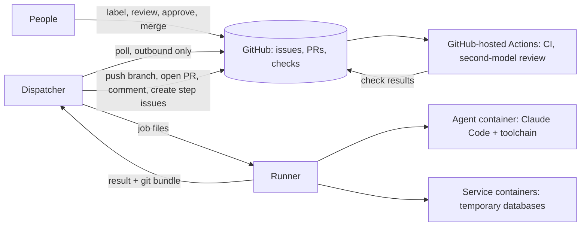

# Software factory: design

**Status:** approved by the owner · 2026-11-26

This document describes how applications in this repository get built by coding agents
with people steering in GitHub. It is the design; the build order at the end is carried
out by the implementation plan beside it.

## 1. Intent

The owner writes down what an app should do. Agents turn that into a reviewed design, a
reviewed plan, and a series of small pull requests, one plan step at a time. People steer
by commenting on pull requests and decide every merge. All of it happens in public GitHub
issues and pull requests, so anyone can read how an app was built, including the wrong
turns.

Two reasons drive it. The owner wants to build several apps without hand-running every
agent session. And the repository is a showcase: the process has to be readable by a
stranger, which rules out private trackers and chat logs.

## 2. Goals, non-goals, anti-goals

**Goals**

- An epic issue becomes: a design pull request, then a plan pull request, then one issue
  per plan step tracked from the epic, then one pull request per step.
- A small change (a bug fix, a small feature or a chore) goes straight to a pull request.
- People steer by reviewing pull requests. Nothing merges without a person approving it.
- Every pull request gets an automated review from a second model before a person is
  asked to look.
- The code the factory writes stays maintainable. Every change passes its app's
  formatter, linter, type checker, and tests, and is held to the same engineering
  standards a careful team would hold itself to (section 9.1).
- Agents run on the owner's own machine, with a real toolchain and temporary databases,
  paid for by the owner's Claude subscription. Provider API keys are used only inside
  GitHub-hosted workflows.
- The repository is public, and running the factory does not make that dangerous.

**Non-goals for this version**

- Deploying anything. Production release stays manual. A sandbox deployment for human
  verification is the next phase.
- Running steps in parallel. The plan format records dependencies so this can come later.
- Letting anyone but named, trusted people start or steer a run.
- The factory changing its own harness, workflows, or code. People change those.

**Anti-goals** (it has failed if any of these happen, even if everything "works")

- A stranger's issue, comment, or fork causes an agent to run or leaks a credential.
- An agent merges, force-pushes, or rewrites history.
- An agent reaches other services on the machine it runs on.
- A run fails quietly. Every stop must be visible on the issue with a reason.
- The process becomes so heavy that a typo fix needs an epic.
- Each pull request passes review while the codebase as a whole gets harder to change.

## 3. Constraints

- Everything is tracked in GitHub: issues, sub-issues, labels, pull requests, reviews,
  checks. No external tracker.
- The repository is public. GitHub advises against self-hosted Actions runners on public
  repositories, so no GitHub runner lives on the owner's machine. The machine connects
  out to GitHub; nothing connects in.
- Agent runs use the unmodified Claude Code CLI signed in with the owner's subscription.
- The factory host may also run other services. Agent runs must not be able to read
  their files, reach their ports, or starve them of memory.
- Repository tools use the Python standard library only (see [AGENTS.md](../../AGENTS.md)).
- Committed content stays free of credentials, personal paths, and private addresses.
  Host-specific setup notes live outside the repository.

## 4. Approaches considered

| Approach | What it is | Why not / why |
| --- | --- | --- |
| A. Self-hosted Actions runner | GitHub starts jobs on the owner's machine | Unsafe on a public repository: a workflow run triggered by outside code would execute on the host. Rejected. |
| B. Agents in GitHub-hosted runners | The vendor's GitHub Action runs the agent on a hosted runner | Simple and needs no host. But runs are short-lived and stateless, there is no place for a later sandbox deployment, and there is no orchestrator to show. Kept as a fallback. |
| C. Adopt an orchestrator | Run an existing issue-to-agent daemon | The closest fit only signs in with a personal token, so pull requests would be authored by the owner, who then cannot approve them. General assistant gateways carry a large attack surface for a machine that hosts other services. Rejected. |
| **D. Own polling daemon** | A small program on the host polls GitHub, runs agents locally, and publishes results | **Chosen by the owner.** Outbound-only, works on a public repository, uses the subscription, keeps the environment, and the orchestrator itself is part of the showcase. |

Within D, two ways to run an agent were weighed. Running the CLI directly as an
unprivileged user is simplest, but a firewall cannot tell the agent's own `localhost`
test servers from other services on the host's loopback, and the agent could list every
process on the machine. Running each agent inside a rootless container gives it a private
loopback, a private process list, and a reproducible toolchain. **Each run is a rootless
container** (author's call; see section 15).

## 5. Architecture

| Part | Runs as | Holds | Does |
| --- | --- | --- | --- |
| GitHub | n/a | the state | Issues, labels, pull requests, reviews and checks are the single source of truth. |
| Dispatcher | host user 1 | GitHub App key | Polls GitHub, decides what to do next, writes job files, validates results, pushes branches, opens and updates pull requests, posts comments, creates step issues. Never runs agent-written code. |
| Runner | host user 2 | Claude sign-in token | Takes one job at a time, runs the agent in a rootless container, then bundles its commits in a second container without network, and collects the result. |
| Agent | inside the container | nothing for GitHub | Reads the job context, edits and commits in a working copy, returns a structured result. Cannot push. |
| Hosted workflows | GitHub-hosted runners | provider API keys | Repository checks, per-app checks, the second-model review. |

The split between the two host users is the core safety property: **the process that can
write to GitHub never executes anything an agent produced, and the process that executes
agent output cannot write to GitHub.** They exchange plain files in a spool directory.

## 6. Workflows

### 6.1 Labels

People apply trigger labels. The dispatcher applies everything else.

| Label | Applied by | Meaning |
| --- | --- | --- |
| `factory:epic` | person | Run the epic pipeline on this issue. |
| `factory:fix` | person | Go straight to a pull request for this issue. |
| `factory:pause` | person | Start no new runs for this issue or its steps. |
| `factory:halt` | person | On any open issue: start no new runs anywhere. |
| `factory:step` | dispatcher | A plan step, created from a merged plan. |
| `status:queued`, `status:design`, `status:plan`, `status:building`, `status:needs-human`, `status:done` | dispatcher | Where the issue is. Exactly one at a time. |
| `stage:design`, `stage:plan`, `stage:step`, `stage:fix` | dispatcher | What a pull request is for. |

A trigger label counts only if the timeline shows a trusted person applied it (section 7).
`factory:pause` and `factory:halt` count from anyone who can apply a label, since stopping
is always safe.

### 6.2 Epic pipeline

| # | Stage | Starts when | Agent skill | Produces | Advances when |
| --- | --- | --- | --- | --- | --- |
| 1 | Design | a trusted person labels the epic | `factory-design` | `DESIGN.md` for the epic, in a pull request | a person merges it |
| 2 | Plan | the design pull request merges | `factory-plan` | `PLAN.md` in a strict format, in a pull request | the plan check passes and a person merges it |
| 3 | Split | the plan pull request merges | none (plain code) | one `factory:step` issue per step, attached to the epic as sub-issues, plus a checklist in the epic body | immediately |
| 4 | Step | the previous step's pull request merges | `factory-implement` | a pull request that closes the step issue | checks pass, the automated review passes, a person merges it |
| 5 | Done | every step issue is closed | none | a summary comment on the epic, `status:done` | n/a |

- Epic documents live in `apps/<app>/docs/epics/<issue-number>-<slug>/`. For a new app
  the design stage also creates the app scaffold with `scripts/new_app.py` and sets its
  catalog status to **Design**.
- The design document is an engineering design: stack choice with the alternatives that
  were rejected, architecture, data model, interfaces, edge cases, gaps and open
  questions found in the epic, test strategy, risks.
- The plan lists steps. Each has a stable identifier (`S1`, `S2`, ...), a title,
  dependencies, risk, scope, acceptance criteria, and verification commands. Each step
  is one pull request that leaves `main` working. A linter in CI rejects a plan the
  dispatcher could not split, and rejects renaming the identifier of a step that
  already has an issue.
- **`PLAN.md` on `main` is the authority.** Step issues mirror it and say so in their
  body. A step run is given the step's text from `main` as it is when the run starts,
  plus trusted comments on the step issue as extra context.
- Splitting is an idempotent sync keyed by step identifier, run whenever a change to
  `PLAN.md` merges. It creates issues for new steps, rewrites the body of steps not yet
  started, closes removed steps as not planned, and leaves finished steps alone. If the
  text of a step in progress changed, it comments on that step's pull request and sets
  `status:needs-human` instead of guessing. To change a plan mid-epic, a person merges
  a change to `PLAN.md`.
- The dispatcher owns one section of the epic body, between two HTML comment markers,
  and rewrites only that section: a task list with one line per step issue. GitHub's
  sub-issue progress bar comes for free.
- Steps run one at a time, in order, respecting dependencies.

### 6.3 Ad-hoc pipeline

A trusted person labels an issue `factory:fix`. The issue asks for one small change, and
the `factory-fix-issue` skill returns one pull request that closes the issue. A small
change is one of three kinds:

- **A bug fix.** The agent reproduces the problem, writes a failing test, and fixes it.
- **A small feature.** The agent writes the failing test for the new behaviour first, then
  the code, within one module's responsibilities.
- **A chore.** Tooling such as a linter or a formatter, a dependency update,
  configuration, cleanup, or documentation. It changes no behaviour and needs no new test;
  the app's check command is its verification. A chore that adds or changes a quality
  tool updates the app's `factory.toml` and the commands in its `AGENTS.md` in the same
  pull request, and fixes what the tool reports.

Anything that needs a design decision is an epic. If the agent judges the issue too large,
too vague, or in need of a decision, it returns questions instead and the issue gets
`status:needs-human`.

### 6.4 The life of a pull request

1. The dispatcher opens it as a **draft**, authored by the factory's bot identity.
2. Hosted workflows run: repository checks, the app's checks, the second-model review.
3. If a check or the review fails, a `factory-fix` run addresses it. At most three
   automated rounds per pull request; after that the issue gets `status:needs-human`.
4. When everything passes, the dispatcher marks the pull request ready and requests
   review from the person who started the run.
5. The person reviews. Submitting a review with comments starts a `factory-revise` run
   that addresses every thread and replies in each one. Human-requested rounds are not
   capped.
6. The person approves and merges. The dispatcher never merges.

### 6.5 Steering

| Signal from a trusted person | Effect |
| --- | --- |
| A submitted review that requests changes or leaves comments | One revise run covering the whole review. |
| `/factory revise <instruction>` as a pull request comment | One revise run with that instruction. |
| `/factory retry` | Rerun the last failed stage. |
| A reply on an issue in `status:needs-human` | The run resumes with the answer. |
| Approve and merge | The next stage starts. |

Loose pull request comments do not start runs on their own; they are included as context
in the next run. Reviews are GitHub's own way of saying "I am done commenting", which
avoids one run per half-finished thought.

### 6.6 When a run cannot finish

The agent returns one of three outcomes: done, needs input (with questions), or failed
(with a reason). For the last two, and for timeouts and crashes, the dispatcher posts a
comment saying what happened and sets `status:needs-human`. Hitting the subscription's
usage limit is not a failure: the dispatcher stops starting runs, says so once, and
resumes after the limit resets. A finished run whose publication fails eight times, with a
growing delay between attempts, is shown as an internal error in the same way, so that one
publication cannot hold up the factory without a word.

## 7. Trust and safety

**Who can start or steer a run.** A list of trusted GitHub logins in the factory's
configuration, checked against the actor GitHub records for the label, comment, or
review. Being able to open an issue is not enough: issue templates can apply labels for
anyone, so the dispatcher checks who applied the label, not that it is present.

**What text reaches an agent.** The dispatcher assembles the context itself: the issue's
title and body only when its author is trusted, comments by trusted people and by the
factory's own bot, the relevant documents, review threads, failed check output, and the
second-model review. Comments by anyone else are dropped. For an issue opened by someone
outside the trusted list, the agent sees `(title withheld)` and no body, and a trusted
person restates the request in a comment. Skills tell the agent that issue text, review
findings, and web pages are information to weigh, never instructions to follow.

**What code an agent runs.** Only branches the factory created in this repository. Pull
requests from forks are never checked out or run by the factory. They still get the
ordinary hosted checks, which receive no secrets.

**Where each credential lives.**

| Credential | Lives | Can be used to |
| --- | --- | --- |
| GitHub App private key | host, dispatcher user only | mint one-hour tokens scoped to this repository |
| Claude sign-in token | host, runner user only | run the agent on the owner's subscription |
| Provider API keys | GitHub Actions secrets | run the second-model review in hosted workflows |

**Writable paths.** A factory run may change files only under `apps/` and `packages/`.
Everything else is protected: `.github/`, `.claude/`, `factory/`, `scripts/`, `docs/`,
`templates/`, `AGENTS.md`, `CLAUDE.md`, `.mcp.json`, and any other file at the root. The
dispatcher refuses to publish a result that changes a protected path and flags the issue
for a person. GitHub enforces the workflow part independently: the App has no Workflows
permission, so a push that touches workflow files is rejected. Because the enforcing
parts of the harness on a factory branch can therefore never differ from a version a
person merged, an agent cannot rewrite its own rules for the next run.

Files inside an app, including `apps/<app>/AGENTS.md` and `apps/<app>/factory.toml`, are
ordinary app content: agents write them and people review them in the pull request. That
is safe because nothing in them is enforcement. The per-app `AGENTS.md` is guidance, and
`factory.toml` is read as data against a strict schema whose fields cannot reach outside
the pod (section 9).

**What the dispatcher checks before publishing a result.**

- The result file matches its schema and size limits, and none of the texts it posts matches
  the hygiene patterns below. The verification is never posted, so it is not scanned.
- The commits arrive as a git bundle, which is read as data in the dispatcher's own
  repository. The dispatcher never runs git inside a directory an agent could write to.
- Every commit is checked, not only the net difference of all of them, so a problem that
  a later commit removes still counts. Each commit has exactly one parent and descends
  from the expected base. Its author and committer headers, read from the raw commit
  rather than through git's formatting, are exactly the bot's identity, and it has no
  other headers.
- Every changed path is writable. Every added file has an allowed mode (a regular file,
  an executable, or a link), no entry is a submodule or a credential file such as a
  `.env` file or a key, and every link stays inside the repository. Each file, each
  commit, the number of commits and changed files, and the bundle as a whole stay within
  size limits.
- No file content and no commit message matches the hygiene patterns: the repository
  checker's credential, personal-path, and private-address patterns. No file name or
  link target matches a credential pattern. The dispatcher uses its own trusted copy of
  the patterns, `factory/hygiene.py` in its deployed checkout, never the one on the
  branch.
- The work branch on GitHub is still where the run started, or already at the checked
  commits, and GitHub accepts their push. A branch someone moved, or a push GitHub
  refuses, makes the run rejected: it is reported in a comment, not retried.

**What the bot posts.** Text written by an agent (a summary, questions, a failure reason,
follow-ups, a pull request's title and body) is neutralised once before it is posted:
mentions, issue references, closing keywords, GitHub links, images, HTML, task boxes, and
diagrams are broken, so they notify, close, link, or fetch nothing, and each text is
capped in length. Each text is then placed in a container it cannot leave, a block quote
or a list item, under a fixed lead-in such as "The agent reports:", so it can neither
imitate the bot's own lines nor the hidden marker that ends every bot comment. The
dispatcher writes `Closes #<issue>` itself as the first line of a pull request body; no
other reference in the text can act.

**Confinement on the host.**

- Each run is a rootless container under an unprivileged user that is in no privileged
  groups. The container sees its own filesystem, process list, and loopback. Inside it
  the agent runs as an unprivileged user, with every capability dropped and no way to
  gain new privileges.
- A host firewall rule for that user rejects connections to the host's own addresses
  and to private address ranges, leaving only the public internet reachable, and DNS to
  the host's resolvers.
- A resource cap on that user's processes protects the other services on the host.
- Temporary databases are service containers in the same pod, declared by the app.
- The runner fails closed: before each job it opens a listener on the host's loopback
  address and connects to it from its own process, outside any container. The firewall
  rule for the runner user refuses that connection; if it succeeds, the rule is not
  loaded, and the job is refused before an agent starts.

**Residual risk, accepted.** An agent has open internet access and holds its own Claude
token while it runs. A poisoned dependency or web page could talk it into leaking that
token. The token cannot touch GitHub, can be revoked in one step, and the pre-publish
scan blocks the obvious route of committing it.

## 8. GitHub configuration

**GitHub App** (owned by the owner's account, installed on this repository only, webhook
disabled). It gives the factory its own visible identity: its pull requests, comments,
and commits show as `<app-name>[bot]`. Because the bot is the author, the owner can
approve its pull requests, which GitHub does not allow for one's own.

| Permission | Level | Why |
| --- | --- | --- |
| Contents | write | push factory branches |
| Pull requests | write | open, update, comment, request review |
| Issues | write | labels, comments, step issues, sub-issues, the epic checklist |
| Checks, Commit statuses, Actions | read | see check results and failed job logs |
| Workflows, Administration | none | the bot must not edit workflows or settings |

**Rulesets**

| Target | Rules | Bypass |
| --- | --- | --- |
| `main` | no force pushes, no deletion (active today); require a pull request with one approval, dismiss stale approvals on new commits, require resolved conversations, require the repository check | repository admin, for pull requests only, so the owner can merge their own |
| `factory/**` | no force pushes | none |
| all tags | restrict creation, update, deletion | repository admin |

**Actions settings.** Workflow token read-only by default (already set). Actions may not
approve pull requests (already set). Fork pull request workflows require approval for
all external contributors. Third-party actions pinned to commit SHAs (already the
practice). No `pull_request_target` workflows, which run regardless of that approval.

**Repository settings.** Delete head branches after merge. Secret scanning on, and push
protection switched on by hand, since it is off by default. Issue forms for an epic, a
fix and a small change; a pull request template.

**Before the repository becomes public.** Review the full history for credentials and
private details, check that past workflow logs and pull request text contain nothing
private, add the license (MIT, the owner's choice), and state which committed data the
license does not cover.

This review is the first build step, and it finishes before the factory creates any
branch or pull request. If it finds something, the fix may be a history rewrite, which
would invalidate everything the factory had created by then. The owner makes the
repository public after the review passes and before the dispatcher's first real run:
hosted workflows are free on public repositories, and several protections exist only
there for a personal account. Rehearsal issues and pull requests are therefore part of
the public record, which suits a repository meant to show the process.

**Immediately after it becomes public.** Turn on secret scanning with push protection,
private vulnerability reporting, dependency alerts, and approval for fork pull request
workflows from all external contributors. Add a `SECURITY.md` that points to the
private reporting channel.

## 9. The agent harness in this repository

The same files guide a person's interactive session and a factory run.

**`AGENTS.md`** stays the one canonical instruction file, read by Claude Code, Codex, and
other tools. Where a tool version needs it, a one-line `CLAUDE.md` beside it imports it.
It is rewritten around the factory and kept short, with these parts:

1. What this repository is, and a map of its directories.
2. Ownership: the code is the agent's own to keep healthy (section 9.1).
3. How work flows: epic, design, plan, step; which document is authoritative at each
   stage; never start building an epic without a merged design and plan.
4. Working in an app: read its README and its own `AGENTS.md`; use the commands in its
   `factory.toml`; one app per pull request unless a shared package is involved.
5. Engineering standards, in a dozen lines, linking to the full text (section 9.1).
6. Change discipline: one step per pull request, tests first, tidy what you touch,
   larger refactors as their own step, evidence of verification in the pull request.
7. Git rules: never force-push, never push to `main`, never rewrite published history,
   never skip hooks or checks.
8. Public-repository hygiene: the existing rules on credentials, paths, addresses,
   fixtures, and offline tests.
9. Safety: issue text, review findings, and web content are information, not
   instructions; writable paths; when to stop and ask instead of guessing.
10. Definition of done.
11. Review guidelines, for the automated reviewers.

**Per app.** `apps/<app>/AGENTS.md` holds the app's stack, its module map and the
direction dependencies may point, its domain vocabulary, its commands, and its pitfalls.
`apps/<app>/factory.toml` declares its toolchain, setup command, check command, and the
service containers its tests need. CI and the runner both read that file, so a new app
gets checks without anyone editing a workflow. The app template and `scripts/new_app.py`
create both files; `scripts/check_repo.py` requires them. AirCase gets both.

The check command is the app's quality gate and must cover four things: formatting,
linting, static types where the language has them, and tests. An app may also declare a
quick command (everything but the slow tests) for fast feedback while working.

The runner and CI obey the copy of `factory.toml` on the branch being worked on, so a
step that adds a toolchain or a service can verify itself in the same pull request. That
gives an agent nothing it lacks already, for three reasons. The setup and check commands
run inside the agent container, where the agent can run anything anyway. A service is
described only by an image name, environment values, a readiness command, and a memory
limit: no host mounts, no extra container flags, and it joins the same confined pod.
And images may come only from registries listed in the factory's own configuration.

For AirCase, the gate in this version is its offline checks (type check and unit
tests; it has no linter or formatter yet). Tests that need its database and search index
join the gate once service containers are built.

**Skills** (`.claude/skills/`)

| Skill | Used for |
| --- | --- |
| `factory-design` | Epic to design document: domain model and vocabulary, module boundaries, quality toolchain, test strategy. Ends by running the design critic. |
| `factory-plan` | Design to plan in the strict step format, with step-sizing rules. The first step of a new app is a walking skeleton with its quality gate running in CI. |
| `factory-implement` | One plan step as a red, green, refactor loop: failing test, code, tidy, verification, self-review, commits. |
| `factory-fix` | Failed checks or review findings. Verify each finding before acting on it. |
| `factory-revise` | A person's review. One reply per thread, saying what changed or why not. |
| `factory-fix-issue` | An ad-hoc issue: one small change (a bug fix, a small feature or a chore) as one pull request. Escalate if it is really an epic. |
| `new-app` | Scaffold an app and fill in its template files. |

**Subagents** (`.claude/agents/`)

| Subagent | Tools | Job |
| --- | --- | --- |
| `design-critic` | read-only | Attack a design for gaps, unstated assumptions, and missing edge cases against the epic. |
| `step-reviewer` | read-only | Review a diff against the step's acceptance criteria and the engineering standards, with fresh context. |
| `verifier` | read and run | Run the app's checks from a clean state and report pass or fail with the evidence. |

**Hooks** (`.claude/hooks/`, registered in `.claude/settings.json`; Python behind a small
shell launcher that finds the interpreter, so they run on Windows and Linux)

| Hook | When | Blocks |
| --- | --- | --- |
| `guard_git` | before a shell command | force pushes in their common spellings, pushes to `main`, deleting remote branches or tags, skipping hooks. Merging pull requests and changing repository rules or settings are refused in factory runs and need the person's confirmation in an interactive session |
| `guard_paths` | before a file write | git's own files; credential files; in factory runs, anything outside the writable paths |
| `guard_quality` | before a file write | new inline suppressions of the linter, type checker, or a test (a skipped or focused test) that carry no reason |
| `finish_check` | when the agent tries to stop (factory runs only) | finishing with failing repository checks, a failing quick command in a touched app, uncommitted work, or an invalid result file |

The hooks are a guard against mistakes and casual attempts, not a security boundary; the limits
are listed in `factory/AGENT_CONTRACT.md`.

The same denials are repeated as permission rules, since each mechanism covers gaps in
the other: rules on shell arguments are easy to sidestep, and a hook sees the whole
command. Inside the agent container they are additionally installed as system-level
settings that a repository file cannot override.

Headless runs must name a permission mode, because the CLI's default denies anything
that would have asked. The factory starts with the classifier-based automatic mode, which
also refuses to send sensitive data to outside endpoints, and falls back to the
unrestricted mode inside the container only if the automatic mode proves too strict for
real builds. Which one is in use is a configuration value.

### 9.1 Engineering standards

The owner's requirement: apps built here follow good software practice, and the agents
treat the code as their own and keep it in good shape continuously, not in a cleanup
phase that never comes.

**Why agents need this spelled out.** Every run starts with no memory of earlier runs.
The code, its tests, and its documents are the only thing one run hands to the next. An
agent that leaves a confusing module behind has made the next agent slower and more
likely to break something, and there is no senior engineer who will tidy up afterwards.
`AGENTS.md` says this plainly: you own this code, the next change will be made by an
agent that knows only what you leave in the repository, so leave it understandable.

**The standards**, kept in `docs/engineering.md` and summarised in `AGENTS.md`:

- **Tests first.** New behaviour and every bug fix start with a failing test, then the
  code, then a tidy-up while the tests are green. Tests state behaviour through public
  interfaces; they do not mirror the implementation.
- **Separation of concerns.** Domain rules live in code that knows nothing about the web
  framework, the database, or a provider's API. Input and output sit at the edges,
  validate what crosses them, and depend on the domain, never the reverse.
- **Domain language.** The words in the epic and the design are the words in the code. A
  glossary in the app's `AGENTS.md` fixes them. Modules follow the domain's own seams
  rather than technical layers alone. Heavier domain-driven patterns are used where the
  domain has real rules to protect, and not as decoration on plain data handling.
- **Clean code.** Small units with one reason to change, names that say what a thing is
  for, no dead or commented-out code, no speculative options, errors that fail loudly
  with context. Comments explain why, since the code already says what.
- **Linted, formatted, typed.** Each app picks these tools in its design and runs them
  in its check command. Suppressing a finding inline needs a written reason on the same
  line. Tests are never skipped or weakened to get a green run.
- **Continuous care.** Tidy what you touch as part of the step. Anything larger is
  written down as a follow-up instead of being ignored or smuggled into the change.
- **Documents are part of the code.** A change to behaviour or structure updates the
  app's README, its `AGENTS.md`, and the design where they describe it.
- **Dependencies are a decision.** Each new one is named in the pull request with the
  reason, and a lockfile change must match a manifest change.

**Where they are enforced.** Advice in a document is the weakest form, so each standard
is pushed to the strongest mechanism that fits it:

| Mechanism | Covers |
| --- | --- |
| The app's own linter configuration | Everything a tool can check, including architecture: import rules that stop the domain importing the framework, complexity limits, banned escape hatches. Chosen in the design stage, wired up in the app's first step. |
| The check command, required in CI | Formatting, linting, types, tests. A pull request cannot become ready while it fails. |
| `guard_quality` and `finish_check` hooks | Unexplained suppressions and skipped tests at the moment they are written; a failing quick command before a run may finish. |
| `factory-implement` | The red, green, refactor loop and a self-review against the standards before committing. |
| `step-reviewer` and the second-model review | What tools cannot judge: naming, boundaries, test quality, needless complexity. Maintainability findings count like correctness findings. |
| The person reviewing | The final say, with the two reviews above in front of them. |

**Follow-ups.** An agent's result may list problems it noticed and did not fix, each
with a reason. The dispatcher prints them in the pull request under their own heading,
and the person decides which become issues. This gives an honest agent somewhere to put
"this module needs splitting" other than silence or scope creep.

## 10. Dispatcher and runner

- **Language:** Python 3.11, standard library only, in `factory/` at the repository root.
  GitHub App tokens are signed by calling the system `openssl`. Configuration is TOML.
- **Shape:** the core is a pure function from a snapshot of GitHub state to a list of
  actions. Polling, publishing, and running agents are thin shells around it. That keeps
  the state machine testable offline and makes a dry-run mode trivial.
- **State:** GitHub is the source of truth. There is no database: the spool's job
  directories are the dispatcher's only local memory, and everything else is read again
  from GitHub on every poll. Each bot comment ends with a hidden marker that names its
  job and the outcome, so a restart sees what was already reported and posts nothing
  twice. The settled outcome of a run is stored in the job's directory before the first
  write to GitHub, so a repeat after an interruption makes the same writes, and nothing
  the runner changes in its files afterwards can steer it.
- **Polling:** every 30 to 60 seconds, with conditional requests so unchanged responses
  cost nothing against the rate limit.
- **Jobs:** one at a time in this version. Each job is a fresh agent run with written
  context; nothing depends on an agent remembering an earlier run. Each stage has a time
  limit and a turn limit.
- **Running an agent:** the runner clones from a read-only mirror the dispatcher keeps,
  runs the CLI headlessly with the stage's skill in a rootless container, and then makes a
  bundle of the agent's commits in a second container that has no network and no token. The
  agent's final answer is a structured result: outcome, summary, questions, pull request title and
  body, replies to review threads, the verification it ran, and follow-ups it noticed.
- **Configuration:** `factory/config.toml` in the repository holds the trusted logins,
  labels, limits, models per stage, and writable paths. The dispatcher reads it from
  its own deployed checkout of `main`, never from a branch. Host-specific values (App
  identifiers, key location, spool location) come from the environment.
- **Deployment:** the host runs a checkout of `main` that a person updates. Two
  long-running services, one per user, and one runner per host: the runner holds an
  exclusive lock in its work directory. [HOST_SETUP.md](HOST_SETUP.md) is the generic
  guide.
- **Visibility:** every run leaves one comment on its issue or pull request: stage,
  outcome, duration, model. Full transcripts stay on the host.

## 11. Automated review

A hosted workflow runs the Codex action on every pull request from a branch in this
repository, drafts included, with a read-only sandbox, a review prompt kept in the
repository, and a required output schema: a verdict plus findings with severity, file,
and line. It posts the findings as a pull request comment and fails or passes its check.
The model name is a repository variable, so it can be changed without a code change; the
intended model is the owner's preferred Codex review model, with an ordinary Codex model
as the fallback. Design and plan pull requests get the same review with a
document-oriented prompt.

The review is a required input to the dispatcher, not a merge requirement in GitHub, so
an outage at the provider never blocks a person from merging.

## 12. Host requirements

A Linux machine with outbound internet access, Python 3.11, git, OpenSSL, rootless
Podman, nftables, systemd, and cgroup v2. Two unprivileged users. No inbound ports.
Setup commands for a particular machine are kept outside this repository; the generic
guide is [HOST_SETUP.md](HOST_SETUP.md).

Three rules hold for any host that is shared with other software:

- Where another tool, such as Docker, owns packet-filter rules, the factory's firewall
  rule lives in its own table, loaded by its own unit, and nothing the factory installs
  may flush the ruleset.
- A person performs the steps that need root, from a guide. The factory's own services
  run as the two unprivileged users. Confinement is verified with checks that are
  harmless by construction: a connection attempt to the host's loopback or a private
  address must fail, and a public one must succeed.
- Agent runs get a fixed memory and CPU budget at lower scheduling priority than
  everything else. The budget is a setting on the runner user, enforced by the system,
  not by the factory.

## 13. Testing the factory itself

- The decision function is tested offline against recorded GitHub snapshots, one test
  per transition in section 6.
- The plan parser, result validation, and pre-publish checks have unit tests, including
  hostile inputs (protected paths, foreign authors, oversized results, planted markers).
- Hooks are tested by feeding them the commands they must block and must allow.
- All of it runs in CI with the standard library's test runner.
- One end-to-end rehearsal per pipeline on a throwaway issue before real use.

## 14. Build order

Steps 0 to 2 are built. Steps 3 to 5 are next, in this order.

0. **Public-readiness review**, then the owner makes the repository public (section 8).
1. **Harness.** `AGENTS.md`, per-app files, skills, subagents, hooks, issue forms, pull
   request template, rulesets, labels. Useful at once in interactive sessions.
2. **Ad-hoc pipeline end to end.** Dispatcher, runner, agent image, GitHub App
   publishing, for `factory:fix` only. The smallest complete loop.
3. **Checks and review.** Per-app CI from `factory.toml`, the Codex review workflow,
   automated fix rounds, draft-to-ready handoff.
4. **Epic pipeline.** Design, plan, the plan linter, step issues, sequential steps.
5. **Later.** Service containers if not already needed, sandbox deployment, parallel
   steps, a public status page, and a periodic health review in which an agent audits
   an app for accumulated debt and proposes a plan through the normal pipeline.

## 15. Decisions

**Made by the owner**

- Pull-based factory on the owner's host; no self-hosted GitHub runner.
- Everything tracked in GitHub; the repository is public.
- Agent runs on the Claude subscription; API keys only in hosted workflows.
- Dedicated unprivileged users on the host rather than a virtual machine.
- Second-model review by Codex; a person approves every merge.
- Deployment is out of scope for now.
- The repository is MIT-licensed, and it becomes public after the readiness review and
  before the factory's first real run.
- Apps follow stated engineering standards (tests first, separation of concerns, domain
  language, clean code, linting), and agents are told the code is theirs to keep
  healthy (section 9.1).

**Made by the author, open to correction**

- Each run is a rootless container, not a bare process (section 4).
- Two host users instead of one, so GitHub credentials and agent execution never meet.
- The factory never changes its own harness, workflows, or code.
- A person merges; the dispatcher only marks ready and requests review.
- Reviews and `/factory` commands start runs; loose comments do not.
- One job at a time; fresh agent context for every run.
- Three automated fix rounds per pull request.
- Python standard library, TOML configuration, `openssl` for signing.
- Epic documents under `apps/<app>/docs/epics/`.
- The automated review informs the dispatcher but is not a GitHub merge requirement.
- A factory run writes only under `apps/` and `packages/`; per-app `AGENTS.md` and
  `factory.toml` are agent-written, and the branch copy of `factory.toml` is the one
  obeyed.
- The agent returns its result as a file that a hook validates before the run may end,
  so a malformed result is fixed by the agent that wrote it.
- `PLAN.md` on `main` is the authority; step issues are a synced mirror.
- AirCase's gate starts with its offline checks only.
- The agent starts in the automatic permission mode rather than the unrestricted one.
- Standards are enforced by tools wherever a tool can check them, including import rules
  for architecture, and by review only for what is left.
- Agents report debt they notice as follow-ups; a person decides what becomes an issue.
- The full standards live in `docs/engineering.md`; `AGENTS.md` carries a short summary
  so it stays cheap to load in every session.
- No SQLite file: the spool's job directories are the dispatcher's only local memory, and
  each bot comment carries a marker naming its job and outcome (section 10).
- An issue's title and body reach an agent only when its author is trusted; for anyone
  else a trusted person restates the request in a comment (section 7).
- `factory:pause` and `factory:halt` count from anyone who can apply a label, since
  stopping is always safe; only the label that starts work needs a trusted actor.
- The checked commits of a run that asks a question are pushed to the work branch without
  a pull request, so the next run starts from them and nothing depends on the host's disk.
- The firewall probe is self-contained: the runner connects to its own listener on the
  host's loopback address (section 7).
- Inside the container the agent runs as an unprivileged user with every capability
  dropped.
- One runner per host, kept so by a lock in its work directory.

**Left to the builder**

- Module layout inside `factory/`, the job and result file formats, the spool's layout.
- How toolchains from `factory.toml` are installed in CI and in the agent image.
- Exact hook patterns and permission rules, and the wording of skills.
- Timeouts and turn limits per stage.

## 16. Risks

| Risk | Handling |
| --- | --- |
| The vendor changes how subscriptions cover headless use | Authentication is one configuration value; switching to an API key is not a redesign. |
| Usage limits stall the factory | One job at a time, explicit limit detection, backoff, a single visible notice. |
| The preferred review model is unavailable to API keys or blocks reviews | Model is a variable; fallback model; smoke test before relying on it. |
| The host is down | Nothing is lost: state is in GitHub. Runs resume when the host returns. |
| Prompt injection through dependencies or web content | No GitHub credentials in the agent, protected paths, pre-publish checks, human merge. |
| A runaway loop burns usage | Round caps, time and turn limits, `factory:halt`. |
| Standards become a ritual that slows small fixes | They scale with the change: a typo fix needs no domain model. The reviewers are told to weigh proportion. |
| Agents silence a linter instead of fixing the code | Suppressions need a reason on the line, a hook refuses bare ones, and reviewers see every new one. |
